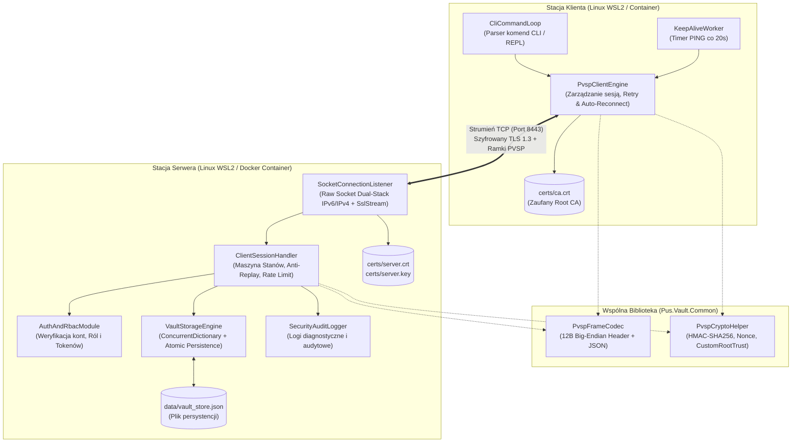

# Programowanie Usług Sieciowych - Projekt Grupowy (Etap 2)

## Projekt Aplikacji Sieciowej: **PUS-Vault (Bezpieczny Menedżer Sekretów i Konfiguracji)**

* **Przedmiot:** Programowanie Usług Sieciowych (PUS)
* **Wykorzystywany protokół:** `PVSP v1.0 (PUS-Vault Secret Protocol)` (zdefiniowany w Etapie 1)
* **Zespół projektowy:**
  * Kacper Gumulak
  * Damian Judka

---

## 1. Opis funkcjonalny aplikacji

### 1.1. Co aplikacja robi?
**PUS-Vault** to rozproszony system sieciowy działający w architekturze Klient-Serwer, służący do bezpiecznego, scentralizowanego przechowywania, dystrybucji oraz zarządzania poufnymi danymi konfiguracyjnymi (tzw. sekretami), takimi jak klucze API, hasła bazodanowe, tokeny dostępowe czy parametry środowiskowe.

System składa się z wielowątkowego serwera usługowego (**PUS-Vault Server**) utrzymującego magazyn danych typu klucz-wartość (*Key-Value*) oraz interaktywnej aplikacji klienckiej wiersza poleceń (**PUS-Vault CLI Client**). Komunikacja pomiędzy komponentami odbywa się wyłącznie za pomocą zaprojektowanego w Etapie 1 autorskiego protokołu aplikacyjnego **PVSP (PUS-Vault Secret Protocol)**, wykorzystującego niskopoziomowe gniazda strumieniowe TCP (`System.Net.Sockets.Socket`), szyfrowanie kanału TLS 1.3 (z własnym Urzędem Certyfikacji - Custom CA) oraz kryptograficzne uwierzytelnianie komunikatów kodem `HMAC-SHA256`.

Podstawowe funkcje użytkowe aplikacji obejmują:
* nawiązywanie szyfrowanej sesji z weryfikacją tożsamości serwera i dwuetapowym logowaniem użytkownika (`HELLO` $\rightarrow$ `AUTH`),
* dodawanie nowych oraz aktualizację istniejących sekretów (`SET`),
* bezpieczne pobieranie wartości wskazanego sekretu na żądanie (`GET`),
* przeglądanie listy dostępnych identyfikatorów (kluczy) sekretów bez ujawniania ich wartości (`LIST`),
* trwałe usuwanie wycofanych sekretów z magazynu (`DELETE`),
* automatyczne podtrzymywanie sesji (`PING`/`PONG`) oraz przezroczyste dla użytkownika wznawianie połączenia po awarii sieci (*Auto-Reconnect*).

### 1.2. Jaki problem użytkownika rozwiązuje?
W zespołach programistycznych i administracyjnych (DevOps) powszechnym problemem bezpieczeństwa jest przechowywanie haseł oraz kluczy API w postaci jawnego tekstu w plikach lokalnych (np. `.env`, `appsettings.json`), repozytoriach kodu Git lub przesyłanie ich przez niezabezpieczone komunikatory. Prowadzi to do:
1. **Ryzyka wycieku poświadczeń** w przypadku kompromitacji stacji roboczej lub repozytorium.
2. **Braku centralnej kontroli dostępu** (brak rozróżnienia, kto może modyfikować sekrety, a kto jedynie je odczytywać).
3. **Braku audytu i integralności** podczas przesyłania konfiguracji przez sieć lokalną lub Internet.

Aplikacja **PUS-Vault** eliminuje te problemy, wprowadzając jeden centralny punkt prawdy (*Single Source of Truth*), w którym sekrety są pobierane przez uprawnione podmioty w czasie rzeczywistym przez podwójnie zabezpieczony kanał sieciowy (TLS 1.3 + HMAC-SHA256), z pełnym wymuszeniem ról autoryzacyjnych (RBAC) oraz logowaniem zdarzeń bezpieczeństwa.

### 1.3. Kto jest użytkownikiem (Aktorzy)?
System definiuje trzy główne role (aktorów) wchodzące w interakcję z aplikacją:

| Aktor | Przypisana rola w PVSP | Charakterystyka i uprawnienia w aplikacji |
| :--- | :--- | :--- |
| **1. Administrator Bezpieczeństwa / DevOps** | `READ_WRITE` (konto np. `admin`) | Użytkownik zarządzający cyklem życia sekretów. Posiada pełne uprawnienia do odczytu (`GET`, `LIST`) oraz modyfikacji stanu magazynu (`SET`, `DELETE`). |
| **2. Programista / Aplikacja Kliencka (Konsument)** | `READ_ONLY` (konto np. `reader`) | Użytkownik lub skrypt pobierający konfigurację niezbędną do pracy. Posiada uprawnienia wyłącznie do listowania kluczy (`LIST`) oraz odczytu wartości sekretów (`GET`). Próba zapisu lub usunięcia danych jest blokowana przez serwer. |
| **3. Demon Serwera / Moduł Monitorujący (System)** | *Aktor wewnętrzny* | Proces serwera zarządzający cyklem życia gniazd TCP, weryfikacją timeoutów bezczynności (*Idle Timeout*), kontrolą przepływności (*Rate Limiting*) oraz atomową persystencją magazynu do pliku dyskowego. |

---

## 2. Architektura rozwiązania

### 2.1. Model architektoniczny
Rozwiązanie zostało zaprojektowane w modelu **Klient-Serwer (Client-Server)** z wielowątkowym, asynchronicznym serwerem obsługującym wielu równoległych klientów jednocześnie oraz lekkim klientem konsolowym (CLI). W warstwie kodu źródłowego (.NET 8 / C#) system podzielony jest na trzy wyraźnie odseparowane moduły (projekty w solucji `PusMainProject.sln`):
1. **`Pus.Vault.Common`** - współdzielona biblioteka klas implementująca specyfikację protokołu PVSP.
2. **`Pus.Vault.Server`** - aplikacja serwera nasłuchująca na gniazdach sieciowych i zarządzająca magazynem.
3. **`Pus.Vault.Client`** - aplikacja kliencka realizująca interfejs użytkownika oraz mechanizmy odporności połączenia.

### 2.2. Opis komponentów systemu

#### A. Komponenty biblioteki wspólnej (`Pus.Vault.Common`)
* **`PvspFrameCodec` (Serializator/Deserializator Ramek):** Moduł odpowiedzialny za kodowanie i dekodowanie 12-bajtowego nagłówka binarnego w porządku *Big-Endian* (`Magic=0x5053`, `Version=0x01`, `Type`, `MessageId`, `PayloadLength`) oraz bezpieczne odczytywanie strumienia TCP za pomocą pętli `ReadExactly` (eliminacja problemu *Partial Reads*).
* **`PvspCryptoHelper` (Moduł Kryptograficzny):** Komponent wyliczający i weryfikujący podpisy `HMAC-SHA256` w oparciu o klucz sesyjny `hmacSecret`, generujący kryptograficznie bezpieczne liczby losowe (`serverNonce` - 16 bajtów CSPRNG) oraz budujący niestandardowy łańcuch zaufania X.509 (`CustomRootTrust` dla `ca.crt`).
* **`PvspModels` & `ErrorCodes`:** Zestaw klas DTO (Data Transfer Objects) reprezentujących ładunki JSON poszczególnych komunikatów oraz słownik kodów błędów protokołu (`100`-`500`).

#### B. Komponenty serwera (`Pus.Vault.Server`)
* **`SocketConnectionListener` (Warstwa Transportowa i TLS):** Zarządza surowym gniazdem nasłuchującym `System.Net.Sockets.Socket` w trybie **Dual-Stack (IPv6 + IPv4-mapped)**. Dla każdego zaakceptowanego klienta (`AcceptAsync`) nakłada strumień `SslStream` i wymusza negocjację TLS 1.3 przy użyciu certyfikatu `server.crt` i klucza `server.key`.
* **`ClientSessionHandler` (Maszyna Stanów i Ochrona Anti-Replay):** Utrzymuje kontekst pojedynczego połączenia klienta (`DISCONNECTED` $\rightarrow$ `TLS_CONNECTED` $\rightarrow$ `HANDSHAKED` $\rightarrow$ `AUTHENTICATED` $\rightarrow$ `CLOSED`). Weryfikuje monotoniczność numerów `Message ID`, okno czasowe `timestamp` ($\pm 30\text{s}$), przechowuje ostatnią odpowiedź na potrzeby obsługi duplikatów oraz egzekwuje limit zapytań (*Rate Limiter*: maks. 20 żądań / 10s).
* **`AuthAndRbacModule` (Moduł Uwierzytelniania i Autoryzacji):** Weryfikuje poświadczenia użytkowników (`username`, `password`, `clientNonce`), zlicza nieudane próby logowania (maks. 3), generuje tokeny sesyjne (`sessionToken`) oraz sprawdza uprawnienia ról (`READ_WRITE` vs `READ_ONLY`) przed dopuszczeniem do operacji na danych.
* **`VaultStorageEngine` (Silnik Magazynu i Persystencji):** Wątkowo bezpieczny magazyn klucz-wartość oparty na strukturze `ConcurrentDictionary<string, string>` w pamięci RAM, zapewniający natychmiastowy dostęp współbieżny. Po każdej operacji modyfikującej stan (`SET`, `DELETE`) silnik wykonuje atomowy zapis zrzutu danych do lokalnego pliku JSON (`data/vault_store.json`) przy użyciu blokady synchronizacyjnej `SemaphoreSlim` oraz podmiany pliku tymczasowego (`File.Move`).
* **`SecurityAuditLogger` (Moduł Logowania i Diagnostyki):** Rejestruje przebieg sesji, błędy protokołu oraz zdarzenia bezpieczeństwa (np. odrzucony HMAC, próba ataku Replay) na standardowe wyjście konsoli oraz do pliku `logs/server.log`.

#### C. Komponenty klienta (`Pus.Vault.Client`)
* **`CliCommandLoop` (Interfejs REPL / CLI):** Interaktywny parser poleceń użytkownika w terminalu (obsługujący komendy: `login`, `set <key> <val>`, `get <key>`, `list`, `delete <key>`, `ping`, `exit`) oraz tryb wsadowy sterowany flagami wiersza poleceń.
* **`PvspClientEngine` (Silnik Komunikacji i Auto-Recovery):** Zarządza aktywnym gniazdem `Socket` i strumieniem `SslStream`, automatycznie inkrementuje licznik `Message ID`, podpisuje wychodzące pakiety `DATA_REQ` kluczem `hmacSecret` oraz realizuje pętlę ponawiania połączenia (*Exponential Backoff*: `1s`, `2s`, `4s`) w przypadku wykrycia zerwania gniazda lub timeoutu odpowiedzi (`5s`).
* **`KeepAliveWorker` (Zadanie Tła Keep-Alive):** Asynchroniczny timer wysyłający w tle ramkę `PING (0x07)` co 20 sekund bezczynności, zapobiegający rozłączeniu sesji przez serwer (*Idle Timeout*).

### 2.3. Diagram komponentów i wdrożenia

### 2.4. Przepływ danych między komponentami (Data Flow)
Przepływ danych podczas realizacji typowego żądania (np. zapisu sekretu `set DB_PASS Tajne123`) przebiega następująco:
1. **Wejście użytkownika:** Użytkownik wpisuje komendę w `CliCommandLoop`. Parser weryfikuje poprawność argumentów (czy klucz nie jest pusty i nie przekracza 128 znaków).
2. **Konstrukcja i podpisanie pakietu:** `PvspClientEngine` pobiera z pamięci sesji `sessionToken` oraz `hmacSecret`, inkrementuje `Message ID` i za pomocą `PvspCryptoHelper` oblicza podpis `HMAC-SHA256` z konkatenacji pól żądania.
3. **Serializacja binarna:** `PvspFrameCodec` serializuje obiekt żądania do UTF-8 JSON, wylicza jego długość w bajtach (`Payload Length`), buduje 12-bajtowy nagłówek binarny i zapisuje całość do szyfrowanego strumienia `SslStream` na gnieździe `Socket`.
4. **Odbiór i deszyfracja na serwerze:** `SocketConnectionListener` odbiera zaszyfrowane rekordy TLS i przekazuje odszyfrowany strumień bajtów do `ClientSessionHandler`.
5. **Walidacja warstwy protokołu i bezpieczeństwa:**
   * `PvspFrameCodec` odczytuje dokładnie 12 bajtów nagłówka, weryfikuje `Magic Bytes (0x5053)`, wersję (`0x01`) oraz limit rozmiaru (`<= 64 KB`), a następnie odczytuje dokładnie `Payload Length` bajtów ładunku JSON.
   * `ClientSessionHandler` sprawdza, czy sesja znajduje się w stanie `AUTHENTICATED`, czy nie przekroczono limitu zapytań (*Rate Limit*), czy `Message ID` jest większy od poprzedniego oraz czy `timestamp` mieści się w oknie $\pm 30\text{s}$.
   * `PvspCryptoHelper` weryfikuje zgodność podpisu `HMAC-SHA256`.
   * `AuthAndRbacModule` sprawdza, czy rola przypisana do `sessionToken` to `READ_WRITE`.
6. **Wykonanie operacji i persystencja:** `VaultStorageEngine` aktualizuje wartość w `ConcurrentDictionary` i zapisuje stan do pliku `data/vault_store.json`.
7. **Odpowiedź:** Serwer buduje ramkę `DATA_RESP (0x06)` z tym samym numerem `Message ID`, koduje ją przez `PvspFrameCodec` i odsyła przez `SslStream` do klienta, który wyświetla potwierdzenie w terminalu.

---

## 3. Przypadki użycia (Use Cases)

Poniżej zdefiniowano **6 kompletnych przypadków użycia**, które wyczerpują wszystkie wymagania funkcjonalne oraz mechanizmy bezpieczeństwa i niezawodności protokołu PVSP.

### UC-01: Nawiązanie bezpiecznej sesji i uwierzytelnienie użytkownika
* **i. Cel:** Zestawienie szyfrowanego kanału TLS 1.3, weryfikacja certyfikatu serwera oraz zalogowanie użytkownika w celu uzyskania tokenu sesyjnego i klucza HMAC.
* **ii. Aktor:** Administrator (`READ_WRITE`) lub Programista (`READ_ONLY`).
* **iii. Warunki wstępne:** Serwer `Pus.Vault.Server` nasłuchuje na porcie `8443/TCP`. Klient posiada plik certyfikatu urzędu `ca.crt` oraz poprawne poświadczenia konta.
* **iv. Scenariusz główny:**
  1. Użytkownik uruchamia klienta i wydaje polecenie połączenia oraz logowania (`login admin SecretAdminPassword!`).
  2. Klient otwiera gniazdo TCP, inicjuje handshake TLS 1.3 i weryfikuje certyfikat serwera względem `ca.crt` (`CustomRootTrust`). Sesja osiąga stan `TLS_CONNECTED`.
  3. Klient wysyła ramkę `HELLO (0x01)` z `MsgID=1`, nazwą klienta i znacznikiem czasu.
  4. Serwer odsyła ramkę `HELLO_ACK (0x02)` z wygenerowanym 16-bajtowym `serverNonce` i zmienia stan sesji na `HANDSHAKED`.
  5. Klient wysyła ramkę `AUTH (0x03)` z `MsgID=2`, podając `username`, `password` oraz przepisany `clientNonce`.
  6. Serwer pozytywnie weryfikuje dane, generuje `sessionToken` oraz klucz `hmacSecret`, zmienia stan na `AUTHENTICATED` i odsyła ramkę `AUTH_ACK (0x04)` wraz z przyznaną rolą (`READ_WRITE`).
* **v. Scenariusze alternatywne / błędy:**
  * *5a. Nieprawidłowy certyfikat serwera (Atak MitM):* Walidacja `CustomRootTrust` w kroku 2 kończy się niepowodzeniem. Klient natychmiast przerywa połączenie i zgłasza błąd bezpieczeństwa TLS.
  * *6a. Błędne hasło lub login:* Serwer odsyła ramkę `ERROR (201 ERR_AUTH_FAILED)` i inkrementuje licznik nieudanych prób. Po 3 nieudanej próbie serwer zamyka gniazdo TCP.
  * *6b. Przekroczenie czasu na logowanie (>15s):* Serwer odsyła `ERROR (105 ERR_TIMEOUT)` i zamyka połączenie.
* **vi. Wynik końcowy:** Sesja na serwerze jest w stanie `AUTHENTICATED`, a klient przechowuje w pamięci `sessionToken` oraz `hmacSecret`, gotowy do wykonywania operacji na danych.

### UC-02: Zapisanie lub aktualizacja sekretu w magazynie (`SET`)
* **i. Cel:** Bezpieczne umieszczenie nowego sekretu lub nadpisanie istniejącej wartości w magazynie serwera.
* **ii. Aktor:** Administrator (`READ_WRITE`).
* **iii. Warunki wstępne:** Aktor jest uwierzytelniony (stan sesji `AUTHENTICATED`, rola `READ_WRITE`).
* **iv. Scenariusz główny:**
  1. Administrator wpisuje w CLI polecenie `set STRIPE_API_KEY sk_live_987654321`.
  2. Klient buduje komunikat `DATA_REQ (0x05)` z akcją `"SET"`, inkrementuje `Message ID`, wylicza podpis `HMAC-SHA256` i wysyła ramkę do serwera.
  3. Serwer weryfikuje stan sesji, świeżość wiadomości (`Message ID`, `timestamp`), poprawność podpisu `HMAC` oraz uprawnienia roli `READ_WRITE`.
  4. Serwer zapisuje parę `("STRIPE_API_KEY", "sk_live_987654321")` w słowniku pamięciowym oraz utrwala stan w pliku `vault_store.json`.
  5. Serwer odsyła ramkę `DATA_RESP (0x06)` ze statusem `"OK"` i potwierdzeniem nazwy klucza.
* **v. Scenariusze alternatywne / błędy:**
  * *3a. Brak uprawnień (wywołanie przez aktora `READ_ONLY`):* Serwer odrzuca operację i zwraca `ERROR (203 ERR_FORBIDDEN)`. Połączenie pozostaje otwarte.
  * *3b. Nieprawidłowy podpis HMAC (modyfikacja pakietu w locie):* Serwer wykrywa niezgodność skrótu, zwraca `ERROR (204 ERR_INVALID_HMAC)`, unieważnia sesję i zamyka gniazdo.
  * *3c. Zbyt duży ładunek (>64 KB):* Serwer odrzuca ramkę kodem `ERROR (103 ERR_PAYLOAD_TOO_LARGE)` i zamyka połączenie.
* **vi. Wynik końcowy:** Sekret jest trwale zapisany na serwerze i dostępny do odczytu dla uprawnionych klientów.

### UC-03: Pobranie wartości sekretu po kluczu (`GET`)
* **i. Cel:** Odczytanie poufnej wartości sekretu przypisanej do podanego klucza.
* **ii. Aktor:** Administrator (`READ_WRITE`) lub Programista (`READ_ONLY`).
* **iii. Warunki wstępne:** Sesja znajduje się w stanie `AUTHENTICATED`.
* **iv. Scenariusz główny:**
  1. Aktor wydaje polecenie `get STRIPE_API_KEY`.
  2. Klient wysyła podpisaną kodem HMAC ramkę `DATA_REQ (0x05)` z polem `"action": "GET"` oraz `"key": "STRIPE_API_KEY"`.
  3. Serwer weryfikuje podpis HMAC, świeżość wiadomości oraz obecność klucza w `VaultStorageEngine`.
  4. Serwer odsyła ramkę `DATA_RESP (0x06)` zawierającą pole `"value": "sk_live_987654321"`.
  5. Klient wyświetla pobraną wartość sekretu na ekranie terminala.
* **v. Scenariusze alternatywne / błędy:**
  * *3a. Klucz nie istnieje w magazynie:* Serwer odsyła ramkę `ERROR (404 ERR_KEY_NOT_FOUND)` z komunikatem diagnostycznym. Sesja pozostaje aktywna.
  * *3b. Wykrycie ataku powtórzeniowego (Replay Attack - stary `Message ID` lub `timestamp` spoza okna $\pm 30\text{s}$):* Serwer zwraca `ERROR (301 ERR_REPLAY_DETECTED)` i natychmiast zrywa połączenie.
* **vi. Wynik końcowy:** Aktor otrzymuje aktualną wartość sekretu bez naruszenia jej poufności w sieci.

### UC-04: Pobranie listy dostępnych kluczy sekretów (`LIST`)
* **i. Cel:** Uzyskanie wykazu wszystkich identyfikatorów sekretów przechowywanych aktualnie w magazynie (bez przesyłania ich poufnych wartości).
* **ii. Aktor:** Administrator (`READ_WRITE`) lub Programista (`READ_ONLY`).
* **iii. Warunki wstępne:** Sesja znajduje się w stanie `AUTHENTICATED`.
* **iv. Scenariusz główny:**
  1. Aktor wydaje polecenie `list`.
  2. Klient wysyła ramkę `DATA_REQ (0x05)` z akcją `"LIST"` i wyliczonym podpisem HMAC.
  3. Serwer weryfikuje żądanie, pobiera kolekcję kluczy ze słownika `VaultStorageEngine` i zwraca ramkę `DATA_RESP (0x06)` z tablicą JSON `"keys": ["DB_HOST", "STRIPE_API_KEY"]`.
  4. Klient formatuje i wypisuje listę kluczy w konsoli.
* **v. Scenariusze alternatywne / błędy:**
  * *3a. Magazyn jest pusty:* Serwer zwraca `DATA_RESP (0x06)` z pustą tablicą `"keys": []`.
  * *3b. Przekroczenie limitu zapytań (>20 żądań w 10s):* Serwer blokuje wykonanie akcji i odsyła `ERROR (429 ERR_RATE_LIMIT)`.
* **vi. Wynik końcowy:** Aktor poznaje strukturę kluczy dostępnych w magazynie.

### UC-05: Usunięcie sekretu z magazynu (`DELETE`)
* **i. Cel:** Trwałe skasowanie wybranego sekretu z pamięci serwera oraz pliku persystencji.
* **ii. Aktor:** Administrator (`READ_WRITE`).
* **iii. Warunki wstępne:** Sesja znajduje się w stanie `AUTHENTICATED` z rolą `READ_WRITE`, a usuwany klucz istnieje w magazynie.
* **iv. Scenariusz główny:**
  1. Administrator wpisuje komendę `delete STRIPE_API_KEY`.
  2. Klient wysyła podpisaną ramkę `DATA_REQ (0x05)` z akcją `"DELETE"` oraz kluczem `"STRIPE_API_KEY"`.
  3. Serwer weryfikuje podpis HMAC oraz rolę `READ_WRITE`, usuwa wpis z `ConcurrentDictionary` i aktualizuje plik `vault_store.json`.
  4. Serwer odsyła ramkę `DATA_RESP (0x06)` ze statusem `"OK"`.
* **v. Scenariusze alternatywne / błędy:**
  * *3a. Próba usunięcia przez użytkownika `READ_ONLY`:* Serwer zwraca `ERROR (203 ERR_FORBIDDEN)` - dane pozostają nienaruszone.
  * *3b. Próba usunięcia nieistniejącego klucza:* Serwer zwraca `ERROR (404 ERR_KEY_NOT_FOUND)`.
* **vi. Wynik końcowy:** Sekret zostaje bezpowrotnie usunięty z systemu.

### UC-06: Automatyczne utrzymanie sesji (*Keep-Alive*) oraz wznawianie połączenia po awarii (*Auto-Reconnect*)
* **i. Cel:** Zapewnienie ciągłości pracy klienta podczas bezczynności oraz automatyczne odtworzenie sesji po przejściowej awarii połączenia TCP.
* **ii. Aktor:** Klient (`PvspClientEngine` / `KeepAliveWorker`) oraz Serwer (`ClientSessionHandler`).
* **iii. Warunki wstępne:** Sesja jest w stanie `AUTHENTICATED`.
* **iv. Scenariusz główny (Keep-Alive):**
  1. Użytkownik nie wpisuje żadnej komendy przez 20 sekund.
  2. Komponent `KeepAliveWorker` automatycznie wysyła ramkę `PING (0x07)` z `Payload Length = 0`.
  3. Serwer resetuje zegar bezczynności sesji (*Idle Timer*) i natychmiast odsyła ramkę `PONG (0x08)`.
* **v. Scenariusz alternatywny (Utrata połączenia i Auto-Reconnect podczas żądania):**
  1. Użytkownik wydaje komendę `get DB_HOST`, ale połączenie sieciowe ulega zerwaniu (lub mija 5-sekundowy `Request Timeout`).
  2. `PvspClientEngine` przechwytuje wyjątek sieciowy, zamyka uszkodzone gniazdo i informuje użytkownika w konsoli o rozpoczęciu procedury *Auto-Reconnect*.
  3. Klient wykonuje do 3 prób połączenia z opóźnieniem *Exponential Backoff* (`1s`, `2s`, `4s`).
  4. Po odzyskaniu łączności klient automatycznie zestawia nowy kanał TLS 1.3, wykonuje sekwencję `HELLO` $\rightarrow$ `AUTH` (używając zapamiętanych w sesji poświadczeń), pobiera nowy `sessionToken` oraz `hmacSecret`, po czym automatycznie ponawia przerwane żądanie `get DB_HOST`.
* **vi. Wynik końcowy:** Sesja jest podtrzymywana bez udziału użytkownika, a chwilowe awarie sieci są maskowane przez warstwę protokołu aplikacyjnego.

---

## 4. Mapowanie aplikacji na protokół PVSP

### 4.1. Powiązanie funkcji aplikacji z komunikatami i stanami protokołu

Wszystkie funkcje biznesowe oraz techniczne aplikacji `PUS-Vault` mapują się bezpośrednio (1:1) na typy wiadomości oraz maszynę stanów zdefiniowaną w specyfikacji protokołu **PVSP (Etap 1)**:

| Funkcja aplikacji / Komenda CLI | Wymagany stan sesji przed akcją | Wysyłany komunikat (Klient $\rightarrow$ Serwer) | Oczekiwana odpowiedź (Serwer $\rightarrow$ Klient) | Stan sesji po pomyślnym wykonaniu | Powiązany przypadek użycia |
| :--- | :--- | :--- | :--- | :--- | :--- |
| Nawiązanie połączenia TCP + TLS | `DISCONNECTED` | Handshake TCP + TLS 1.3 | Certyfikat X.509 (`server.crt`) | `TLS_CONNECTED` | UC-01 |
| Inicjalizacja sesji (automatycznie przy `login`) | `TLS_CONNECTED` | `0x01 HELLO` | `0x02 HELLO_ACK` (zwraca `serverNonce`) | `HANDSHAKED` | UC-01 |
| Logowanie użytkownika (`login <user> <pass>`) | `HANDSHAKED` | `0x03 AUTH` | `0x04 AUTH_ACK` (lub `0xFF ERROR 201`) | `AUTHENTICATED` | UC-01 |
| Zapis sekretu (`set <key> <value>`) | `AUTHENTICATED` (rola `READ_WRITE`) | `0x05 DATA_REQ` (`action="SET"`, +HMAC) | `0x06 DATA_RESP` (`status="OK"`) lub `0xFF ERROR` | `AUTHENTICATED` | UC-02 |
| Pobranie sekretu (`get <key>`) | `AUTHENTICATED` (dowolna rola) | `0x05 DATA_REQ` (`action="GET"`, +HMAC) | `0x06 DATA_RESP` (`value="..."`) lub `0xFF ERROR 404` | `AUTHENTICATED` | UC-03 |
| Wylistowanie kluczy (`list`) | `AUTHENTICATED` (dowolna rola) | `0x05 DATA_REQ` (`action="LIST"`, +HMAC) | `0x06 DATA_RESP` (`keys=[...]`) | `AUTHENTICATED` | UC-04 |
| Usunięcie sekretu (`delete <key>`) | `AUTHENTICATED` (rola `READ_WRITE`) | `0x05 DATA_REQ` (`action="DELETE"`, +HMAC) | `0x06 DATA_RESP` (`status="OK"`) lub `0xFF ERROR 203/404` | `AUTHENTICATED` | UC-05 |
| Podtrzymanie sesji (`ping` lub timer tła) | `AUTHENTICATED` | `0x07 PING` (`Len=0`) | `0x08 PONG` (`Len=0`) | `AUTHENTICATED` | UC-06 |
| Zamknięcie aplikacji (`exit` / `quit`) | Dowolny aktywny | `0x09 BYE` (`Len=0`) | Zamknięcie gniazda TCP (`FIN`) | `CLOSED` | UC-01..06 |

### 4.2. Jak protokół wspiera realizację przypadków użycia?
1. **Bezproblemowa obsługa strumienia TCP:** Dzięki umieszczeniu pola `Payload Length` na bajtach `8..11` nagłówka binarnego, aplikacja kliencka i serwerowa mogą przesyłać wartości sekretów o dowolnym rozmiarze (do 64 KB), zawierające znaki nowej linii, spacje czy dane zakodowane w Base64, bez ryzyka błędnego pocięcia wiadomości przez bufor karty sieciowej.
2. **Korelacja i odporność na duplikaty:** Pole `Message ID` (bajty `4..7`) pozwala silnikowi klienta (`PvspClientEngine`) jednoznacznie dopasować odpowiedź serwera do wysłanego polecenia CLI, a serwerowi umożliwia zwrócenie zbuforowanego wyniku (`302 ERR_DUPLICATE_MSG`) w razie ponowienia tego samego pakietu.
3. **Wbudowana kontrola uprawnień (RBAC):** Przekazanie pola `role` w komunikacie `AUTH_ACK (0x04)` pozwala aplikacji klienckiej od razu poinformować użytkownika o poziomie jego uprawnień, natomiast weryfikacja `sessionToken` po stronie serwera przy każdym `DATA_REQ (0x05)` gwarantuje egzekwowanie bezpieczeństwa niezależnie od klienta.

### 4.3. Ewentualne rozszerzenia protokołu (z uzasadnieniem)
Specyfikacja protokołu PVSP z Etapu 1 została zaprojektowana kompletnie pod kątem wymagań systemu `PUS-Vault` i **nie wymaga zmian łamiących kompatybilność** (tzw. *breaking changes*). Wprowadzono jedynie jedno opcjonalne doprecyzowanie implementacyjne na potrzeby diagnostyki w Etapie 3:
* **Tryb symulacji błędów w kliencie CLI (komendy testowe `raw-corrupt`, `raw-replay`):** Aby podczas demonstracji (Etap 3) w prosty sposób udowodnić działanie wszystkich mechanizmów obronnych serwera, aplikacja kliencka zostanie wyposażona w specjalne komendy diagnostyczne pozwalające celowo wysłać ramkę z uszkodzonym podpisem HMAC (`ERR_INVALID_HMAC 204`), przestarzałym znacznikiem czasu (`ERR_REPLAY_DETECTED 301`) lub błędnymi bajtami `Magic Bytes` (`ERR_BAD_MAGIC 100`). Nie zmienia to samej specyfikacji protokołu, a jedynie ułatwia weryfikację serwera na żywo.

---

## 5. Wymagania niefunkcjonalne

### 5.1. Bezpieczeństwo (Security)
* **Brak transmisji jawnej:** Całość ruchu sieciowego musi odbywać się wyłącznie wewnątrz szyfrowanego tunelu TLS 1.3 (`SslStream` z algorytmem `AES-256-GCM`). Połączenia niezaszyfrowane są odrzucane na poziomie handshake'u.
* **Własna infrastruktura PKI (Custom CA):** Klient nie ufa globalnemu magazynowi systemu operacyjnego dla domeny lokalnej, lecz jawnie weryfikuje certyfikat serwera względem lokalnego pliku `ca.crt` (`X509ChainTrustMode.CustomRootTrust`).
* **Integralność aplikacyjna i Anti-Replay:** Każda operacja na sekretach (`DATA_REQ`) musi posiadać ważny podpis `HMAC-SHA256` wyliczony kluczem sesyjnym oraz aktualny `timestamp` ($\pm 30\text{s}$) i rosnący `Message ID`.
* **Bezpieczna obsługa błędów i logów:** Komunikaty `ERROR (0xFF)` oraz logi serwera nigdy nie mogą zawierać w treści wartości przechowywanych sekretów, haseł użytkowników ani kluczy `hmacSecret` (ochrona przed wyciekiem informacji wrażliwych).

### 5.2. Wydajność (Performance)
* **Współbieżność:** Serwer musi obsługiwać minimum **50 jednoczesnych sesji klienckich** bez blokowania wątku głównego akceptującego połączenia (wykorzystanie asynchronicznego modelu I/O opartego na `Task` oraz `async/await` na gniazdach `Socket`).
* **Czas odpowiedzi (Latency):** Średni czas przetworzenia żądania `GET` / `SET` po stronie serwera (w sieci lokalnej / loopback) nie powinien przekraczać **15 ms**.
* **Narzut protokołu:** Stały narzut binarnego nagłówka PVSP wynosi dokładnie **12 bajtów** na wiadomość, co zapewnia minimalne obciążenie pasma sieciowego.

### 5.3. Niezawodność i Odporność (Reliability & Resilience)
* **Atomowość zapisu danych:** Persystencja magazynu do pliku `data/vault_store.json` odbywa się poprzez zapis do pliku tymczasowego (`vault_store.json.tmp`) i atomową operację `File.Move(..., overwrite: true)`. Awaria zasilania w trakcie zapisu nie powoduje uszkodzenia dotychczasowej bazy sekretów.
* **Izolacja awarii klientów:** Krytyczny błąd protokołu, nieobsłużony wyjątek lub nagłe rozłączenie jednego klienta powoduje zamknięcie wyłącznie jego gniazda i zwolnienie jego sesji, bez żadnego wpływu na pracę serwera oraz pozostałych podłączonych klientów.
* **Samonaprawa połączenia (Self-Healing):** Klient automatycznie wykrywa zerwanie połączenia i przeprowadza do 3 prób rekonfiguracji sesji z algorytmem *Exponential Backoff*.

### 5.4. Skalowalność (Scalability)
* **Architektura Dual-Stack:** Zastosowanie gniazd IPv6 w trybie `DualMode = true` pozwala na jednoczesną obsługę nowoczesnych sieci IPv6 oraz klasycznych sieci IPv4 na jednym deskryptorze gniazda.
* **Separacja warstwy składowania:** Wydzielenie logiki magazynu do klasy `VaultStorageEngine` (za interfejsem repozytorium) pozwala w przyszłości na łatwe zastąpienie lokalnego pliku JSON zewnętrznym klastrem (np. Redis lub PostgreSQL) bez modyfikacji ani jednej linijki kodu obsługującego protokół PVSP.

### 5.5. Logowanie i Diagnostyka (Logging & Monitoring)
* Serwer oraz klient generują czytelne, ustrukturyzowane logi w języku angielskim, zawierające znacznik czasu UTC, poziom zdarzenia (`[INFO]`, `[WARN]`, `[SECURITY]`, `[ERROR]`), identyfikator sesji / adres IP klienta oraz typ przetwarzanej ramki PVSP (np. `[2026-11-12 14:20:05 UTC] [INFO] [Session:127.0.0.1:54321] Rcv MsgID=3 Type=DATA_REQ Action=SET Key=STRIPE_API_KEY -> Status=OK`).

---

## 6. Plan implementacji i testowania

### 6.1. Zakres MVP (Minimum Viable Product) oraz elementy dodatkowe (Bonusowe)

#### Zakres podstawowy (MVP - wymagany na ocenę 5.0):
1. Skrypt `scripts/generate_certs.sh` generujący strukturę PKI (własny Root CA `ca.crt` oraz certyfikaty `server.crt` i `server.key` w formacie PEM).
2. Biblioteka `Pus.Vault.Common` z pełną implementacją 12-bajtowego kodeka ramek (`PvspFrameCodec`), obsługą `ReadExactly`, kalkulatorem `HMAC-SHA256` oraz modelami JSON.
3. Wielowątkowy serwer `Pus.Vault.Server` obsługujący gniazda TCP Dual-Stack, TLS 1.3, maszynę stanów sesji, konta o rolach `READ_WRITE` i `READ_ONLY`, ochronę Anti-Replay, *Rate Limiting*, timeouty oraz persystencję do pliku JSON.
4. Klient `Pus.Vault.Client` (CLI) umożliwiający wykonanie wszystkich 6 przypadków użycia (logowanie, `SET`, `GET`, `LIST`, `DELETE`, `PING`, `BYE`), automatyczny *Reconnect* oraz komendy symulujące błędy bezpieczeństwa na potrzeby demonstracji.

#### Zakres rozszerzony (Pod punkty bonusowe z regulaminu):
1. **Zestaw testów automatycznych (`Pus.Vault.Tests` - xUnit):** Projekt testów jednostkowych i integracyjnych automatycznie weryfikujący poprawność serializacji nagłówków binarnych, obsługę pofragmentowanych strumieni TCP, wykrywanie manipulacji HMAC oraz odrzucanie ataków Replay.
2. **Konteneryzacja (`Dockerfile` + `docker-compose.yml`):** Przygotowanie konfiguracji pozwalającej na uruchomienie serwera i klienta w izolowanych kontenerach Docker w dedykowanej sieci wirtualnej.

### 6.2. Plan testów (Funkcjonalne, Błędów, Bezpieczeństwa, Obciążeniowe)

Weryfikacja systemu w Etapie 3 zostanie przeprowadzona według poniższej matrycy testowej:

| ID Testu | Kategoria | Nazwa i opis scenariusza testowego | Oczekiwany rezultat (Kryterium zaliczenia) |
| :--- | :--- | :--- | :--- |
| **T-01** | **Funkcjonalny** | Pełny cykl życia sesji i operacji CRUD (`HELLO` $\rightarrow$ `AUTH` jako `admin` $\rightarrow$ `SET` $\rightarrow$ `GET` $\rightarrow$ `LIST` $\rightarrow$ `DELETE` $\rightarrow$ `BYE`). | Wszystkie operacje zwracają `DATA_RESP (OK)`, a zmiany są widoczne w pliku `vault_store.json`. |
| **T-02** | **Funkcjonalny** | Test persystencji po restarcie serwera: zapis sekretu `SET`, wyłączenie procesu serwera, ponowne uruchomienie i wywołanie `GET`. | Serwer po starcie wczytuje `vault_store.json` i poprawnie zwraca wcześniej zapisany sekret. |
| **T-03** | **Bezpieczeństwa** | Próba połączenia klienta z użyciem niezaufanego certyfikatu CA lub odrzucenie nieprawidłowego certyfikatu serwera. | Handshake TLS 1.3 zostaje natychmiast przerwany wyjątkiem `AuthenticationException`. |
| **T-04** | **Bezpieczeństwa** | Weryfikacja RBAC: zalogowanie na konto `reader` (`READ_ONLY`), wykonanie poprawnego `GET`, a następnie próba wywołania `SET` oraz `DELETE`. | Operacja `GET` zwraca dane; operacje `SET` i `DELETE` zostają zablokowane kodem `203 ERR_FORBIDDEN`. |
| **T-05** | **Bezpieczeństwa** | Naruszenie integralności danych: celowa zmiana 1 bajtu w podpisie `hmac` wysyłanej ramki `DATA_REQ`. | Serwer odrzuca pakiet kodem `204 ERR_INVALID_HMAC`, loguje incydent `[SECURITY]` i zamyka połączenie. |
| **T-06** | **Bezpieczeństwa** | Symulacja ataku powtórzeniowego (Replay Attack): wysłanie ramki z powtórzonym mniejszym `Message ID` lub `timestamp` starszym niż 30 sekund. | Serwer wykrywa anomalię, zwraca `301 ERR_REPLAY_DETECTED` i natychmiast zrywa sesję. |
| **T-07** | **Błędów i Odporności** | Test pofragmentowanego strumienia TCP (*Partial Reads*): wysłanie 12-bajtowego nagłówka i ładunku JSON w małych porcjach po 3 bajty z opóźnieniem `50 ms`. | Pętla `ReadExactly` na serwerze bezbłędnie składa kompletną ramkę i zwraca poprawną odpowiedź. |
| **T-08** | **Błędów i Odporności** | Uszkodzona ramka binarna: wysłanie pakietu z błędnymi bajtami `Magic Bytes` (np. `0x00 0x00`) lub deklaracją `Payload Length > 64 KB`. | Serwer zwraca odpowiednio `100 ERR_BAD_MAGIC` lub `103 ERR_PAYLOAD_TOO_LARGE` i bezpiecznie zamyka gniazdo bez alokacji nadmiarowej pamięci. |
| **T-09** | **Błędów i Odporności** | Test *Auto-Reconnect* klienta oraz *Idle Timeout* serwera: nagłe ubicie lub restart serwera w trakcie aktywnej sesji klienta. | Przy kolejnej komendzie klient wykrywa zerwanie gniazda, wykonuje *Exponential Backoff*, odtwarza sesję (`HELLO`+`AUTH`) i realizuje żądanie. |
| **T-10** | **Obciążeniowy / Limitów** | Wysłanie serii 25 żądań w ciągu 1 sekundy z jednej sesji (test *Rate Limitera*) oraz równoległe podłączenie 20 klientów wysyłających zapytania jednocześnie. | Pierwsze 20 żądań w oknie przechodzi, kolejne otrzymują `429 ERR_RATE_LIMIT`. Serwer stabilnie obsługuje wszystkich 20 równoległych klientów ze średnim czasem odpowiedzi `< 15 ms`. |

#### Kryteria zakończenia implementacji (Definition of Done):
Projekt uznaje się za gotowy do obrony (Etap 3), gdy 100% testów z tabeli `T-01`..`T-10` kończy się wynikiem pozytywnym, kod kompiluje się bez ostrzeżeń w środowisku Linux (.NET 8 SDK), a repozytorium zawiera kompletną instrukcję uruchomienia (`README.md`).

### 6.3. Podział pracy w zespole

Prace projektowe, analityczne, implementacyjne oraz weryfikacyjne zostały podzielone pomiędzy członków zespołu w sposób zapewniający spójność architektury i niezależną weryfikację jakości rozwiązania:

| Członek zespołu | Główny obszar odpowiedzialności | Szczegółowy zakres realizowanych zadań |
| :--- | :--- | :--- |
| **Damian Judka** | **Analiza wymagań, Projektowanie funkcjonalne, Testy i Weryfikacja Jakości (QA) oraz Dokumentacja** | 1. Analiza wymagań funkcjonalnych i niefunkcjonalnych systemu `PUS-Vault` oraz opracowanie przypadków użycia (`UC-01`..`UC-06`). 2. Opracowanie modelu zagrożeń bezpieczeństwa (STRIDE) oraz reguł kontroli dostępu (RBAC). 3. Przygotowanie planu testów oraz realizacja testów manualnych, scenariuszy błędnych, testów bezpieczeństwa i testów obciążeniowych (`T-01`..`T-10`). 4. Redakcja techniczna dokumentacji projektowej (Etap 1, Etap 2) oraz przygotowanie instrukcji uruchomienia i materiałów do prezentacji końcowej (Etap 3). |
| **Kacper Gumulak** | **Architektura techniczna, Implementacja niskopoziomowa (.NET 8 / C#), Kryptografia oraz Konteneryzacja** | 1. Implementacja biblioteki wspólnej `Pus.Vault.Common` (binarny kodek ramek `PvspFrameCodec`, obsługa `ReadExactly`, wyliczanie podpisów `HMAC-SHA256`, modele JSON). 2. Implementacja wielowątkowego serwera `Pus.Vault.Server` (surowe gniazda TCP Dual-Stack, integracja TLS 1.3 `SslStream` z Custom CA, maszyna stanów sesji, silnik `VaultStorageEngine`). 3. Implementacja klienta `Pus.Vault.Client` (interfejs CLI/REPL, obsługa *Keep-Alive* oraz mechanizmu *Auto-Reconnect*). 4. Przygotowanie skryptów OpenSSL (`generate_certs.sh`), testów jednostkowych `xUnit` oraz konfiguracji kontenerów Docker. |