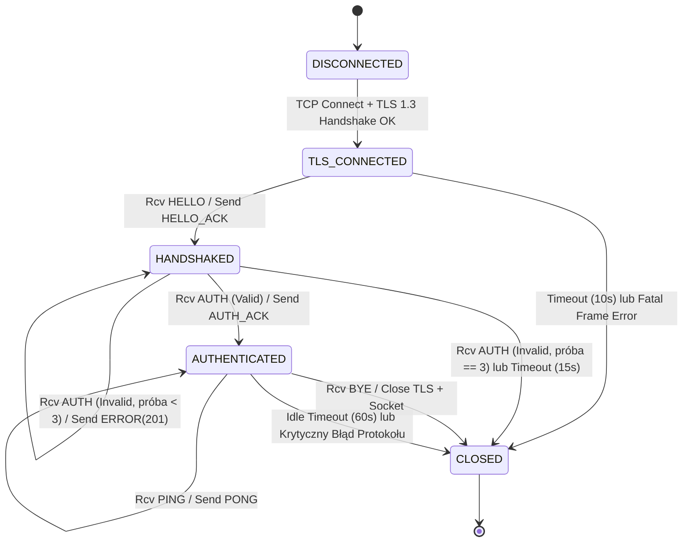
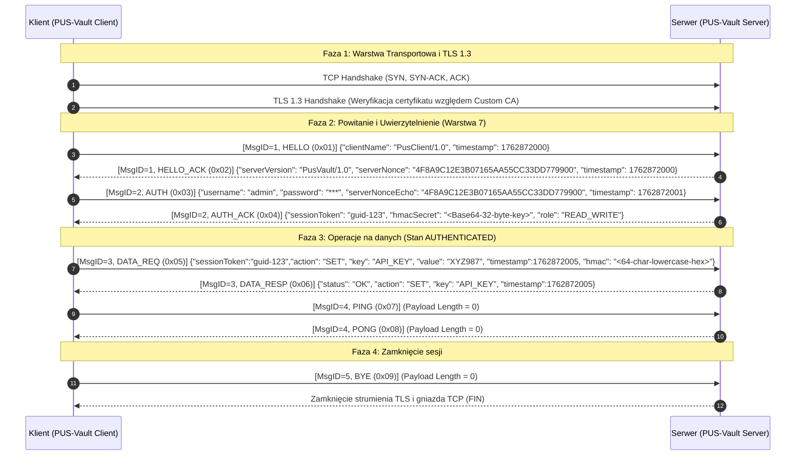
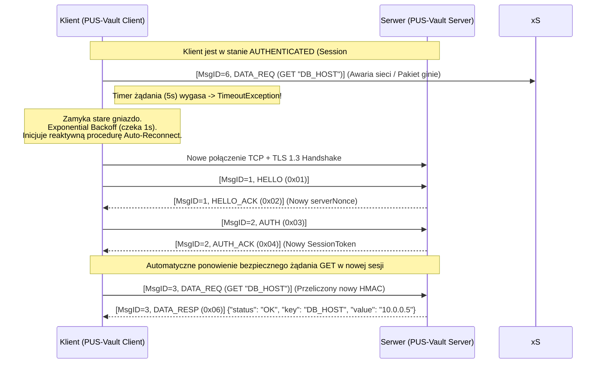

# Programowanie Usług Sieciowych - Projekt Grupowy (Etap 1)
## Specyfikacja Techniczna Autorskiego Protokołu Sieciowego: **PVSP (PUS-Vault Secret Protocol)**

* **Przedmiot:** Programowanie Usług Sieciowych (PUS)
* **Wersja protokołu:** `1.0` (`0x01`)
* **Zespół projektowy:**
  * Kacper Gumulak
  * Damian Judka

---

## 1. Cel protokołu i zakres

### 1.1. Do czego służy protokół?
**PVSP (PUS-Vault Secret Protocol)** to stanowy, bezpieczny protokół warstwy aplikacji (warstwa 7 modelu ISO/OSI) zaprojektowany do zdalnego zarządzania poufnymi danymi konfiguracyjnymi oraz sekretami (wpisami typu klucz-wartość, ang. *Key-Value*) przechowywanymi w centralnym magazynie (**PUS-Vault**). 

Protokół umożliwia uwierzytelnionym klientom wykonywanie podstawowych operacji CRUD na sekretach:
* zapisywanie i aktualizację sekretu (`SET`),
* pobieranie wartości sekretu (`GET`),
* listowanie dostępnych kluczy (`LIST`),
* usuwanie wskazanego sekretu (`DELETE`).

### 1.2. Jakie problemy rozwiązuje?
Protokół PVSP adresuje cztery fundamentalne problemy występujące w niskopoziomowym programowaniu usług sieciowych:
1. **Brak granic wiadomości w strumieniu TCP (Framing / Partial Data):** Protokół TCP operuje na ciągłym strumieniu bajtów i nie zachowuje granic pakietów aplikacyjnych (zjawisko sklejania lub fragmentacji segmentów). PVSP rozwiązuje ten problem poprzez wprowadzenie deterministycznego, 12-bajtowego nagłówka binarnego zawierającego dokładną długość ładunku (`Payload Length`).
2. **Bezpieczna dystrybucja sekretów przez sieć niezaufaną:** Przesyłanie haseł lub kluczy API w postaci jawnej naraża system na podsłuch (sniffing) oraz modyfikację w locie (Man-in-the-Middle). PVSP używa TLS 1.3 do ochrony całego kanału, a HMAC-SHA256 dodatkowo uwierzytelnia żądania operacji na magazynie.
3. **Ochrona przed atakami powtórzeniowymi (Replay Attacks) i duplikatami:** Dzięki ścisłej numeracji sekwencyjnej komunikatów (`Message ID`) oraz znacznikom czasu (`Timestamp`), serwer potrafi wykryć i odrzucić zduplikowane lub przechwycone i ponownie wysłane pakiety.
4. **Kontrola żywotności sesji i wykrywanie cichych rozłączeń (Half-Open Connections):** Zastosowanie jawnej maszyny stanów, mechanizmu `PING`/`PONG` (Keep-Alive) oraz rygorystycznych limitów czasu (Timeouts) zapobiega wyciekom zasobów po stronie serwera.

### 1.3. Model komunikacji
Protokół działa w klasycznym, scentralizowanym modelu **Klient-Serwer (Client-Server)**. W wariancie MVP po jednej stronie połączenia może istnieć najwyżej jedno oczekujące żądanie aplikacyjne; upraszcza to korelację odpowiedzi i zapobiega przeplataniu ramek:
* **Serwer (PUS-Vault Server):** Pasywnie nasłuchuje na określonym porcie TCP, weryfikuje tożsamość klientów, utrzymuje stan sesji, wymusza reguły autoryzacji oraz zarządza magazynem sekretów.
* **Klient (PUS-Vault Client):** Aktywnie inicjuje połączenie sieciowe, przeprowadza proces powitania i uwierzytelnienia, a następnie wysyła synchroniczne żądania operacji na danych w schemacie *Request-Response* (Żądanie-Odpowiedź). Klient jest inicjatorem wszystkich żądań aplikacyjnych.

---

## 2. Założenia techniczne

### 2.1. Warstwa transportowa i zabezpieczeń kanału
* **Protokół transportowy:** **TCP** (Transmission Control Protocol) - gniazda strumieniowe (`SOCK_STREAM`) obsługiwane w trybie IPv4 oraz IPv6 (Dual-Stack).
* **Warstwa kryptograficzna kanału:** **TLS 1.3** (Transport Layer Security) zestawiany bezpośrednio po nawiązaniu połączenia TCP, z weryfikacją certyfikatu X.509 serwera względem prywatnego Urzędu Certyfikacji (**Custom CA**).
* **Domyślny port usługi:** `8443/TCP`.

### 2.2. Kodowanie wiadomości (Model Hybrydowy: Binarny + JSON)
W celu połączenia wysokiej wydajności parsowania buforów sieciowych z czytelnością struktur danych, protokół PVSP stosuje **kodowanie hybrydowe**:
1. **Nagłówek ramki (Header):** Stały rozmiar **12 bajtów**, kodowany **binarnie**. Wszystkie pola wielobajtowe zapisywane są w sieciowym porządku bajtów **Big-Endian (Network Byte Order)**.
2. **Ładunek (Payload):** Zmienny rozmiar (od `0` do `65536` bajtów, czyli 64 KiB), kodowany tekstowo w formacie **JSON** przy użyciu kodowania znaków **UTF-8** (bez znacznika BOM). Limit dotyczy dokładnie liczby bajtów po serializacji, razem z białymi znakami.

### 2.3. Założenia dotyczące niezawodności (Warstwa 4 vs Warstwa 7)
Podział odpowiedzialności pomiędzy systemowym stosem TCP/IP a autorskim protokołem aplikacyjnym PVSP przedstawia poniższa tabela:

| Zagadnienie | Co zapewnia warstwa transportowa (TCP + TLS 1.3) | Co zapewnia protokół aplikacyjny (PVSP - Warstwa 7) |
| :--- | :--- | :--- |
| **Podział na wiadomości** | Brak (ciągły strumień bajtów). | **Pełne ramkowanie (Framing)** na podstawie pola `Payload Length` w nagłówku binarnym (ochrona przed *partial reads*). |
| **Retransmisja i kolejność** | Gwarantuje kolejność bajtów i retransmisję zgubionych segmentów IP w ramach jednego połączenia. | W ramach jednej sesji klient wysyła następny request dopiero po odpowiedzi. Po reconnect automatycznie ponawiane są wyłącznie bezpieczne operacje `GET` i `LIST`. |
| **Wykrywanie duplikatów** | Odrzuca duplikaty segmentów TCP na poziomie jądra OS. | Wykrywa duplikaty logiczne (np. po ponownym wysłaniu żądania przez klienta) na podstawie pola `Message ID`. |
| **Integralność i poufność** | TLS 1.3 zapewnia negocjowaną poufność i integralność rekordów kanału. Konkretny cipher suite zależy od biblioteki i środowiska. | Dodatkowa weryfikacja integralności i autentyczności `DATA_REQ` za pomocą podpisu `HMAC-SHA256` powiązanego z sesją użytkownika. |
| **Wykrywanie awarii łącza** | Zależne od długich, systemowych timerów TCP. | Aktywne wykrywanie martwych połączeń za pomocą ramek `PING`/`PONG` oraz sztywnych timeoutów aplikacyjnych. |

---

### 2.4. Ograniczenia wariantu MVP

W celu ograniczenia złożoności implementacji i jednoznacznego testowania przyjęto następujące reguły:

1. Klient inicjuje `HELLO`, `AUTH`, `DATA_REQ`, `PING` i `BYE`. Serwer nie inicjuje `PING` ani `BYE`.
2. W danym połączeniu klient nie wysyła kolejnego żądania aplikacyjnego przed otrzymaniem odpowiedzi na poprzednie. Ramka `PING` jest wysyłana tylko wtedy, gdy nie trwa żądanie biznesowe.
3. `Message ID` jest liczone od `1` osobno dla każdego połączenia TCP/TLS. `0` jest zarezerwowane. Każde nowe żądanie ma ID równe poprzedniemu ID plus jeden.
4. Odpowiedź serwera kopiuje ID żądania. `PONG` kopiuje ID `PING`. `BYE` nie ma osobnego `BYE_ACK`; po jego odebraniu strona odpowiadająca zamyka TLS i TCP.
5. Po utracie połączenia automatycznie ponawiane są wyłącznie `GET` i `LIST`. Po utracie odpowiedzi dla `SET` lub `DELETE` klient zgłasza wynik nieznany i nie wykonuje cichego retry.

## 3. Struktura komunikatów

### 3.1. Budowa ramki protokołu (Binarny Nagłówek + JSON Payload)
Każdy komunikat przesyłany przez gniazdo składa się z 12-bajtowego nagłówka binarnego oraz opcjonalnego ładunku JSON:

```text
 0                   1                   2                   3
 0 1 2 3 4 5 6 7 8 9 0 1 2 3 4 5 6 7 8 9 0 1 2 3 4 5 6 7 8 9 0 1
+-+-+-+-+-+-+-+-+-+-+-+-+-+-+-+-+-+-+-+-+-+-+-+-+-+-+-+-+-+-+-+-+
|      Magic Bytes (0x5053)     | Version (0x01)|  Message Type |  [Bajty 0..3]
+-+-+-+-+-+-+-+-+-+-+-+-+-+-+-+-+-+-+-+-+-+-+-+-+-+-+-+-+-+-+-+-+
|                   Message ID (uint32, Big-Endian)             |  [Bajty 4..7]
+-+-+-+-+-+-+-+-+-+-+-+-+-+-+-+-+-+-+-+-+-+-+-+-+-+-+-+-+-+-+-+-+
|                 Payload Length (uint32, Big-Endian)           |  [Bajty 8..11]
+-+-+-+-+-+-+-+-+-+-+-+-+-+-+-+-+-+-+-+-+-+-+-+-+-+-+-+-+-+-+-+-+
|                                                               |
|                  JSON Payload (UTF-8, 0..65536 B)             |  [Bajty 12..N]
|                                                               |
+-+-+-+-+-+-+-+-+-+-+-+-+-+-+-+-+-+-+-+-+-+-+-+-+-+-+-+-+-+-+-+-+
```

#### Specyfikacja pól nagłówka binarnego (12 bajtów - wszystkie pola wymagane):
* **`Magic Bytes`** (2 bajty, `uint16`, offset `0`): Stała sygnatura protokołu `0x50 0x53` (znaki ASCII `"PS"` od *PUS*). Pozwala na natychmiastową synchronizację strumienia i odrzucenie obcego ruchu sieciowego.
* **`Version`** (1 bajt, `uint8`, offset `2`): Wersja protokołu. Aktualnie jedyną wspieraną wartością jest `0x01`.
* **`Message Type`** (1 bajt, `uint8`, offset `3`): Kod określający typ komunikatu (zgodnie z punktem 3.2).
* **`Message ID`** (4 bajty, `uint32`, offset `4`): Numer sekwencyjny nadawany przez klienta osobno dla każdego połączenia TCP/TLS. Pierwsze żądanie ma ID `1`, wartość `0` jest zarezerwowana, a każde kolejne żądanie ma ID dokładnie o jeden większe. W odpowiedziach serwera pole to kopiuje ID żądania, na które serwer odpowiada.
* **`Payload Length`** (4 bajty, `uint32`, offset `8`): Rozmiar ładunku JSON w bajtach. Maksymalna dopuszczalna wartość wynosi `65536` (64 KiB). Dla ramek bez ładunku (np. `PING`) wynosi `0`.

### 3.2. Typy wiadomości (`Message Type`)

| Kod (HEX) | Nazwa typu | Kierunek | Opis przeznaczenia |
| :---: | :--- | :---: | :--- |
| `0x01` | **`HELLO`** | Klient $\rightarrow$ Serwer | Inicjalizacja sesji aplikacyjnej, przedstawienie identyfikatora klienta. |
| `0x02` | **`HELLO_ACK`** | Serwer $\rightarrow$ Klient | Potwierdzenie nawiązania sesji, przekazanie losowego `ServerNonce` do logowania. |
| `0x03` | **`AUTH`** | Klient $\rightarrow$ Serwer | Żądanie uwierzytelnienia użytkownika (login oraz poświadczenia). |
| `0x04` | **`AUTH_ACK`** | Serwer $\rightarrow$ Klient | Potwierdzenie autoryzacji, wydanie `SessionToken` oraz klucza `HmacSecret`. |
| `0x05` | **`DATA_REQ`** | Klient $\rightarrow$ Serwer | Żądanie wykonania operacji na magazynie sekretów (`GET`, `SET`, `LIST`, `DELETE`). |
| `0x06` | **`DATA_RESP`** | Serwer $\rightarrow$ Klient | Odpowiedź zawierająca wynik operacji `DATA_REQ` (np. pobrany sekret lub potwierdzenie zapisu). |
| `0x07` | **`PING`** | Klient $\rightarrow$ Serwer | Komunikat kontrolny utrzymania połączenia (*Keep-Alive*). |
| `0x08` | **`PONG`** | Serwer $\rightarrow$ Klient | Odpowiedź na `PING`; kopiuje `Message ID` ramki `PING`. |
| `0x09` | **`BYE`** | Klient $\rightarrow$ Serwer | Sygnalizacja poprawnego, zamierzonego zamknięcia sesji aplikacyjnej; nie wymaga osobnej odpowiedzi. |
| `0xFF` | **`ERROR`** | Serwer $\rightarrow$ Klient | Komunikat błędu zawierający kod numeryczny, nazwę błędu oraz opis diagnostyczny. |

### 3.3. Pola wiadomości w ładunku JSON (Wymagane i Opcjonalne)

W zależności od typu wiadomości (`Message Type`), ładunek JSON posiada następującą strukturę pól:

Reguły wspólne:

* Nazwy pól są rozróżniane wielkością liter. Payload musi być pojedynczym obiektem JSON; tablice, liczby i `null` jako dokument główny są odrzucane.
* Pola nieznane oraz powtórzone nazwy pól są odrzucane kodem `ERR_INVALID_PAYLOAD (106)`. Brak pola opcjonalnego oznacza jego nieobecność; `null` nie jest równoważne brakowi pola.
* Wszystkie wartości tekstowe są kodowane w UTF-8. `timestamp` jest podpisaną liczbą `int64` oznaczającą sekundy Unix UTC.
* Limit 64 KiB dotyczy całego zserializowanego payloadu. Limity poszczególnych pól są sprawdzane przed wykonaniem operacji.

1. **`HELLO` (`0x01`):**
   * `clientName` *(string, wymagane)* - nazwa i wersja aplikacji klienckiej.
   * `timestamp` *(long, wymagane)* - aktualny czas Unix (w sekundach UTC).
2. **`HELLO_ACK` (`0x02`):**
   * `serverVersion` *(string, wymagane)* - identyfikator serwera.
   * `serverNonce` *(string, wymagane)* - losowy ciąg 16 bajtów CSPRNG, zapisany jako dokładnie 32 znaki HEX i użyty tylko w bieżącym połączeniu.
   * `timestamp` *(long, wymagane)* - czas serwera (w sekundach UTC).
3. **`AUTH` (`0x03`):**
   * `username` *(string, wymagane)* - nazwa użytkownika (np. `"admin"` lub `"reader"`).
   * `password` *(string, wymagane)* - hasło lub klucz API użytkownika.
   * `serverNonceEcho` *(string, wymagane)* - dokładna kopia `serverNonce` otrzymanego w `HELLO_ACK`. Serwer akceptuje nonce tylko w połączeniu, dla którego go wygenerował, i tylko raz.
   * `timestamp` *(long, wymagane)* - czas wysłania żądania.
4. **`AUTH_ACK` (`0x04`):**
   * `sessionToken` *(string, wymagane)* - losowy token sesji o entropii co najmniej 128 bitów, ważny tylko do końca bieżącej sesji.
   * `hmacSecret` *(string, wymagane)* - wygenerowany przez CSPRNG klucz sesyjny o długości dokładnie 32 bajtów, kodowany Base64. Po stronie klienta i serwera wartość Base64 jest dekodowana przed użyciem HMAC.
   * `role` *(string, wymagane)* - przyznana rola autoryzacyjna (`"READ_WRITE"` lub `"READ_ONLY"`).
5. **`DATA_REQ` (`0x05`):**
   * `sessionToken` *(string, wymagane)* - token aktywnej sesji.
   * `action` *(string, wymagane)* - typ operacji: `"SET"`, `"GET"`, `"LIST"` lub `"DELETE"`.
   * `key` *(string, opcjonalne)* - nazwa klucza sekretu (wymagane dla `"SET"`, `"GET"`, `"DELETE"`; pomijane dla `"LIST"`).
   * `value` *(string, opcjonalne)* - wartość sekretu (wymagane wyłącznie dla akcji `"SET"`).
   * `timestamp` *(long, wymagane)* - czas wygenerowania żądania (ochrona Anti-Replay).
   * `hmac` *(string, wymagane)* - 32-bajtowy podpis `HMAC-SHA256` zapisany jako dokładnie 64 znaki lowercase HEX. Podpis jest liczony z kanonicznego, długościowanego formatu binarnego opisanego w sekcji 5.1, a pole `hmac` nie jest częścią wejścia.
6. **`DATA_RESP` (`0x06`):**
   * `status` *(string, wymagane)* - `"OK"`.
   * `action` *(string, wymagane)* - echo wykonanej akcji.
   * `key` *(string, wymagane dla `SET`, `GET` i `DELETE`)* - nazwa klucza, którego dotyczyła operacja.
   * `value` *(string, wymagane dla `"GET"`)* - zwrócona wartość sekretu.
   * `keys` *(array of strings, wymagane dla `"LIST"`)* - lista kluczy, ewentualnie podzielona na strony zgodnie z limitami.
   * `timestamp` *(long, wymagane)* - czas odpowiedzi serwera.
   * Dla `SET` i `DELETE` odpowiedź zawiera `status`, `action`, `key` i `timestamp`. Dla `GET` dodatkowo zawiera `value`, a dla `LIST` dodatkowo `keys`.
7. **`PING` (`0x07`), `PONG` (`0x08`), `BYE` (`0x09`):**
   * W wariancie MVP zawsze mają pusty payload (`Payload Length = 0`). `PING` wysyła klient, `PONG` wysyła serwer jako odpowiedź, a `BYE` wysyła klient i po jego odebraniu serwer zamyka sesję.
8. **`ERROR` (`0xFF`):**
   * `errorCode` *(int, wymagane)* - numeryczny kod błędu (zgodnie z sekcją 6.1).
   * `errorName` *(string, wymagane)* - symboliczna nazwa błędu.
   * `message` *(string, wymagane)* - czytelny opis przyczyny błędu (bez ujawniania wrażliwych danych wewnętrznych serwera).
   * `timestamp` *(long, wymagane)* - czas wystąpienia błędu.

### 3.4. Przykładowe ramki (Reprezentacja HEX + JSON)

#### Przykład 1: Ramka `PING` (`0x07`) - bez ładunku JSON
* `Magic`: `0x50 0x53`, `Version`: `0x01`, `Type`: `0x07` (`PING`), `Message ID`: `5`, `Payload Length`: `0`.
```text
HEX Nagłówka (12 bajtów): 50 53 01 07 00 00 00 05 00 00 00 00
Payload (0 bajtów):       [brak]
```

#### Przykład 2: Ramka `DATA_REQ` (`0x05`) - pobranie sekretu (`GET`)
* `Magic`: `0x50 0x53`, `Version`: `0x01`, `Type`: `0x05` (`DATA_REQ`), `Message ID`: `3`, `Payload Length`: `187` (`0x000000BB`).
```text
HEX Nagłówka (12 bajtów): 50 53 01 05 00 00 00 03 00 00 00 BB
Payload JSON (187 bajtów UTF-8, zapis zwarty):
{"sessionToken":"a1b2c3d4-e5f6-7890-abcd-ef1234567890","action":"GET","key":"DB_PASSWORD","timestamp":1762872000,"hmac":"9f86d081884c7d659a2feaa0c55ad015a3bf4f1b2b0b822cd15d6c15b0f00a08"}
```

### 3.5. Walidacja (Co jest błędem formatu?)
Odbiorca uznaje komunikat za niepoprawny składniowo lub strukturalnie w następujących przypadkach:
1. Nie udało się odczytać pełnych 12 bajtów nagłówka przed zamknięciem strumienia — połączenie jest zamykane bez odpowiedzi PVSP.
2. Pierwsze dwa bajty nagłówka są różne od `0x50 0x53` (`ERR_BAD_MAGIC`).
3. Bajt wersji jest różny od `0x01` (`ERR_UNSUPPORTED_VERSION`).
4. Bajt `Message Type` nie należy do zbioru zdefiniowanych identyfikatorów `{0x01..0x09, 0xFF}` (`ERR_UNKNOWN_MSG_TYPE`) albo kierunek/typ jest niedozwolony w bieżącym stanie (`ERR_UNAUTHORIZED_STATE`).
5. Wartość `Payload Length` przekracza maksymalny dopuszczalny limit `65536` bajtów (`ERR_PAYLOAD_TOO_LARGE`).
6. Strumień bajtów nie zawiera poprawnego dokumentu JSON w kodowaniu UTF-8, gdy `Payload Length > 0` (`ERR_INVALID_JSON`).
7. W obiekcie JSON brakuje wymaganego pola, występuje pole nieznane/powtórzone, niepoprawny typ albo niedozwolona kombinacja pól (`ERR_INVALID_PAYLOAD (106)`).
8. Wartość `action` nie należy do `SET`, `GET`, `LIST`, `DELETE` albo nie spełnia reguł wymaganych pól (`ERR_INVALID_ACTION (107)`).
9. Payload odpowiedzi serwera przekroczyłby limit 64 KiB (`ERR_RESPONSE_TOO_LARGE (108)`).

Po poprawnym odczytaniu całej ramki błędy `104`, `106`, `107`, `202`, `203`, `404`, `429` i `500` nie zrywają połączenia. Błędy `100`, `101`, `102`, `103`, `105`, `204` i `301` kończą sesję zgodnie z tabelą w sekcji 6.1.

---

## 4. Model stanów i przebieg komunikacji

### 4.1. Opis cyklu życia sesji
Każde połączenie klienta na serwerze przechodzi przez ściśle zdefiniowaną maszynę stanów:
1. **`DISCONNECTED` $\rightarrow$ `TLS_CONNECTED` (Nawiązanie połączenia):** Klient inicjuje handshake TCP, po czym handshake TLS 1.3. Klient weryfikuje certyfikat serwera względem lokalnego `ca.crt`, SAN i nazwy/adresu użytego do połączenia.
2. **`TLS_CONNECTED` $\rightarrow$ `HANDSHAKED` (Powitanie aplikacyjne):** Klient ma 10 sekund na wysłanie pełnej ramki `HELLO`. Serwer odpowiada `HELLO_ACK` z jednorazowym `serverNonce` i przechodzi do oczekiwania na `AUTH`.
3. **`HANDSHAKED` $\rightarrow$ `AUTHENTICATED` (Uwierzytelnienie i autoryzacja):** Klient ma 15 sekund od `HELLO_ACK` na przesłanie `AUTH`. Po pozytywnej weryfikacji serwer generuje token sesji i klucz HMAC, odsyła `AUTH_ACK` i przechodzi do stanu autoryzowanego. Po błędnym haśle serwer odsyła `ERROR (201)`; po trzech błędach zamyka połączenie.
4. **`AUTHENTICATED` (Wymiana danych i utrzymanie sesji):** Klient wysyła najwyżej jedno oczekujące żądanie `DATA_REQ`, `PING` albo `BYE`. `DATA_REQ` otrzymuje `DATA_RESP` lub `ERROR`, a `PING` otrzymuje `PONG`.
5. **`AUTHENTICATED` $\rightarrow$ `CLOSED` (Zamknięcie sesji):** Klient wysyła `BYE`, po czym serwer zamyka TLS oraz TCP. Serwer może również zamknąć sesję po timeoutcie, błędzie krytycznym albo rozłączeniu klienta.

### 4.2. Diagram stanów sesji (Mermaid)



#### 4.2.1. Dozwolone komunikaty w stanie sesji

* `TLS_CONNECTED`: tylko `HELLO` klienta. `BYE` może zostać użyty do awaryjnego zamknięcia, ale nie wymaga odpowiedzi.
* `HANDSHAKED`: tylko `AUTH` klienta albo `BYE`.
* `AUTHENTICATED`: `DATA_REQ`, `PING` albo `BYE` klienta. Serwer wysyła wtedy odpowiednio `DATA_RESP`/`ERROR`, `PONG` albo zamyka połączenie.
* `PONG` jest wyłącznie odpowiedzią serwera na wcześniej odebrany `PING`; samodzielny `PONG` klienta jest błędem `ERR_UNAUTHORIZED_STATE`.
* Komunikat powtórzony w tym samym stanie, komunikat z niedozwolonego kierunku albo `HELLO`/`AUTH` po uwierzytelnieniu skutkuje `ERR_UNAUTHORIZED_STATE`. Po zużyciu payloadu połączenie pozostaje otwarte.

### 4.3. Diagram sekwencji dla pełnej sesji (Mermaid)



### 4.4. Zasady timeoutów, retransmisji (Retry) oraz Keep-Alive

| Mechanizm | Wartość | Opis zachowania |
| :--- | :---: | :--- |
| **TLS Handshake Timeout** | `10 sekund` | Jeśli negocjacja TLS nie zakończy się w tym czasie, połączenie jest zamykane bez ramki PVSP. |
| **HELLO Timeout** | `10 sekund` | Po zakończeniu TLS klient ma 10 sekund na wysłanie pełnej ramki `HELLO`; po przekroczeniu serwer wysyła `ERROR (105)` i zamyka gniazdo. |
| **AUTH Timeout** | `15 sekund` | Po wysłaniu `HELLO_ACK` klient ma 15 sekund na wysłanie pełnej ramki `AUTH`; po przekroczeniu serwer wysyła `ERROR (105)` i zamyka gniazdo. |
| **Request Timeout (Klient)** | `5 sekund` | Czas, jaki klient oczekuje na odpowiedź `DATA_RESP`, `PONG` lub `ERROR`. Po przekroczeniu klient zamyka połączenie i uruchamia recovery zgodnie z polityką retry. |
| **Keep-Alive Interval (`PING`)** | `20 sekund` | Gdy nie trwa żądanie biznesowe i przez 20 sekund nie ma ruchu, klient wysyła `PING`. Serwer odpowiada `PONG` w ciągu 5 sekund. |
| **Session Idle Timeout (Serwer)** | `60 sekund` | Maksymalny czas bez poprawnej ramki od klienta. Po przekroczeniu serwer unieważnia token sesji i zamyka gniazdo. |
| **Polityka Retry / Reconnect** | Maks. `3 próby` | Po utracie połączenia klient podejmuje do 3 prób z opóźnieniem `1s`, `2s`, `4s`. Po ponownym `HELLO` i `AUTH` automatycznie ponawia tylko `GET`/`LIST`. Dla `SET`/`DELETE` zwraca użytkownikowi wynik nieznany. |

Timeouty odczytu i zapisu są egzekwowane przez deadline/CancellationToken obejmujący `SslStream.ReadAsync`, `WriteAsync` i handshake TLS. Samo `Socket.ReceiveTimeout` nie jest kontraktem timeoutu dla asynchronicznego `SslStream`.

---

## 5. Bezpieczeństwo komunikacji

Protokół PVSP wdraża architekturę **Defense-in-Depth (obrona w głąb)**, łącząc zabezpieczenia warstwy transportowej z kryptografią warstwy aplikacyjnej.

### 5.1. Realizacja mechanizmów bezpieczeństwa

1. **Poufność (Confidentiality):**
   * Cały ruch protokołu PVSP jest tunelowany wewnątrz **TLS 1.3**. Cipher suite jest negocjowany przez bibliotekę i środowisko; projekt nie zakłada, że zawsze będzie to `AES-256-GCM`.
   * Klient rygorystycznie weryfikuje certyfikat X.509 serwera za pomocą własnego urzędu certyfikacji (**Custom Root CA** - `X509ChainTrustMode.CustomRootTrust`), nazwę/SAN, EKU `serverAuth` i okres ważności. Callback akceptujący dowolny certyfikat jest niedopuszczalny.
2. **Integralność (Integrity):**
   * Poza integralnością rekordów TLS, każda operacja `DATA_REQ` w warstwie 7 jest chroniona kodem uwierzytelniającym wiadomość **HMAC-SHA256**. HMAC nie zastępuje poprawnej walidacji TLS.
   * Klucz `hmacSecret` jest generowany dynamicznie przez serwer (CSPRNG - kryptograficznie bezpieczny generator liczb losowych) podczas logowania i przypisany wyłącznie do jednej sesji.
   * Modyfikacja dowolnego pola podpisanego wejścia, w tym `Message Type`, `Message ID`, `sessionToken`, `action`, `key`, `value` albo `timestamp`, powoduje niezgodność HMAC. `ERR_INVALID_HMAC (204)` kończy sesję po wysłaniu błędu.
3. **Uwierzytelnienie (Authentication):**
   *Dwuetapowe: serwer uwierzytelnia się certyfikatem X.509 podczas fazy TLS, natomiast klient uwierzytelnia się w fazie `AUTH` parą `username` + `password` powiązaną z jednorazowym `serverNonceEcho`. Po zalogowaniu tożsamość klienta reprezentuje krótkożyjący `sessionToken`.
4. **Autoryzacja (Authorization - RBAC):**
   * Protokół definiuje kontrolę dostępu opartą na rolach (*Role-Based Access Control*):
     * Rola **`READ_ONLY`** - uprawnia wyłącznie do wywoływania akcji `"GET"` oraz `"LIST"`. Próba wywołania `"SET"` lub `"DELETE"` kończy się błędem `ERR_FORBIDDEN (203)`.
     * Rola **`READ_WRITE`** - uprawnia do wszystkich operacji (`"GET"`, `"LIST"`, `"SET"`, `"DELETE"`).
5. **Ochrona przed atakami powtórzeniowymi (Anti-Replay Protection):**
   * Zrealizowana poprzez kombinację trzech elementów:
     1. **`serverNonce`** w fazie logowania `HELLO_ACK` $\rightarrow$ `AUTH`.
     2. **Sekwencyjny `Message ID`** w nagłówku binarnym - serwer zapamiętuje `lastAcceptedMessageId` oraz digest ostatniego żądania. ID równe ostatniemu jest duplikatem tylko wtedy, gdy digest jest identyczny; ID mniejsze albo większe niż `lastAcceptedMessageId + 1` jest odrzucane jako replay/luka sekwencji.
     3. **Okno czasowe `timestamp`** - serwer akceptuje `HELLO`, `AUTH` i `DATA_REQ`, których znacznik czasu nie różni się od czasu zegara serwera o więcej niż **$\pm 30\text{ sekund}$**. Ramki `PING`, `PONG` i `BYE` nie mają timestampu, a ich świeżość wynika z bieżącej sesji i sekwencji ID.

#### 5.1.1. Kanoniczne wejście HMAC

HMAC jest liczony z następującego ciągu bajtów, bez separatorów tekstowych i bez zależności od kolejności pól JSON:

```text
ASCII("PVSP-HMAC-v1")
|| version (uint8)
|| messageType (uint8)
|| messageId (uint32, Big-Endian)
|| sessionTokenLength (uint32, Big-Endian)
|| UTF-8(sessionToken)
|| actionLength (uint32, Big-Endian)
|| UTF-8(action)
|| keyPresent (uint8: 0 albo 1)
|| keyLength (uint32, Big-Endian, jeśli keyPresent = 1)
|| UTF-8(key, jeśli keyPresent = 1)
|| valuePresent (uint8: 0 albo 1)
|| valueLength (uint32, Big-Endian, jeśli valuePresent = 1)
|| UTF-8(value, jeśli valuePresent = 1)
|| timestamp (int64, Big-Endian)
```

Klucz HMAC jest wynikiem dekodowania pola `hmacSecret` z Base64 i ma dokładnie 32 bajty. Pole `hmac` jest wyłączone z wejścia, ma dokładnie 64 znaki lowercase HEX, a jego wartość jest porównywana funkcją stałoczasową. Serwer najpierw waliduje framing, UTF-8, JSON i schemat, a dopiero potem sprawdza timestamp, ID i HMAC zgodnie z kolejnością z sekcji 6.2.

Wartości HMAC w scenariuszu 1 są testowymi wektorami dokumentacyjnymi. Dla `hmacSecret = K7gNU3sdo+OL0wNhqoVWhr3g6s1xYv72ol/pe/Unols=`, `Message Type = 0x05`, `Message ID = 3`, akcji `SET`, klucza `STRIPE_API_KEY`, wartości `demo-secret-value` i timestampu `1762872005` oczekiwany wynik to `fda9738508eec82c74f473d54be7981b103f10826c1234b91df59be4ba285e5f`.

### 5.2. Podstawowy model zagrożeń (Threat Model - STRIDE)

| Zagrożenie | Wektor ataku | Mechanizm mitygacji w protokole PVSP |
| :--- | :--- | :--- |
| **Podsłuch (Eavesdropping / Sniffing)** | Przechwytywanie pakietów narzędziem `tcpdump` / Wireshark w celu odczytania haseł i sekretów. | Obowiązkowe szyfrowanie całego kanału za pomocą **TLS 1.3** z poprawną walidacją certyfikatu. |
| **Man-in-the-Middle (MitM)** | Podstawienie fałszywego serwera przechwytującego połączenie klienta. | Weryfikacja łańcucha certyfikatu X.509 serwera względem lokalnego, zaufanego certyfikatu **Custom CA (`ca.crt`)**. |
| **Modyfikacja danych (Tampering)** | Próba zmiany klucza lub wartości sekretu w locie lub manipulacja pamięcią bufora. | Integralność TLS oraz weryfikacja **HMAC-SHA256** obliczanego z kanonicznych pól żądania i nagłówka. |
| **Atak powtórzeniowy (Replay Attack)** | Nagranie poprawnej ramki `DATA_REQ (DELETE)` i ponowne wysłanie jej do serwera. | Jednorazowy nonce logowania, sekwencyjny **`Message ID`**, okno **`timestamp` ($\pm 30\text{s}$)** oraz klucz HMAC związany z bieżącą sesją. |
| **Nieautoryzowana eskalacja uprawnień** | Użytkownik z kontem tylko do odczytu próbuje nadpisać lub usunąć sekret w magazynie. | Weryfikacja roli przypisanej do `sessionToken` po stronie serwera (**RBAC**) przed wykonaniem akcji. |
| **Denial of Service (DoS) / Wyciek pamięci**| Wysłanie złośliwego nagłówka z `Payload Length = 2 GB` w celu alokacji całej pamięci RAM serwera. | Sztywny limit **`MAX_PAYLOAD_SIZE = 64 KiB`** sprawdzany przed alokacją, limit połączeń, limit handshake’ów, *Rate Limiting* oraz krótkie timeouty sesji. |

---

### 5.3. Granice ochrony danych w MVP

Wariant MVP chroni transmisję i dostęp do magazynu, ale nie implementuje szyfrowania danych at rest. `data/vault_store.json` jest plikiem plaintext i ten fakt jest jawnym ograniczeniem projektu: kompromitacja hosta, użytkownika systemowego, kopii zapasowej albo obrazu kontenera może ujawnić sekrety.

Minimalne zabezpieczenia MVP:

* katalog `data` oraz plik magazynu są tworzone z uprawnieniami właściciela, odpowiednio `0700` i `0600`;
* plik magazynu nie jest umieszczany w repozytorium ani logowany;
* sekrety, hasła, tokeny, `hmacSecret`, nonce i surowe payloady nie są zapisywane w logach;
* hasła kont są przechowywane wyłącznie jako hashe PBKDF2-HMAC-SHA256 z losową solą co najmniej 16 bajtów i minimum 600 000 iteracji, zgodnie z konfiguracją opisaną w README;
* klient pobiera hasło przez ukryty prompt i nie przekazuje go jako argumentu procesu;
* szyfrowanie pliku magazynu pozostaje rozszerzeniem poza MVP i może zostać dodane bez zmiany PVSP.

## 6. Obsługa błędów i awarii połączenia

### 6.1. Tabela kodów błędów (`ERROR` - `0xFF`)

Kody błędów są pogrupowane tematycznie: 1xx — framing i format, 2xx — uwierzytelnienie i stan, 3xx — świeżość i sekwencja, 4xx — logika aplikacji i limity, 5xx — błąd wewnętrzny.

| Kod | Symboliczna nazwa (`errorName`) | Znaczenie / Przyczyna wystąpienia | Czy zamyka połączenie? |
| :-: | :--- | :--- | :---: |
| `100` | `ERR_BAD_MAGIC` | Pierwsze 2 bajty nagłówka są różne od `0x50 0x53` (utrata synchronizacji strumienia). | **TAK** (Natychmiast) |
| `101` | `ERR_UNSUPPORTED_VERSION`| Wersja protokołu w nagłówku jest różna od `0x01`. | **TAK** (Natychmiast) |
| `102` | `ERR_UNKNOWN_MSG_TYPE` | Nieznany identyfikator `Message Type` w nagłówku binarnym. | **TAK** (Natychmiast) |
| `103` | `ERR_PAYLOAD_TOO_LARGE` | Pole `Payload Length` przekracza limit `65536` bajtów (64 KiB); odrzucenie następuje przed alokacją. | **TAK** (Natychmiast) |
| `104` | `ERR_INVALID_JSON` | Ładunek nie jest poprawnym UTF-8 albo poprawnym dokumentem JSON. | NIE |
| `105` | `ERR_TIMEOUT` | Przekroczono timeout TLS, `HELLO`, `AUTH`, odczytu albo bezczynności sesji. | **TAK** |
| `106` | `ERR_INVALID_PAYLOAD` | JSON jest poprawny, ale ma brakujące/nieznane/powtórzone pola, zły typ albo przekracza limit pola. | NIE |
| `107` | `ERR_INVALID_ACTION` | Nieznana akcja albo niedozwolona kombinacja `action`, `key` i `value`. | NIE |
| `108` | `ERR_RESPONSE_TOO_LARGE` | Odpowiedź, np. `LIST`, przekroczyłaby limit 64 KiB. | NIE |
| `201` | `ERR_AUTH_FAILED` | Nieprawidłowy login, hasło albo niezgodny `serverNonceEcho`. | Po 3 nieudanych próbach |
| `202` | `ERR_UNAUTHORIZED_STATE` | Próba wysłania komunikatu niezgodnego z aktualnym stanem sesji (np. `DATA_REQ` przed `AUTH`). | NIE |
| `203` | `ERR_FORBIDDEN` | Brak uprawnień roli (np. użytkownik `READ_ONLY` wywołuje akcję `SET` lub `DELETE`). | NIE |
| `204` | `ERR_INVALID_HMAC` | Podpis `HMAC-SHA256` jest nieprawidłowy albo ma zły format. Serwer odsyła błąd i zamyka sesję. | **TAK** |
| `301` | `ERR_REPLAY_DETECTED` | Timestamp jest poza oknem $\pm30\text{s}$ albo ID jest mniejsze niż oczekiwane. | **TAK** |
| `302` | `ERR_DUPLICATE_MSG` | Otrzymano ponownie ostatnie ID z identycznym digestem żądania; serwer zwraca zapisaną odpowiedź. Inny digest nie jest duplikatem. | NIE |
| `404` | `ERR_KEY_NOT_FOUND` | Żądany klucz sekretu nie istnieje w magazynie (dla operacji `GET` lub `DELETE`). | NIE |
| `429` | `ERR_RATE_LIMIT` | Przekroczono limit 20 żądań w 10 sekund dla sesji. | NIE (Odrzuca żądanie) |
| `500` | `ERR_INTERNAL_SERVER` | Niespodziewany błąd wewnętrzny serwera podczas przetwarzania żądania; szczegóły nie są ujawniane klientowi. | NIE |

### 6.2. Zachowanie po błędach składni i protokołu
* **Błędy krytyczne framingu (`100`, `101`, `102`, `103`):** Jeżeli serwer odczytał pełny nagłówek, ale jego magic/version/type/length są niepoprawne, odsyła poprawną ramkę `ERROR` z ID odczytanym z nagłówka, a następnie zamyka TLS i TCP. Przy niepełnym nagłówku serwer zamyka połączenie bez odpowiedzi PVSP.
* **Timeout (`105`), błędny HMAC (`204`) i replay (`301`):** Serwer odsyła `ERROR`, jeśli może bezpiecznie skorelować odpowiedź, unieważnia sesję i zamyka połączenie.
* **Błędy po odczytaniu pełnego payloadu (`104`, `106`, `107`, `202`, `203`, `404`, `429`, `500`):** Strumień zachowuje synchronizację. Serwer odsyła `ERROR` i utrzymuje połączenie, z wyjątkiem sytuacji zamknięcia wynikającej z timeoutu transportowego.

Walidacja `DATA_REQ` przebiega w ustalonej kolejności: framing i limit rozmiaru, UTF-8, JSON, schemat i limity pól, stan sesji, sekwencja `Message ID`, okno czasu, kanoniczne wejście HMAC, RBAC, rate limit, a dopiero na końcu operacja magazynu.

### 6.3. Timeout połączenia oraz utrata połączenia w trakcie sesji
* **Po stronie serwera:** Timeouty są realizowane przez deadline/CancellationToken wokół operacji `SslStream.ReadAsync`, a nie przez samo `Socket.ReceiveTimeout`. Jeśli klient nagle straci zasilanie lub połączenie sieciowe i przez 60 sekund nie prześle poprawnej ramki, serwer usuwa sesję z pamięci, loguje zredagowane zdarzenie i zwalnia deskryptor gniazda.
* **Po stronie klienta (Mechanizm Auto-Recovery):** Gdy klient wykryje zerwanie połączenia (odczyt zwróci `0` bajtów albo minie 5-sekundowy deadline odpowiedzi), przechodzi w procedurę odzyskiwania:
  1. Zamyka stare gniazdo TCP.
  2. Odczekuje czas wyznaczony przez algorytm *Exponential Backoff* (`1s`, `2s`, `4s`).
  3. Tworzy nowe gniazdo, zestawia nowy kanał TLS 1.3 i automatycznie przeprowadza sekwencję `HELLO` $\rightarrow$ `AUTH`, uzyskując nowy `sessionToken`.
  4. Ponawia przerwane żądanie wyłącznie, jeśli było to `GET` albo `LIST`. Dla `SET` i `DELETE` klient zgłasza użytkownikowi wynik nieznany i nie wykonuje automatycznej mutacji.

### 6.4. Obsługa częściowych danych (Partial Data) oraz duplikatów
1. **Częściowe dane / Fragmentacja TCP (Partial Reads):**
   W sieciach rozległych pojedyncza ramka PVSP (np. 12 bajtów nagłówka + 500 bajtów JSON) może dotrzeć do karty sieciowej w kilku osobnych segmentach TCP (np. najpierw 5 bajtów, potem 200 bajtów, a na końcu reszta). 
   * **Rozwiązanie w protokole:** Zarówno klient, jak i serwer stosują pętlę dokładnego odczytu bufora (`ReadExactly`):
     * Krok 1: Czytaj ze strumienia w pętli `while (totalRead < 12)` aż do skompletowania pełnych 12 bajtów nagłówka binarnego.
     * Krok 2: Zdekoduj z bajtów `8..11` liczbę `payloadLength`.
     * Krok 3: Zaalokuj bufor o rozmiarze `payloadLength` i czytaj w pętli `while (totalRead < payloadLength)` aż do odebrania kompletnego dokumentu JSON.
2. **Duplikaty wiadomości w jednej sesji:**
   W wariancie MVP klient nie wysyła kolejnego żądania przed odpowiedzią. Jeżeli ta sama ramka zostanie ponowiona w tej samej sesji, serwer przechowuje `lastAcceptedMessageId`, digest żądania i ostatnią odpowiedź. ID równe ostatniemu z identycznym digestem powoduje ponowne odesłanie zapisanej odpowiedzi (`302` nie oznacza ponownego wykonania operacji). To samo ID z innym digestem jest błędem protokołu i nie może wykonać operacji.

   Po reconnect powstaje nowa sesja i nowy licznik ID. Automatyczny retry dotyczy wyłącznie `GET` i `LIST`; mutacje `SET` i `DELETE` po utracie odpowiedzi mają wynik nieznany.

### 6.5. Limity i ochrona przed nadużyciami (Abuse Protection)
* **Maksymalny rozmiar payloadu (`MAX_PAYLOAD_SIZE`):** `65 536 bajtów` (64 KiB). Każda ramka deklarująca większy rozmiar jest odrzucana przed alokacją pamięci pod JSON.
* **Maksymalna długość klucza sekretu:** `128 bajtów UTF-8`; dozwolone są wyłącznie znaki ASCII alfanumeryczne oraz `_`, `-`, `.`.
* **Maksymalna długość wartości sekretu:** `32 768 bajtów UTF-8`; limit pola i limit całego payloadu są sprawdzane po serializacji.
* **Limity pól:** `clientName` 64 bajty, `username` 64 bajty, `password` 256 bajtów, `sessionToken` 128 bajtów, `errorName` 64 bajty, `message` 512 bajtów, a `LIST` najwyżej 1 000 kluczy w odpowiedzi. Przekroczenie limitu daje `ERR_INVALID_PAYLOAD (106)` albo `ERR_RESPONSE_TOO_LARGE (108)`.
* **Rate Limiting:** Dokładnie 20 żądań `DATA_REQ` na 10 sekund w ramach jednej sesji, jako sliding window. `PING` nie zużywa limitu, ale nie może być wysyłany w trakcie oczekiwania na `DATA_REQ`.
* **Ochrona zasobów:** Serwer ogranicza liczbę równoległych połączeń do wartości konfigurowalnej, minimum 50 dla testu projektu, oraz liczbę trwających handshake’ów. Połączenia nieuwierzytelnione mają ten sam timeout TLS/HELLO/AUTH.
* **Limit prób uwierzytelnienia:** Maksymalnie 3 nieudane próby `AUTH` na jedno połączenie oraz dodatkowy backoff per konto/adres IP.

---

## 7. Przykładowe scenariusze komunikacji

Poniżej przedstawiono trzy kompletne scenariusze z dokładną zawartością pól nagłówków binarnych oraz ładunków JSON.

### Scenariusz 1: Poprawna sesja (Logowanie, zapis sekretu `SET`, odczyt `GET`, zamknięcie `BYE`)

**Krok 1 - Klient wysyła `HELLO`:**
* **Nagłówek binarny:** `Magic=0x5053` | `Ver=0x01` | `Type=0x01 (HELLO)` | `MsgID=1` | `Len=56`
* **Payload JSON:**
```json
{"clientName":"PusVault-CLI/1.0","timestamp":1762872000}
```

**Krok 2 - Serwer odpowiada `HELLO_ACK`:**
* **Nagłówek binarny:** `Magic=0x5053` | `Ver=0x01` | `Type=0x02 (HELLO_ACK)` | `MsgID=1` | `Len=111`
* **Payload JSON:**
```json
{"serverVersion":"PusVault-Server/1.0","serverNonce":"4F8A9C12E3B07165AA55CC33DD779900","timestamp":1762872000}
```

**Krok 3 - Klient wysyła `AUTH`:**
* **Nagłówek binarny:** `Magic=0x5053` | `Ver=0x01` | `Type=0x03 (AUTH)` | `MsgID=2` | `Len=113`
* **Payload JSON:**
```json
{"username":"admin","password":"***","serverNonceEcho":"4F8A9C12E3B07165AA55CC33DD779900","timestamp":1762872001}
```

**Krok 4 - Serwer odpowiada `AUTH_ACK`:**
* **Nagłówek binarny:** `Magic=0x5053` | `Ver=0x01` | `Type=0x04 (AUTH_ACK)` | `MsgID=2` | `Len=135`
* **Payload JSON:**
```json
{"sessionToken":"f47ac10b-58cc-4372-a567-0e02b2c3d479","hmacSecret":"K7gNU3sdo+OL0wNhqoVWhr3g6s1xYv72ol/pe/Unols=","role":"READ_WRITE"}
```

**Krok 5 - Klient zapisuje sekret (`DATA_REQ` - `SET`):**
* **Nagłówek binarny:** `Magic=0x5053` | `Ver=0x01` | `Type=0x05 (DATA_REQ)` | `MsgID=3` | `Len=218`
* **Payload JSON (218 bajtów UTF-8, zapis zwarty):**
```json
{"sessionToken":"f47ac10b-58cc-4372-a567-0e02b2c3d479","action":"SET","key":"STRIPE_API_KEY","value":"demo-secret-value","timestamp":1762872005,"hmac":"fda9738508eec82c74f473d54be7981b103f10826c1234b91df59be4ba285e5f"}
```

**Krok 6 - Serwer potwierdza zapis (`DATA_RESP`):**
* **Nagłówek binarny:** `Magic=0x5053` | `Ver=0x01` | `Type=0x06 (DATA_RESP)` | `MsgID=3` | `Len=76`
* **Payload JSON:**
```json
{"status":"OK","action":"SET","key":"STRIPE_API_KEY","timestamp":1762872005}
```

**Krok 7 - Klient pobiera zapisany sekret (`DATA_REQ` - `GET`):**
* **Nagłówek binarny:** `Magic=0x5053` | `Ver=0x01` | `Type=0x05 (DATA_REQ)` | `MsgID=4` | `Len=190`
* **Payload JSON (190 bajtów UTF-8, zapis zwarty):**
```json
{"sessionToken":"f47ac10b-58cc-4372-a567-0e02b2c3d479","action":"GET","key":"STRIPE_API_KEY","timestamp":1762872008,"hmac":"fca8790166d7423982168cf528aa3f5fe53de6fad1e941ef3c952e4bf50da754"}
```

**Krok 8 - Serwer zwraca sekret (`DATA_RESP`):**
* **Nagłówek binarny:** `Magic=0x5053` | `Ver=0x01` | `Type=0x06 (DATA_RESP)` | `MsgID=4` | `Len=104`
* **Payload JSON:**
```json
{"status":"OK","action":"GET","key":"STRIPE_API_KEY","value":"demo-secret-value","timestamp":1762872008}
```

**Krok 9 - Klient kończy sesję (`BYE`):**
* **Nagłówek binarny:** `Magic=0x5053` | `Ver=0x01` | `Type=0x09 (BYE)` | `MsgID=5` | `Len=0`
* **Payload JSON:** *[Brak - 0 bajtów, serwer zamyka gniazdo]*

---

### Scenariusz 2: Przypadki błędów bezpieczeństwa (Pominięcie autoryzacji, brak uprawnień roli, naruszenie HMAC)

**Przypadek 2A - Klient próbuje pobrać dane przed zalogowaniem (w stanie `HANDSHAKED`):**
1. **Klient $\rightarrow$ Serwer:** `Magic=0x5053` | `Ver=0x01` | `Type=0x05 (DATA_REQ)` | `MsgID=2` | `Len=72`
   ```json
   {"sessionToken":"","action":"LIST","timestamp":1762872100,"hmac":"0000"}
   ```
2. **Serwer $\rightarrow$ Klient:** `Magic=0x5053` | `Ver=0x01` | `Type=0xFF (ERROR)` | `MsgID=2` | `Len=150`
   ```json
   {"errorCode":202,"errorName":"ERR_UNAUTHORIZED_STATE","message":"Client must complete AUTH handshake before sending DATA_REQ.","timestamp":1762872100}
   ```

**Przypadek 2B - Użytkownik z rolą `READ_ONLY` próbuje usunąć sekret (`DELETE`):**
1. **Klient $\rightarrow$ Serwer:** `Magic=0x5053` | `Ver=0x01` | `Type=0x05 (DATA_REQ)` | `MsgID=3` | `Len=<liczona z dokładnego payloadu UTF-8>`
   *(Poprawny token dla roli `READ_ONLY` i poprawny podpis HMAC, akcja `"DELETE"` na kluczu `"STRIPE_API_KEY"`; długość należy wygenerować tym samym serializatorem co w implementacji.)*
2. **Serwer $\rightarrow$ Klient:** `Magic=0x5053` | `Ver=0x01` | `Type=0xFF (ERROR)` | `MsgID=3` | `Len=144`
   ```json
   {"errorCode":203,"errorName":"ERR_FORBIDDEN","message":"Insufficient permissions: role READ_ONLY cannot execute DELETE.","timestamp":1762872105}
   ```

**Przypadek 2C - Wykrycie modyfikacji ładunku / błędnego podpisu HMAC:**
1. **Klient $\rightarrow$ Serwer:** `Magic=0x5053` | `Ver=0x01` | `Type=0x05 (DATA_REQ)` | `MsgID=4` | `Len=<liczona z dokładnego payloadu UTF-8>`
   *(Wartość klucza zmieniona w locie z `"PUBLIC_INFO"` na `"ROOT_PASS"`, przez co skrót `hmac` nie zgadza się z zawartością)*
2. **Serwer $\rightarrow$ Klient:** `Magic=0x5053` | `Ver=0x01` | `Type=0xFF (ERROR)` | `MsgID=4` | `Len=155`
   ```json
   {"errorCode":204,"errorName":"ERR_INVALID_HMAC","message":"Message integrity check failed (HMAC-SHA256 mismatch). Closing session.","timestamp":1762872110}
   ```
   *(Serwer unieważnia sesję i natychmiast zamyka gniazdo TCP).*

---

### Scenariusz 3: Błąd protokołu / Awaria połączenia i automatyczne odzyskiwanie sesji (Timeout & Reconnect)



Jeśli utracona zostanie odpowiedź na `SET` albo `DELETE`, klient nie wykonuje automatycznego ponowienia, ponieważ pierwsza operacja mogła już zostać zapisana. Informuje użytkownika o nieznanym wyniku i pozostawia decyzję o ręcznej weryfikacji przez `GET`/`LIST`.

## 8. Wymagania formalne i implementacyjne przed oddaniem

Ten plik Markdown jest źródłem Etapu 1; finalna wersja do oddania musi zostać wyeksportowana do PDF zgodnie z regulaminem. Eksport powinien zachować diagramy, przykłady ramek i tabelę kodów błędów.

Implementacja musi używać jednego serializatora JSON i testów, które automatycznie wyliczają `Payload Length` w bajtach UTF-8. Ręczne zmiany przykładów nie mogą prowadzić do rozbieżności między nagłówkiem a payloadem. Dokument Etapu 2 musi używać dokładnie tych samych nazw pól, kodów błędów, timeoutów i zasad retry.