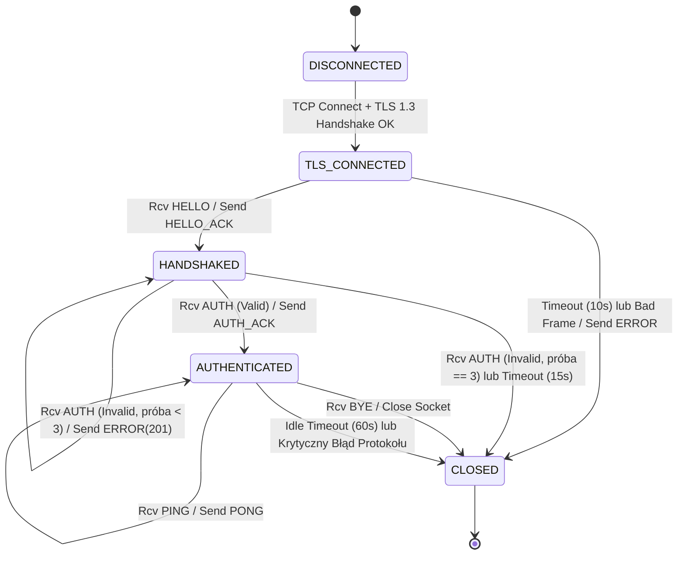
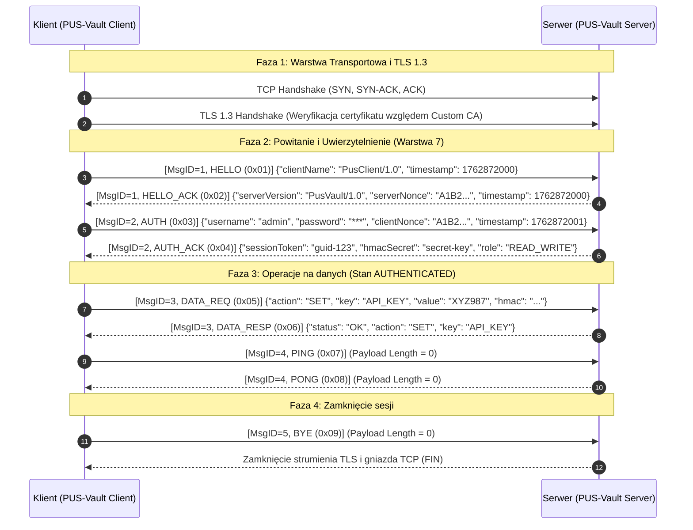
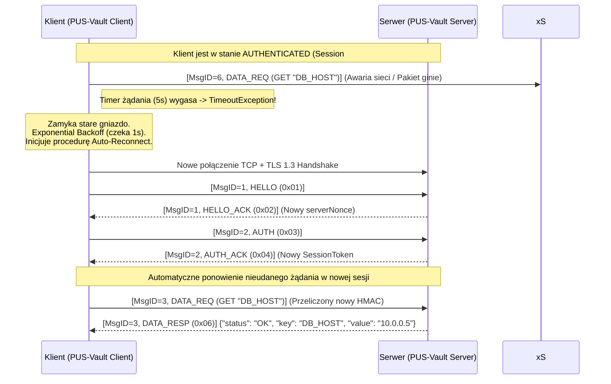

# Programowanie Usług Sieciowych - Projekt Grupowy (Etap 1)
## Specyfikacja Techniczna Autorskiego Protokołu Sieciowego: **PVSP (PUS-Vault Secret Protocol)**

* **Przedmiot:** Programowanie Usług Sieciowych (PUS)
* **Wersja protokołu:** `1.0` (`0x01`)
* **Zespół projektowy:**
  * Kacper Gumulak
  * Damian Judka

---

## 1. Cel protokołu i zakres

### 1.1. Do czego służy protokół?
**PVSP (PUS-Vault Secret Protocol)** to stanowy, bezpieczny protokół warstwy aplikacji (warstwa 7 modelu ISO/OSI) zaprojektowany do zdalnego zarządzania poufnymi danymi konfiguracyjnymi oraz sekretami (wpisami typu klucz-wartość, ang. *Key-Value*) przechowywanymi w centralnym magazynie (**PUS-Vault**). 

Protokół umożliwia uwierzytelnionym klientom wykonywanie podstawowych operacji CRUD na sekretach:
* zapisywanie i aktualizację sekretu (`SET`),
* pobieranie wartości sekretu (`GET`),
* listowanie dostępnych kluczy (`LIST`),
* usuwanie wskazanego sekretu (`DELETE`).

### 1.2. Jakie problemy rozwiązuje?
Protokół PVSP adresuje cztery fundamentalne problemy występujące w niskopoziomowym programowaniu usług sieciowych:
1. **Brak granic wiadomości w strumieniu TCP (Framing / Partial Data):** Protokół TCP operuje na ciągłym strumieniu bajtów i nie zachowuje granic pakietów aplikacyjnych (zjawisko sklejania lub fragmentacji segmentów). PVSP rozwiązuje ten problem poprzez wprowadzenie deterministycznego, 12-bajtowego nagłówka binarnego zawierającego dokładną długość ładunku (`Payload Length`).
2. **Bezpieczna dystrybucja sekretów przez sieć niezaufaną:** Przesyłanie haseł lub kluczy API w postaci jawnej naraża system na podsłuch (sniffing) oraz modyfikację w locie (Man-in-the-Middle). PVSP wymusza szyfrowanie kanału (TLS 1.3) oraz uwierzytelnianie integralności każdej pojedynczej ramki z danymi (HMAC-SHA256).
3. **Ochrona przed atakami powtórzeniowymi (Replay Attacks) i duplikatami:** Dzięki ścisłej numeracji sekwencyjnej komunikatów (`Message ID`) oraz znacznikom czasu (`Timestamp`), serwer potrafi wykryć i odrzucić zduplikowane lub przechwycone i ponownie wysłane pakiety.
4. **Kontrola żywotności sesji i wykrywanie cichych rozłączeń (Half-Open Connections):** Zastosowanie jawnej maszyny stanów, mechanizmu `PING`/`PONG` (Keep-Alive) oraz rygorystycznych limitów czasu (Timeouts) zapobiega wyciekom zasobów po stronie serwera.

### 1.3. Model komunikacji
Protokół działa w klasycznym, scentralizowanym modelu **Klient-Serwer (Client-Server)**:
* **Serwer (PUS-Vault Server):** Pasywnie nasłuchuje na określonym porcie TCP, weryfikuje tożsamość klientów, utrzymuje stan sesji, wymusza reguły autoryzacji oraz zarządza magazynem sekretów.
* **Klient (PUS-Vault Client):** Aktywnie inicjuje połączenie sieciowe, przeprowadza proces powitania i uwierzytelnienia, a następnie wysyła synchroniczne żądania operacji na danych w schemacie *Request-Response* (Żądanie-Odpowiedź).

---

## 2. Założenia techniczne

### 2.1. Warstwa transportowa i zabezpieczeń kanału
* **Protokół transportowy:** **TCP** (Transmission Control Protocol) - gniazda strumieniowe (`SOCK_STREAM`) obsługiwane w trybie IPv4 oraz IPv6 (Dual-Stack).
* **Warstwa kryptograficzna kanału:** **TLS 1.3** (Transport Layer Security) zestawiany bezpośrednio po nawiązaniu połączenia TCP, z weryfikacją certyfikatu X.509 serwera względem prywatnego Urzędu Certyfikacji (**Custom CA**).
* **Domyślny port usługi:** `8443/TCP`.

### 2.2. Kodowanie wiadomości (Model Hybrydowy: Binarny + JSON)
W celu połączenia wysokiej wydajności parsowania buforów sieciowych z czytelnością struktur danych, protokół PVSP stosuje **kodowanie hybrydowe**:
1. **Nagłówek ramki (Header):** Stały rozmiar **12 bajtów**, kodowany **binarnie**. Wszystkie pola wielobajtowe zapisywane są w sieciowym porządku bajtów **Big-Endian (Network Byte Order)**.
2. **Ładunek (Payload):** Zmienny rozmiar (od `0` do `65536` bajtów), kodowany tekstowo w formacie **JSON** przy użyciu kodowania znaków **UTF-8** (bez znacznika BOM).

### 2.3. Założenia dotyczące niezawodności (Warstwa 4 vs Warstwa 7)
Podział odpowiedzialności pomiędzy systemowym stosem TCP/IP a autorskim protokołem aplikacyjnym PVSP przedstawia poniższa tabela:

| Zagadnienie | Co zapewnia warstwa transportowa (TCP + TLS 1.3) | Co zapewnia protokół aplikacyjny (PVSP - Warstwa 7) |
| :--- | :--- | :--- |
| **Podział na wiadomości** | Brak (ciągły strumień bajtów). | **Pełne ramkowanie (Framing)** na podstawie pola `Payload Length` w nagłówku binarnym (ochrona przed *partial reads*). |
| **Retransmisja i kolejność** | Gwarantuje kolejność bajtów i retransmisję zgubionych segmentów IP w ramach jednego połączenia. | Ponawianie całych żądań aplikacyjnych po rekonfiguracji/zerwaniu gniazda (mechanizm *Reconnect & Retry*). |
| **Wykrywanie duplikatów** | Odrzuca duplikaty segmentów TCP na poziomie jądra OS. | Wykrywa duplikaty logiczne (np. po ponownym wysłaniu żądania przez klienta) na podstawie pola `Message ID`. |
| **Integralność i poufność** | Szyfrowanie strumienia (AES-256-GCM) i integralność rekordów TLS. | Dodatkowa weryfikacja integralności i autentyczności ładunku za pomocą podpisu `HMAC-SHA256` powiązanego z sesją użytkownika. |
| **Wykrywanie awarii łącza** | Zależne od długich, systemowych timerów TCP. | Aktywne wykrywanie martwych połączeń za pomocą ramek `PING`/`PONG` oraz sztywnych timeoutów aplikacyjnych. |

---

## 3. Struktura komunikatów

### 3.1. Budowa ramki protokołu (Binarny Nagłówek + JSON Payload)
Każdy komunikat przesyłany przez gniazdo składa się z 12-bajtowego nagłówka binarnego oraz opcjonalnego ładunku JSON:

```text
 0                   1                   2                   3
 0 1 2 3 4 5 6 7 8 9 0 1 2 3 4 5 6 7 8 9 0 1 2 3 4 5 6 7 8 9 0 1
+-+-+-+-+-+-+-+-+-+-+-+-+-+-+-+-+-+-+-+-+-+-+-+-+-+-+-+-+-+-+-+-+
|      Magic Bytes (0x5053)     | Version (0x01)|  Message Type |  [Bajty 0..3]
+-+-+-+-+-+-+-+-+-+-+-+-+-+-+-+-+-+-+-+-+-+-+-+-+-+-+-+-+-+-+-+-+
|                   Message ID (uint32, Big-Endian)             |  [Bajty 4..7]
+-+-+-+-+-+-+-+-+-+-+-+-+-+-+-+-+-+-+-+-+-+-+-+-+-+-+-+-+-+-+-+-+
|                 Payload Length (uint32, Big-Endian)           |  [Bajty 8..11]
+-+-+-+-+-+-+-+-+-+-+-+-+-+-+-+-+-+-+-+-+-+-+-+-+-+-+-+-+-+-+-+-+
|                                                               |
|                  JSON Payload (UTF-8, 0..65536 B)             |  [Bajty 12..N]
|                                                               |
+-+-+-+-+-+-+-+-+-+-+-+-+-+-+-+-+-+-+-+-+-+-+-+-+-+-+-+-+-+-+-+-+
```

#### Specyfikacja pól nagłówka binarnego (12 bajtów - wszystkie pola wymagane):
* **`Magic Bytes`** (2 bajty, `uint16`, offset `0`): Stała sygnatura protokołu `0x50 0x53` (znaki ASCII `"PS"` od *PUS*). Pozwala na natychmiastową synchronizację strumienia i odrzucenie obcego ruchu sieciowego.
* **`Version`** (1 bajt, `uint8`, offset `2`): Wersja protokołu. Aktualnie jedyną wspieraną wartością jest `0x01`.
* **`Message Type`** (1 bajt, `uint8`, offset `3`): Kod określający typ komunikatu (zgodnie z punktem 3.2).
* **`Message ID`** (4 bajty, `uint32`, offset `4`): Unikalny, ściśle rosnący numer sekwencyjny wiadomości nadawany przez klienta (zaczynając od `1`). W odpowiedziach serwera pole to przyjmuje wartość `Message ID` żądania, na które serwer odpowiada (korelacja *Request-Response*).
* **`Payload Length`** (4 bajty, `uint32`, offset `8`): Rozmiar ładunku JSON w bajtach. Maksymalna dopuszczalna wartość wynosi `65536` (64 KB). Dla ramek bez ładunku (np. `PING`) wynosi `0`.

### 3.2. Typy wiadomości (`Message Type`)

| Kod (HEX) | Nazwa typu | Kierunek | Opis przeznaczenia |
| :---: | :--- | :---: | :--- |
| `0x01` | **`HELLO`** | Klient $\rightarrow$ Serwer | Inicjalizacja sesji aplikacyjnej, przedstawienie identyfikatora klienta. |
| `0x02` | **`HELLO_ACK`** | Serwer $\rightarrow$ Klient | Potwierdzenie nawiązania sesji, przekazanie losowego `ServerNonce` do logowania. |
| `0x03` | **`AUTH`** | Klient $\rightarrow$ Serwer | Żądanie uwierzytelnienia użytkownika (login oraz poświadczenia). |
| `0x04` | **`AUTH_ACK`** | Serwer $\rightarrow$ Klient | Potwierdzenie autoryzacji, wydanie `SessionToken` oraz klucza `HmacSecret`. |
| `0x05` | **`DATA_REQ`** | Klient $\rightarrow$ Serwer | Żądanie wykonania operacji na magazynie sekretów (`GET`, `SET`, `LIST`, `DELETE`). |
| `0x06` | **`DATA_RESP`** | Serwer $\rightarrow$ Klient | Odpowiedź zawierająca wynik operacji `DATA_REQ` (np. pobrany sekret lub potwierdzenie zapisu). |
| `0x07` | **`PING`** | Obie strony | Komunikat kontrolny utrzymania połączenia (*Keep-Alive*). |
| `0x08` | **`PONG`** | Obie strony | Odpowiedź potwierdzająca aktywność węzła po otrzymaniu `PING`. |
| `0x09` | **`BYE`** | Obie strony | Sygnalizacja poprawnego, zamierzonego zamknięcia sesji aplikacyjnej. |
| `0xFF` | **`ERROR`** | Serwer $\rightarrow$ Klient | Komunikat błędu zawierający kod numeryczny, nazwę błędu oraz opis diagnostyczny. |

### 3.3. Pola wiadomości w ładunku JSON (Wymagane i Opcjonalne)

W zależności od typu wiadomości (`Message Type`), ładunek JSON posiada następującą strukturę pól:

1. **`HELLO` (`0x01`):**
   * `clientName` *(string, wymagane)* - nazwa i wersja aplikacji klienckiej.
   * `timestamp` *(long, wymagane)* - aktualny czas Unix (w sekundach UTC).
2. **`HELLO_ACK` (`0x02`):**
   * `serverVersion` *(string, wymagane)* - identyfikator serwera.
   * `serverNonce` *(string, wymagane)* - losowy ciąg 16 bajtów (w formacie HEX) wygenerowany przez serwer na potrzeby zabezpieczenia logowania.
   * `timestamp` *(long, wymagane)* - czas serwera (w sekundach UTC).
3. **`AUTH` (`0x03`):**
   * `username` *(string, wymagane)* - nazwa użytkownika (np. `"admin"` lub `"reader"`).
   * `password` *(string, wymagane)* - hasło lub klucz API użytkownika.
   * `clientNonce` *(string, wymagane)* - przepisana wartość `serverNonce` otrzymana w `HELLO_ACK` (dowód świeżości sesji).
   * `timestamp` *(long, wymagane)* - czas wysłania żądania.
4. **`AUTH_ACK` (`0x04`):**
   * `sessionToken` *(string, wymagane)* - unikalny identyfikator sesji (GUID).
   * `hmacSecret` *(string, wymagane)* - wygenerowany dla danej sesji klucz symetryczny (32 bajty w Base64/HEX) służący do podpisywania kolejnych ramek `DATA_REQ`.
   * `role` *(string, wymagane)* - przyznana rola autoryzacyjna (`"READ_WRITE"` lub `"READ_ONLY"`).
5. **`DATA_REQ` (`0x05`):**
   * `sessionToken` *(string, wymagane)* - token aktywnej sesji.
   * `action` *(string, wymagane)* - typ operacji: `"SET"`, `"GET"`, `"LIST"` lub `"DELETE"`.
   * `key` *(string, opcjonalne)* - nazwa klucza sekretu (wymagane dla `"SET"`, `"GET"`, `"DELETE"`; pomijane dla `"LIST"`).
   * `value` *(string, opcjonalne)* - wartość sekretu (wymagane wyłącznie dla akcji `"SET"`).
   * `timestamp` *(long, wymagane)* - czas wygenerowania żądania (ochrona Anti-Replay).
   * `hmac` *(string, wymagane)* - podpis `HMAC-SHA256` w formacie HEX wyliczony ze wzoru: `HMAC_SHA256(hmacSecret, "{MessageID}|{sessionToken}|{action}|{key}|{value}|{timestamp}")`.
6. **`DATA_RESP` (`0x06`):**
   * `status` *(string, wymagane)* - `"OK"`.
   * `action` *(string, wymagane)* - echo wykonanej akcji.
   * `key` *(string, opcjonalne)* - nazwa klucza, którego dotyczyła operacja.
   * `value` *(string, opcjonalne)* - zwrócona wartość sekretu (dla `"GET"`).
   * `keys` *(array of strings, opcjonalne)* - lista wszystkich kluczy (dla `"LIST"`).
   * `timestamp` *(long, wymagane)* - czas odpowiedzi serwera.
7. **`PING` (`0x07`), `PONG` (`0x08`), `BYE` (`0x09`):**
   * Mogą być przesyłane z pustym ładunkiem (`Payload Length = 0`).
8. **`ERROR` (`0xFF`):**
   * `errorCode` *(int, wymagane)* - numeryczny kod błędu (zgodnie z sekcją 6.1).
   * `errorName` *(string, wymagane)* - symboliczna nazwa błędu.
   * `message` *(string, wymagane)* - czytelny opis przyczyny błędu (bez ujawniania wrażliwych danych wewnętrznych serwera).
   * `timestamp` *(long, wymagane)* - czas wystąpienia błędu.

### 3.4. Przykładowe ramki (Reprezentacja HEX + JSON)

#### Przykład 1: Ramka `PING` (`0x07`) - bez ładunku JSON
* `Magic`: `0x50 0x53`, `Version`: `0x01`, `Type`: `0x07` (`PING`), `Message ID`: `5`, `Payload Length`: `0`.
```text
HEX Nagłówka (12 bajtów): 50 53 01 07 00 00 00 05 00 00 00 00
Payload (0 bajtów):       [brak]
```

#### Przykład 2: Ramka `DATA_REQ` (`0x05`) - pobranie sekretu (`GET`)
* `Magic`: `0x50 0x53`, `Version`: `0x01`, `Type`: `0x05` (`DATA_REQ`), `Message ID`: `3`, `Payload Length`: `189` (`0x000000BD`).
```text
HEX Nagłówka (12 bajtów): 50 53 01 05 00 00 00 03 00 00 00 BD
Payload JSON (189 bajtów UTF-8):
{
  "sessionToken": "a1b2c3d4-e5f6-7890-abcd-ef1234567890",
  "action": "GET",
  "key": "DB_PASSWORD",
  "timestamp": 1762872000,
  "hmac": "9f86d081884c7d659a2feaa0c55ad015a3bf4f1b2b0b822cd15d6c15b0f00a08"
}
```

### 3.5. Walidacja (Co jest błędem formatu?)
Odbiorca uznaje komunikat za niepoprawny składniowo lub strukturalnie w następujących przypadkach:
1. Pierwsze dwa bajty nagłówka są różne od `0x50 0x53` (`ERR_BAD_MAGIC`).
2. Bajt wersji jest różny od `0x01` (`ERR_UNSUPPORTED_VERSION`).
3. Bajt `Message Type` nie należy do zbioru zdefiniowanych identyfikatorów `{0x01..0x09, 0xFF}` (`ERR_UNKNOWN_MSG_TYPE`).
4. Wartość `Payload Length` przekracza maksymalny dopuszczalny limit `65536` bajtów (`ERR_PAYLOAD_TOO_LARGE`).
5. Strumień bajtów nie zawiera poprawnego dokumentu JSON w kodowaniu UTF-8, gdy `Payload Length > 0` (`ERR_INVALID_JSON`).
6. W obiekcie JSON brakuje któregokolwiek z pól oznaczonych dla danego typu wiadomości jako **wymagane** lub typy danych pól są niezgodne ze specyfikacją (`ERR_MISSING_FIELD`).

---

## 4. Model stanów i przebieg komunikacji

### 4.1. Opis cyklu życia sesji
Każde połączenie klienta na serwerze przechodzi przez ściśle zdefiniowaną maszynę stanów:
1. **`DISCONNECTED` $\rightarrow$ `TLS_CONNECTED` (Nawiązanie połączenia):** Klient inicjuje 3-etapowy handshake TCP (`SYN`, `SYN-ACK`, `ACK`), po czym natychmiast przeprowadza handshake TLS 1.3 i weryfikuje certyfikat serwera względem lokalnego `ca.crt`.
2. **`TLS_CONNECTED` $\rightarrow$ `HANDSHAKED` (Powitanie aplikacyjne):** Klient ma maksymalnie 10 sekund na wysłanie ramki `HELLO`. Serwer odpowiada ramką `HELLO_ACK` zawierającą `serverNonce` i przechodzi do stanu oczekiwania na logowanie.
3. **`HANDSHAKED` $\rightarrow$ `AUTHENTICATED` (Uwierzytelnienie i autoryzacja):** Klient przesyła poświadczenia w ramce `AUTH`. Po pozytywnej weryfikacji serwer generuje klucz sesyjny, odsyła `AUTH_ACK` i przenosi sesję do stanu autoryzowanego. W przypadku błędnego hasła serwer odsyła `ERROR (201)` i pozostaje w stanie `HANDSHAKED` (maksymalnie 3 próby logowania, po których połączenie jest zamykane).
4. **`AUTHENTICATED` (Wymiana danych i utrzymanie sesji):** Klient może wielokrotnie wysyłać żądania `DATA_REQ` (otrzymując `DATA_RESP` lub `ERROR`) oraz wymieniać pakiety `PING`/`PONG`.
5. **`AUTHENTICATED` $\rightarrow$ `CLOSED` (Zamknięcie sesji):** Klient (lub serwer) wysyła ramkę `BYE`, po czym następuje bezpieczne zamknięcie strumienia TLS oraz gniazda TCP (`FIN`).

### 4.2. Diagram stanów sesji (Mermaid)



### 4.3. Diagram sekwencji dla pełnej sesji (Mermaid)



### 4.4. Zasady timeoutów, retransmisji (Retry) oraz Keep-Alive

| Mechanizm | Wartość | Opis zachowania |
| :--- | :---: | :--- |
| **Handshake / Auth Timeout** | `15 sekund` | Jeśli po nawiązaniu połączenia TLS klient nie ukończy faz `HELLO` oraz `AUTH` w ciągu 15 sekund, serwer wysyła `ERROR (105)` i zamyka gniazdo. |
| **Request Timeout (Klient)** | `5 sekund` | Czas, jaki klient oczekuje na odpowiedź (`DATA_RESP`, `PONG` lub `ERROR`) po wysłaniu żądania. Po przekroczeniu limitu klient uznaje połączenie za uszkodzone. |
| **Keep-Alive Interval (`PING`)** | `20 sekund` | W przypadku braku aktywności użytkownika klient automatycznie wysyła ramkę `PING` co 20 sekund w celu podtrzymania sesji. |
| **Session Idle Timeout (Serwer)**| `60 sekund` | Maksymalny czas bezczynności klienta (brak jakichkolwiek ramek, w tym `PING`). Po 60 sekundach serwer unieważnia `SessionToken` i zamyka gniazdo. |
| **Polityka Retry / Reconnect** | Maks. `3 próby` | W przypadku utraty połączenia lub timeoutu żądania, klient podejmuje do 3 prób ponownego połączenia z wykładniczym opóźnieniem (*Exponential Backoff*: `1s`, `2s`, `4s`), odtwarza sesję (`HELLO` $\rightarrow$ `AUTH`) i ponawia nieudane żądanie. |

---

## 5. Bezpieczeństwo komunikacji

Protokół PVSP wdraża architekturę **Defense-in-Depth (obrona w głąb)**, łącząc zabezpieczenia warstwy transportowej z kryptografią warstwy aplikacyjnej.

### 5.1. Realizacja mechanizmów bezpieczeństwa

1. **Poufność (Confidentiality):**
   * Cały ruch protokołu PVSP jest tunelowany wewnątrz szyfrowanego strumienia **TLS 1.3** (szyfr blokowy `AES-256-GCM` z wymianą kluczy `ECDHE`).
   * Klient rygorystycznie weryfikuje certyfikat X.509 serwera za pomocą własnego urzędu certyfikacji (**Custom Root CA** - `X509ChainTrustMode.CustomRootTrust`), eliminując ryzyko podstawienia fałszywego serwera.
2. **Integralność (Integrity):**
   * Poza integralnością rekordów TLS, każda operacja `DATA_REQ` w warstwie 7 jest chroniona kodem uwierzytelniającym wiadomość **HMAC-SHA256**.
   * Klucz `hmacSecret` jest generowany dynamicznie przez serwer (CSPRNG - kryptograficznie bezpieczny generator liczb losowych) podczas logowania i przypisany wyłącznie do jednej sesji.
   * Modyfikacja choćby jednego znaku w polach `action`, `key`, `value`, `timestamp` lub `Message ID` powoduje niezgodność wyliczonego skrótu HMAC po stronie serwera i natychmiastowe odrzucenie pakietu.
3. **Uwierzytelnienie (Authentication):**
   *Dwuetapowe: serwer uwierzytelnia się certyfikatem X.509 podczas fazy TLS, natomiast klient uwierzytelnia się w fazie `AUTH` parą `username` + `password` powiązaną z losowym wyzwaniem `serverNonce` (ochrona przed powtórzeniem samej ramki logowania). Po zalogowaniu tożsamość klienta reprezentuje krótkożyjący `sessionToken`.
4. **Autoryzacja (Authorization - RBAC):**
   * Protokół definiuje kontrolę dostępu opartą na rolach (*Role-Based Access Control*):
     * Rola **`READ_ONLY`** - uprawnia wyłącznie do wywoływania akcji `"GET"` oraz `"LIST"`. Próba wywołania `"SET"` lub `"DELETE"` kończy się błędem `ERR_FORBIDDEN (203)`.
     * Rola **`READ_WRITE`** - uprawnia do wszystkich operacji (`"GET"`, `"LIST"`, `"SET"`, `"DELETE"`).
5. **Ochrona przed atakami powtórzeniowymi (Anti-Replay Protection):**
   * Zrealizowana poprzez kombinację trzech elementów:
     1. **`serverNonce`** w fazie logowania `HELLO_ACK` $\rightarrow$ `AUTH`.
     2. **Monotonicznie rosnący `Message ID`** w nagłówku binarnym - serwer zapamiętuje `LastProcessedMessageId` dla każdej sesji. Każda ramka z `Message ID < LastProcessedMessageId` jest bezwzględnie odrzucana jako atak Replay.
     3. **Okno czasowe `timestamp`** - serwer akceptuje wyłącznie wiadomości, których znacznik czasu nie różni się od czasu zegara serwera o więcej niż **$\pm 30\text{ sekund}$**.

### 5.2. Podstawowy model zagrożeń (Threat Model - STRIDE)

| Zagrożenie | Wektor ataku | Mechanizm mitygacji w protokole PVSP |
| :--- | :--- | :--- |
| **Podsłuch (Eavesdropping / Sniffing)** | Przechwytywanie pakietów narzędziem `tcpdump` / Wireshark w celu odczytania haseł i sekretów. | Obowiązkowe szyfrowanie całego kanału za pomocą **TLS 1.3 (AES-256)**. |
| **Man-in-the-Middle (MitM)** | Podstawienie fałszywego serwera przechwytującego połączenie klienta. | Weryfikacja łańcucha certyfikatu X.509 serwera względem lokalnego, zaufanego certyfikatu **Custom CA (`ca.crt`)**. |
| **Modyfikacja danych (Tampering)** | Próba zmiany klucza lub wartości sekretu w locie lub manipulacja pamięcią bufora. | Weryfikacja podpisu **HMAC-SHA256** obliczanego z kluczowych pól nagłówka i ładunku JSON. |
| **Atak powtórzeniowy (Replay Attack)** | Nagranie poprawnej ramki `DATA_REQ (DELETE)` i ponowne wysłanie jej do serwera. | Walidacja rosnącego numeru **`Message ID`**, okna czasowego **`timestamp` ($\pm 30\text{s}$)** oraz unikalnego klucza sesji. |
| **Nieautoryzowana eskalacja uprawnień** | Użytkownik z kontem tylko do odczytu próbuje nadpisać lub usunąć sekret w magazynie. | Weryfikacja roli przypisanej do `sessionToken` po stronie serwera (**RBAC**) przed wykonaniem akcji. |
| **Denial of Service (DoS) / Wyciek pamięci**| Wysłanie złośliwego nagłówka z `Payload Length = 2 GB` w celu alokacji całej pamięci RAM serwera. | Sztywny limit **`MAX_PAYLOAD_SIZE = 64 KB`**, limit połączeń, *Rate Limiting* oraz krótkie timeouty sesji. |

---

## 6. Obsługa błędów i awarii połączenia

### 6.1. Tabela kodów błędów (`ERROR` - `0xFF`)

Kody błędów zostały podzielone na kategorie tematyczne (1xx - błędy warstwy protokołu i formatu, 2xx - błędy bezpieczeństwa i stanu, 3xx - błędy świeżości i spójności, 4xx - błędy logiki aplikacji i limitów):

| Kod | Symboliczna nazwa (`errorName`) | Znaczenie / Przyczyna wystąpienia | Czy zamyka połączenie? |
| :-: | :--- | :--- | :---: |
| `100` | `ERR_BAD_MAGIC` | Pierwsze 2 bajty nagłówka są różne od `0x50 0x53` (utrata synchronizacji strumienia). | **TAK** (Natychmiast) |
| `101` | `ERR_UNSUPPORTED_VERSION`| Wersja protokołu w nagłówku jest różna od `0x01`. | **TAK** (Natychmiast) |
| `102` | `ERR_UNKNOWN_MSG_TYPE` | Nieznany identyfikator `Message Type` w nagłówku binarnym. | **TAK** (Natychmiast) |
| `103` | `ERR_PAYLOAD_TOO_LARGE` | Pole `Payload Length` przekracza limit `65536` bajtów (64 KB). | **TAK** (Natychmiast) |
| `104` | `ERR_INVALID_JSON` | Ładunek nie jest poprawnym formatem JSON UTF-8 lub brakuje wymaganych pól. | NIE |
| `105` | `ERR_TIMEOUT` | Przekroczono dopuszczalny czas na autoryzację lub czas bezczynności sesji. | **TAK** |
| `201` | `ERR_AUTH_FAILED` | Nieprawidłowy login, hasło lub niezgodny `clientNonce` podczas logowania. | Po 3 nieudanych próbach |
| `202` | `ERR_UNAUTHORIZED_STATE` | Próba wysłania komunikatu niezgodnego z aktualnym stanem sesji (np. `DATA_REQ` przed `AUTH`). | NIE |
| `203` | `ERR_FORBIDDEN` | Brak uprawnień roli (np. użytkownik `READ_ONLY` wywołuje akcję `SET` lub `DELETE`). | NIE |
| `204` | `ERR_INVALID_HMAC` | Podpis `HMAC-SHA256` wiadomości jest nieprawidłowy (naruszenie integralności). | **TAK** (Albo ostrzeżenie) |
| `301` | `ERR_REPLAY_DETECTED` | Wykryto przestarzały `timestamp` ($>30\text{s}$) lub `Message ID` mniejszy od ostatniego. | **TAK** |
| `302` | `ERR_DUPLICATE_MSG` | Otrzymano duplikat ostatnio przetworzonego `Message ID`. | NIE (Zwraca ost. wynik) |
| `404` | `ERR_KEY_NOT_FOUND` | Żądany klucz sekretu nie istnieje w magazynie (dla operacji `GET` lub `DELETE`). | NIE |
| `429` | `ERR_RATE_LIMIT` | Przekroczono dopuszczalną liczbę żądań na sekundę dla danej sesji. | NIE (Odrzuca żądanie) |
| `500` | `ERR_INTERNAL_SERVER` | Niespodziewany błąd wewnętrzny serwera podczas przetwarzania żądania. | NIE |

### 6.2. Zachowanie po błędach składni i protokołu
* **Błędy krytyczne desynchronizacji strumienia (`100`, `101`, `102`, `103`):** Jeżeli nagłówek binarny jest uszkodzony (np. błędne `Magic Bytes` lub zbyt duży `Payload Length`), serwer nie wie, gdzie kończy się bieżąca ramka w strumieniu TCP. W takiej sytuacji serwer natychmiast odsyła ramkę `ERROR` z odpowiednim kodem, zrywa sesję TLS i zamyka gniazdo (`Socket.Close()`), chroniąc proces przed atakiem przepełnienia bufora.
* **Błędy logiczne i błędy warstwy JSON (`104`, `202`, `203`, `404`, `429`):** Ponieważ nagłówek binarny został odczytany poprawnie i serwer pobrał z bufora dokładnie `Payload Length` bajtów, strumień TCP zachowuje pełną synchronizację. Serwer odsyła ramkę `ERROR`, ale **utrzymuje otwarte połączenie**, pozwalając klientowi na wysłanie kolejnego, poprawnego żądania.

### 6.3. Timeout połączenia oraz utrata połączenia w trakcie sesji
* **Po stronie serwera:** Na gnieździe klienta ustawiany jest limit czasu odczytu (`ReceiveTimeout`). Jeśli klient nagle straci zasilanie lub połączenie sieciowe (brak pakietu `FIN`) i przez 60 sekund nie prześle ramki `PING` ani `DATA_REQ`, wywołanie odczytu na serwerze zgłasza wyjątek `SocketException (TimedOut)` / `IOException`. Serwer przechwytuje wyjątek, usuwa sesję z pamięci, loguje zdarzenie i zwalnia deskryptor gniazda. Note: Dane zapisane wcześniej w magazynie `PUS-Vault` pozostają bezpieczne (atomowość operacji).
* **Po stronie klienta (Mechanizm Auto-Recovery):** Gdy klient wykryje zerwanie połączenia (metoda `Read` zwróci `0` bajtów lub rzuci wyjątek timeoutu po 5 sekundach), przechodzi w procedurę odzyskiwania:
  1. Zamyka stare gniazdo TCP.
  2. Odczekuje czas wyznaczony przez algorytm *Exponential Backoff* (`1s`, `2s`, `4s`).
  3. Tworzy nowe gniazdo, zestawia nowy kanał TLS 1.3 i automatycznie przeprowadza sekwencję `HELLO` $\rightarrow$ `AUTH`, uzyskując nowy `sessionToken`.
  4. Ponawia przerwane żądanie `DATA_REQ`.

### 6.4. Obsługa częściowych danych (Partial Data) oraz duplikatów
1. **Częściowe dane / Fragmentacja TCP (Partial Reads):**
   W sieciach rozległych pojedyncza ramka PVSP (np. 12 bajtów nagłówka + 500 bajtów JSON) może dotrzeć do karty sieciowej w kilku osobnych segmentach TCP (np. najpierw 5 bajtów, potem 200 bajtów, a na końcu reszta). 
   * **Rozwiązanie w protokole:** Zarówno klient, jak i serwer stosują pętlę dokładnego odczytu bufora (`ReadExactly`):
     * Krok 1: Czytaj ze strumienia w pętli `while (totalRead < 12)` aż do skompletowania pełnych 12 bajtów nagłówka binarnego.
     * Krok 2: Zdekoduj z bajtów `8..11` liczbę `payloadLength`.
     * Krok 3: Zaalokuj bufor o rozmiarze `payloadLength` i czytaj w pętli `while (totalRead < payloadLength)` aż do odebrania kompletnego dokumentu JSON.
2. **Duplikaty wiadomości (Idempotentność):**
   Jeśli odpowiedź `DATA_RESP` zaginie w wyniku chwilowego problemu sieciowego, klient może ponowić to samo żądanie z tym samym `Message ID`. Serwer przechowuje w kontekście sesji ostatni przetworzony numer `LastMessageId` oraz keszuje ostatnią wygenerowaną odpowiedź (`LastResponseBytes`). Jeśli otrzyma ramkę o `Message ID == LastMessageId`, nie wykonuje operacji ponownie, lecz odsyła zapisaną odpowiedź (lub informację o duplikacie `302`).

### 6.5. Limity i ochrona przed nadużyciami (Abuse Protection)
* **Maksymalny rozmiar komunikatu (`MAX_PAYLOAD_SIZE`):** `65 536 bajtów` (64 KB). Każda ramka deklarująca większy rozmiar w nagłówku binarnym jest odrzucana przed alokacją pamięci pod bufor JSON.
* **Maksymalna długość klucza sekretu:** `128 znaków` (znaki alfanumeryczne oraz `_`, `-`, `.`).
* **Maksymalna długość wartości sekretu:** `32 768 znaków` (32 KB).
* **Rate Limiting (Ograniczanie częstotliwości żądań):** Maksymalnie **20 żądań na 10 sekund** w ramach jednej sesji (algorytm *Sliding Window* / *Token Bucket*). Przekroczenie limitu skutkuje odrzuceniem nadmiarowych żądań kodem `429 ERR_RATE_LIMIT`.
* **Limit prób uwierzytelnienia:** Maksymalnie **3 nieudane próby `AUTH`** na jedno połączenie TCP.

---

## 7. Przykładowe scenariusze komunikacji

Poniżej przedstawiono trzy kompletne scenariusze z dokładną zawartością pól nagłówków binarnych oraz ładunków JSON.

### Scenariusz 1: Poprawna sesja (Logowanie, zapis sekretu `SET`, odczyt `GET`, zamknięcie `BYE`)

**Krok 1 - Klient wysyła `HELLO`:**
* **Nagłówek binarny:** `Magic=0x5053` | `Ver=0x01` | `Type=0x01 (HELLO)` | `MsgID=1` | `Len=58`
* **Payload JSON:**
```json
{"clientName":"PusVault-CLI/1.0","timestamp":1762872000}
```

**Krok 2 - Serwer odpowiada `HELLO_ACK`:**
* **Nagłówek binarny:** `Magic=0x5053` | `Ver=0x01` | `Type=0x02 (HELLO_ACK)` | `MsgID=1` | `Len=98`
* **Payload JSON:**
```json
{"serverVersion":"PusVault-Server/1.0","serverNonce":"4F8A9C12E3B07165","timestamp":1762872000}
```

**Krok 3 - Klient wysyła `AUTH`:**
* **Nagłówek binarny:** `Magic=0x5053` | `Ver=0x01` | `Type=0x03 (AUTH)` | `MsgID=2` | `Len=106`
* **Payload JSON:**
```json
{"username":"admin","password":"SecretAdminPassword!","clientNonce":"4F8A9C12E3B07165","timestamp":1762872001}
```

**Krok 4 - Serwer odpowiada `AUTH_ACK`:**
* **Nagłówek binarny:** `Magic=0x5053` | `Ver=0x01` | `Type=0x04 (AUTH_ACK)` | `MsgID=2` | `Len=126`
* **Payload JSON:**
```json
{"sessionToken":"f47ac10b-58cc-4372-a567-0e02b2c3d479","hmacSecret":"K7gNU3sdo+OL0wNhqoVWhr3g6s1xYv72ol/pe/Unols=","role":"READ_WRITE"}
```

**Krok 5 - Klient zapisuje sekret (`DATA_REQ` - `SET`):**
* **Nagłówek binarny:** `Magic=0x5053` | `Ver=0x01` | `Type=0x05 (DATA_REQ)` | `MsgID=3` | `Len=216`
* **Payload JSON:**
```json
{
  "sessionToken": "f47ac10b-58cc-4372-a567-0e02b2c3d479",
  "action": "SET",
  "key": "STRIPE_API_KEY",
  "value": "sk_live_987654321",
  "timestamp": 1762872005,
  "hmac": "3c59dc048e8850243be8079a5c74d0797843299a4b009c8a2c8a2c12e0d411c2"
}
```

**Krok 6 - Serwer potwierdza zapis (`DATA_RESP`):**
* **Nagłówek binarny:** `Magic=0x5053` | `Ver=0x01` | `Type=0x06 (DATA_RESP)` | `MsgID=3` | `Len=78`
* **Payload JSON:**
```json
{"status":"OK","action":"SET","key":"STRIPE_API_KEY","timestamp":1762872005}
```

**Krok 7 - Klient pobiera zapisany sekret (`DATA_REQ` - `GET`):**
* **Nagłówek binarny:** `Magic=0x5053` | `Ver=0x01` | `Type=0x05 (DATA_REQ)` | `MsgID=4` | `Len=188`
* **Payload JSON:**
```json
{
  "sessionToken": "f47ac10b-58cc-4372-a567-0e02b2c3d479",
  "action": "GET",
  "key": "STRIPE_API_KEY",
  "timestamp": 1762872008,
  "hmac": "8a12f4c9091283a7c812e90123b12938120398120938102938102938102938ab"
}
```

**Krok 8 - Serwer zwraca sekret (`DATA_RESP`):**
* **Nagłówek binarny:** `Magic=0x5053` | `Ver=0x01` | `Type=0x06 (DATA_RESP)` | `MsgID=4` | `Len=106`
* **Payload JSON:**
```json
{"status":"OK","action":"GET","key":"STRIPE_API_KEY","value":"sk_live_987654321","timestamp":1762872008}
```

**Krok 9 - Klient kończy sesję (`BYE`):**
* **Nagłówek binarny:** `Magic=0x5053` | `Ver=0x01` | `Type=0x09 (BYE)` | `MsgID=5` | `Len=0`
* **Payload JSON:** *[Brak - 0 bajtów, serwer zamyka gniazdo]*

---

### Scenariusz 2: Przypadki błędów bezpieczeństwa (Pominięcie autoryzacji, brak uprawnień roli, naruszenie HMAC)

**Przypadek 2A - Klient próbuje pobrać dane przed zalogowaniem (w stanie `HANDSHAKED`):**
1. **Klient $\rightarrow$ Serwer:** `Magic=0x5053` | `Ver=0x01` | `Type=0x05 (DATA_REQ)` | `MsgID=2` | `Len=82`
   ```json
   {"sessionToken":"","action":"LIST","timestamp":1762872100,"hmac":"0000"}
   ```
2. **Serwer $\rightarrow$ Klient:** `Magic=0x5053` | `Ver=0x01` | `Type=0xFF (ERROR)` | `MsgID=2` | `Len=128`
   ```json
   {
     "errorCode": 202,
     "errorName": "ERR_UNAUTHORIZED_STATE",
     "message": "Client must complete AUTH handshake before sending DATA_REQ.",
     "timestamp": 1762872100
   }
   ```

**Przypadek 2B - Użytkownik z rolą `READ_ONLY` próbuje usunąć sekret (`DELETE`):**
1. **Klient $\rightarrow$ Serwer:** `Magic=0x5053` | `Ver=0x01` | `Type=0x05 (DATA_REQ)` | `MsgID=3` | `Len=191`
   *(Poprawny token dla roli `READ_ONLY` i poprawny podpis HMAC, akcja `"DELETE"` na kluczu `"STRIPE_API_KEY"`)*
2. **Serwer $\rightarrow$ Klient:** `Magic=0x5053` | `Ver=0x01` | `Type=0xFF (ERROR)` | `MsgID=3` | `Len=119`
   ```json
   {
     "errorCode": 203,
     "errorName": "ERR_FORBIDDEN",
     "message": "Insufficient permissions: role READ_ONLY cannot execute DELETE.",
     "timestamp": 1762872105
   }
   ```

**Przypadek 2C - Wykrycie modyfikacji ładunku / błędnego podpisu HMAC:**
1. **Klient $\rightarrow$ Serwer:** `Magic=0x5053` | `Ver=0x01` | `Type=0x05 (DATA_REQ)` | `MsgID=4` | `Len=185`
   *(Wartość klucza zmieniona w locie z `"PUBLIC_INFO"` na `"ROOT_PASS"`, przez co skrót `hmac` nie zgadza się z zawartością)*
2. **Serwer $\rightarrow$ Klient:** `Magic=0x5053` | `Ver=0x01` | `Type=0xFF (ERROR)` | `MsgID=4` | `Len=122`
   ```json
   {
     "errorCode": 204,
     "errorName": "ERR_INVALID_HMAC",
     "message": "Message integrity check failed (HMAC-SHA256 mismatch). Closing session.",
     "timestamp": 1762872110
   }
   ```
   *(Serwer unieważnia sesję i natychmiast zamyka gniazdo TCP).*

---

### Scenariusz 3: Błąd protokołu / Awaria połączenia i automatyczne odzyskiwanie sesji (Timeout & Reconnect)

