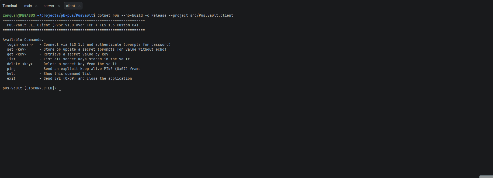
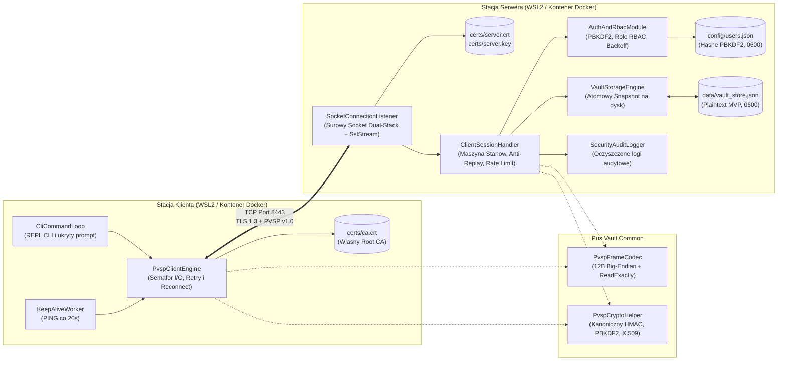
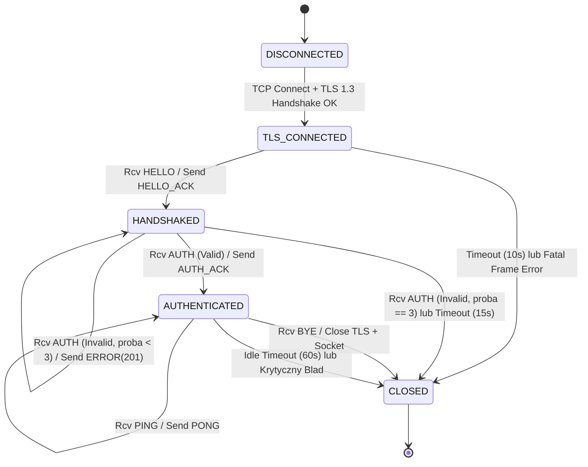
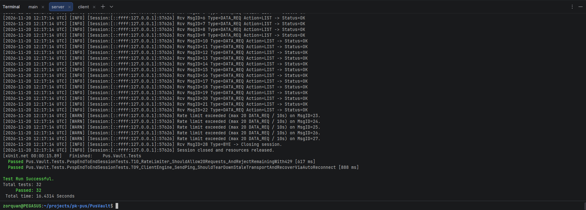
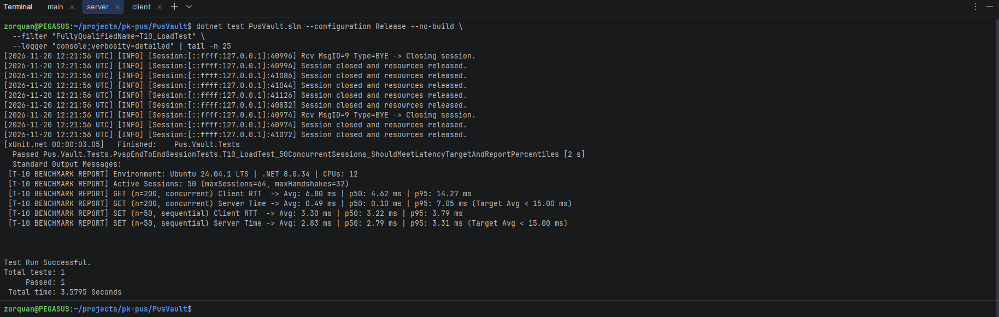
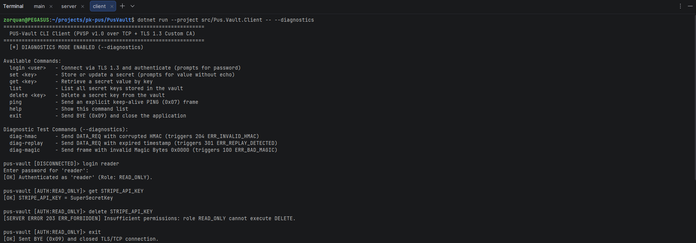
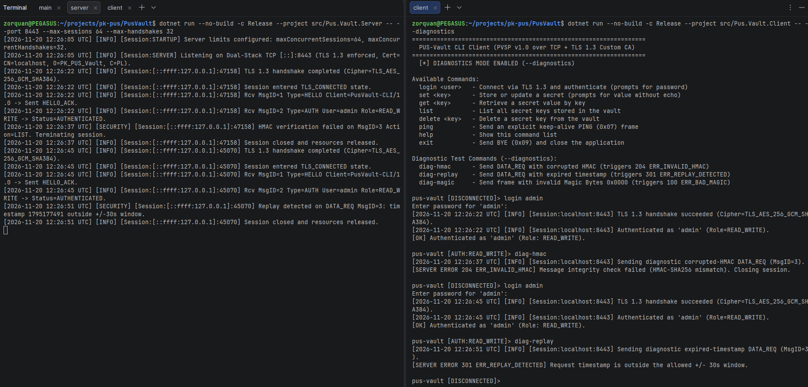
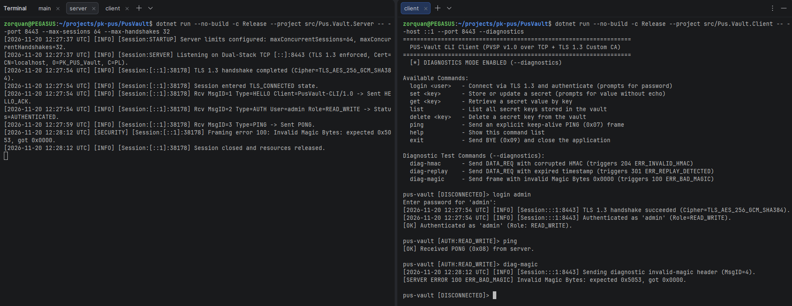

> 🌐 **Dokumentacja w dwóch językach / Documentation in two languages:**  
> 🇬🇧 **[English (README.md)](./README.md)** | 🇵🇱 **Polski (Aktualny)**

# PUS-Vault - Bezpieczny Menedżer Sekretów i Konfiguracji (PVSP v1.0)

[](https://dotnet.microsoft.com/)
[](https://learn.microsoft.com/en-us/dotnet/csharp/)
[](../Assets/projekt-protoko%C5%82u.pdf)
[](./src/Pus.Vault.Common/PvspCryptoHelper.cs)
[](./tests/Pus.Vault.Tests/)
[](https://github.com/zephir-x/pk-pus/actions/workflows/pus-vault-ci.yml)
[](./Dockerfile)
[](https://ubuntu.com/)

Stanowy, wielowątkowy menedżer sekretów i konfiguracji w architekturze Klient–Serwer, zrealizowany w **.NET 8 (C#)** w ramach przedmiotu **Programowanie Usług Sieciowych (PUS)**. Komunikacja odbywa się wyłącznie z wykorzystaniem autorskiego protokołu aplikacyjnego **PVSP v1.0 (PUS-Vault Secret Protocol)** bezpośrednio na surowych gniazdach strumieniowych `System.Net.Sockets.Socket` (TCP Dual-Stack IPv6 + IPv4-mapped), z obowiązkowym szyfrowaniem **TLS 1.3** (własny Urząd Certyfikacji - Custom Root CA) oraz kanonicznym uwierzytelnianiem wiadomości **HMAC-SHA256**.

---

## Spis treści

1. [Przegląd projektu](#1-przegląd-projektu)
2. [Architektura i struktura repozytorium](#2-architektura-i-struktura-repozytorium)
3. [Protokół PVSP v1.0 w pigułce](#3-protokół-pvsp-v10-w-pigułce)
4. [Wymagania środowiskowe](#4-wymagania-środowiskowe)
5. [Instrukcja uruchomienia](#5-instrukcja-uruchomienia)
6. [Komendy CLI i konfiguracja](#6-komendy-cli-i-konfiguracja)
7. [Testy automatyczne i raport wydajności](#7-testy-automatyczne-i-raport-wydajności)
8. [Scenariusze demonstracyjne na żywo](#8-scenariusze-demonstracyjne-na-żywo)
9. [Znane ograniczenia](#9-znane-ograniczenia)
10. [Autorzy i dokumentacja powiązana](#10-autorzy-i-dokumentacja-powiązana)

---

## 1. Przegląd projektu

**PUS-Vault** centralizuje poufne dane konfiguracyjne (klucze API, hasła bazodanowe, tokeny dostępowe) w jednym serwerowym magazynie typu klucz–wartość dostępnym przez interaktywnego klienta konsolowego CLI. Zamiast korzystać z wysokopoziomowych wrapperów sieciowych (`TcpClient`, `TcpListener`, `HttpClient`), cała komunikacja sieciowa oraz ramkowanie strumienia zostały zaimplementowane bezpośrednio na gniazdach `System.Net.Sockets.Socket` owiniętych w `SslStream`.

### Główne możliwości systemu
- **Niskopoziomowe gniazda Dual-Stack:** Pojedyncze gniazdo nasłuchujące IPv6 (`DualMode = true`) na porcie `8443/TCP`, obsługujące jednocześnie klientów IPv6 (`::1`) oraz IPv4 (`127.0.0.1` mapowane jako `::ffff:127.0.0.1`).
- **Hybrydowe ramkowanie (Binarny Nagłówek + JSON):** Stały **12-bajtowy nagłówek binarny Big-Endian** (`Magic=0x5053`, `Version=0x01`, `Type`, `MessageId`, `PayloadLength`) połączony ze ścisłym ładunkiem UTF-8 JSON oraz jawną pętlą odczytu `ReadExactly`, eliminującą problem fragmentacji TCP (*partial reads*).
- **Wielowarstwowe bezpieczeństwo (*Defense-in-Depth*):**
    - Obowiązkowy **TLS 1.3** z weryfikacją certyfikatu względem prywatnego **Custom Root CA** (`X509ChainTrustMode.CustomRootTrust`), walidacją nazwy hosta/SAN oraz rozszerzenia EKU `serverAuth`.
    - Przechowywanie haseł wyłącznie jako skróty **PBKDF2-HMAC-SHA256** (16-bajtowa losowa sól, 600 000 iteracji), jednorazowe wyzwanie `serverNonceEcho` oraz progresywny *backoff* przeciwko atakom *brute-force*.
    - Kanoniczne podpisy **HMAC-SHA256** per sesja (binarny format z prefiksami długości, porównanie stałoczasowe `FixedTimeEquals`), ściśle sekwencyjne `Message ID` i okno czasowe Anti-Replay $\pm 30\text{s}$.
    - Kontrola dostępu oparta na rolach **RBAC** (`READ_WRITE` vs `READ_ONLY`) oraz *Sliding Window Rate Limiter* (`20 DATA_REQ / 10s`).
- **Odporność i persystencja:** Serializowany, atomowy zapis magazynu (`vault_store.json.tmp` -> `Flush(true)` -> `File.Move` z uprawnieniami `0600`), wątek tła `PING`/`PONG` co 20s oraz reaktywny *Auto-Reconnect* (`1s`, `2s`, `4s`) ponawiający automatycznie wyłącznie bezpieczne odczyty `GET` i `LIST`.

> 📸 **Podgląd interaktywnej sesji CLI**  
> 

---

## 2. Architektura i struktura repozytorium

### Diagram komponentów i wdrożenia



### Drzewo katalogów i linki do kodu źródłowego

```text
PusVault/
├── PusVault.sln                             # Solucja .NET 8 spinająca wszystkie 4 projekty
├── Dockerfile                               # Wieloetapowy obraz (sdk:8.0 -> lekkie runtime:8.0 server/client)
├── docker-compose.yml                       # Izolowana sieć bridge, nazwane wolumeny, certyfikaty :ro
├── .dockerignore                            # Blokuje dodawanie certyfikatów, sekretów i danych do obrazów
├── .env.example                             # Szablon początkowych haseł dla uruchomienia w Dockerze
├── README.md / README-pl.md                 # Dwujęzyczna dokumentacja projektu (EN / PL)
├── scripts/
│   └── generate_certs.sh                    # Skrypt OpenSSL: Custom Root CA oraz certyfikat serwera (SAN + EKU)
├── src/
│   ├── Pus.Vault.Common/                    # Wspólna biblioteka protokołu PVSP v1.0 i kryptografii
│   │   ├── ErrorCodes.cs                    # Stałe protokołu, typy ramek, stany sesji i kody błędów (100-500)
│   │   ├── PvspModels.cs                    # Modele DTO JSON oraz rygorystyczny walidator UTF-8 i schematu
│   │   ├── PvspFrameCodec.cs                # Kodek 12B Big-Endian i pętla ReadExactlyLoopAsync
│   │   └── PvspCryptoHelper.cs              # Kanoniczny HMAC-SHA256, PBKDF2, CSPRNG, CustomRootTrust
│   ├── Pus.Vault.Server/                    # Wielowątkowy serwer magazynu TLS 1.3
│   │   ├── Program.cs                       # Punkt wejścia i konfiguracja startowa kont użytkowników
│   │   ├── SocketConnectionListener.cs      # Surowe gniazdo Dual-Stack TCP + SslStream TLS 1.3 + limity
│   │   ├── ClientSessionHandler.cs          # Maszyna stanów sesji, deadline'y, Anti-Replay, Rate Limiter
│   │   ├── AuthAndRbacModule.cs             # Weryfikacja PBKDF2, ochrona timingowa, backoff i kontrola ról
│   │   ├── VaultStorageEngine.cs            # Jedna blokada + atomowy zapis snapshotu na dysk
│   │   └── SecurityAuditLogger.cs           # Logger z ochroną przed Log Injection i rotacją pliku
│   └── Pus.Vault.Client/                    # Interaktywny klient CLI
│       ├── Program.cs                       # Parser flag startowych (--host, --port, --ca, --diagnostics)
│       ├── CliCommandLoop.cs                # Pętla REPL oraz ukryty odczyt haseł i sekretów bez echa
│       ├── PvspClientEngine.cs              # Semafor I/O, podpisywanie HMAC, reaktywny Auto-Reconnect
│       └── KeepAliveWorker.cs               # Wątek tła wysyłający PING co 20s bezczynności
└── tests/
    └── Pus.Vault.Tests/                     # Zestaw testów automatycznych xUnit (21 testów dla T-01..T-12)
        ├── ProtocolAndCryptoUnitTests.cs    # Wektory HMAC, partial reads, framing, walidacja JSON, X.509
        ├── ServerStorageAndAuthTests.cs     # Persystencja, współbieżność, błąd dysku, RBAC, redakcja logów
        └── PvspEndToEndSessionTests.cs      # Pełne CRUD po TLS, diagnostyka, reconnect, rate limit, 50 klientów
```

| Moduł | Katalog źródłowy | Kluczowe pliki implementacji |
| :--- | :--- | :--- |
| **`Pus.Vault.Common`** | [`src/Pus.Vault.Common/`](./src/Pus.Vault.Common/) | [`ErrorCodes.cs`](./src/Pus.Vault.Common/ErrorCodes.cs), [`PvspModels.cs`](./src/Pus.Vault.Common/PvspModels.cs), [`PvspFrameCodec.cs`](./src/Pus.Vault.Common/PvspFrameCodec.cs), [`PvspCryptoHelper.cs`](./src/Pus.Vault.Common/PvspCryptoHelper.cs) |
| **`Pus.Vault.Server`** | [`src/Pus.Vault.Server/`](./src/Pus.Vault.Server/) | [`SocketConnectionListener.cs`](./src/Pus.Vault.Server/SocketConnectionListener.cs), [`ClientSessionHandler.cs`](./src/Pus.Vault.Server/ClientSessionHandler.cs), [`AuthAndRbacModule.cs`](./src/Pus.Vault.Server/AuthAndRbacModule.cs), [`VaultStorageEngine.cs`](./src/Pus.Vault.Server/VaultStorageEngine.cs), [`SecurityAuditLogger.cs`](./src/Pus.Vault.Server/SecurityAuditLogger.cs) |
| **`Pus.Vault.Client`** | [`src/Pus.Vault.Client/`](./src/Pus.Vault.Client/) | [`PvspClientEngine.cs`](./src/Pus.Vault.Client/PvspClientEngine.cs), [`KeepAliveWorker.cs`](./src/Pus.Vault.Client/KeepAliveWorker.cs), [`CliCommandLoop.cs`](./src/Pus.Vault.Client/CliCommandLoop.cs), [`Program.cs`](./src/Pus.Vault.Client/Program.cs) |
| **`Pus.Vault.Tests`** | [`tests/Pus.Vault.Tests/`](./tests/Pus.Vault.Tests/) | [`ProtocolAndCryptoUnitTests.cs`](./tests/Pus.Vault.Tests/ProtocolAndCryptoUnitTests.cs), [`ServerStorageAndAuthTests.cs`](./tests/Pus.Vault.Tests/ServerStorageAndAuthTests.cs), [`PvspEndToEndSessionTests.cs`](./tests/Pus.Vault.Tests/PvspEndToEndSessionTests.cs) |

*(Katalogi robocze `certs/`, `config/`, `data/`, `logs/` oraz plik `.env` są wykluczone z Gita w `.gitignore` i tworzone lokalnie przy uruchomieniu.)*

---

## 3. Protokół PVSP v1.0 w pigułce

Pełna formalna specyfikacja protokołu znajduje się w dokumencie [`Assets/projekt-protokołu.pdf`](../Assets/projekt-protoko%C5%82u.pdf).

### Budowa ramki binarnej (12-bajtowy nagłówek Big-Endian + ładunek UTF-8 JSON)

```text
 0                   1                   2                   3
 0 1 2 3 4 5 6 7 8 9 0 1 2 3 4 5 6 7 8 9 0 1 2 3 4 5 6 7 8 9 0 1
+-+-+-+-+-+-+-+-+-+-+-+-+-+-+-+-+-+-+-+-+-+-+-+-+-+-+-+-+-+-+-+-+
|      Magic Bytes (0x5053)     | Version (0x01)|  Message Type |  [Bajty 0..3]
+-+-+-+-+-+-+-+-+-+-+-+-+-+-+-+-+-+-+-+-+-+-+-+-+-+-+-+-+-+-+-+-+
|                   Message ID (uint32, Big-Endian)             |  [Bajty 4..7]
+-+-+-+-+-+-+-+-+-+-+-+-+-+-+-+-+-+-+-+-+-+-+-+-+-+-+-+-+-+-+-+-+
|                 Payload Length (uint32, Big-Endian)           |  [Bajty 8..11]
+-+-+-+-+-+-+-+-+-+-+-+-+-+-+-+-+-+-+-+-+-+-+-+-+-+-+-+-+-+-+-+-+
|                  JSON Payload (UTF-8, 0..65536 B)             |  [Bajty 12..N]
+-+-+-+-+-+-+-+-+-+-+-+-+-+-+-+-+-+-+-+-+-+-+-+-+-+-+-+-+-+-+-+-+
```

### Maszyna stanów sesji



### Typy wiadomości i kluczowe limity czasowe

| Kod | Typ | Kierunek | Ładunek | Timeout / Polityka |
| :---: | :--- | :---: | :--- | :--- |
| `0x01` / `0x02` | `HELLO` / `HELLO_ACK` | K -> S / S -> K | JSON (`clientName`, `serverNonce`) | Handshake TLS: `10s`, HELLO: `10s` |
| `0x03` / `0x04` | `AUTH` / `AUTH_ACK` | K -> S / S -> K | JSON (`username`, `password`, `serverNonceEcho` -> `sessionToken`, `hmacSecret`, `role`) | Limit na AUTH: `15s` (maks. 3 próby / połączenie) |
| `0x05` / `0x06` | `DATA_REQ` / `DATA_RESP` | K -> S / S -> K | JSON (`SET`, `GET`, `LIST`, `DELETE` + kanoniczny `hmac`) | Request Timeout klienta: `5s`, Rate Limit: `20 / 10s` |
| `0x07` / `0x08` | `PING` / `PONG` | K -> S / S -> K | Pusty (`0` bajtów) | Interwał `PING`: `20s`, Idle Timeout serwera: `60s` |
| `0x09` | `BYE` | K -> S | Pusty (`0` bajtów) | Eleganckie zamknięcie TLS + TCP (bez `BYE_ACK`) |
| `0xFF` | `ERROR` | S -> K | JSON (`errorCode`, `errorName`, `message`, `timestamp`) | Kody krytyczne (`100-103`, `105`, `204`, `301`) zamykają sesję |

---

## 4. Wymagania środowiskowe

Zweryfikowane środowisko referencyjne, na którym zbudowano i przetestowano projekt:

| Składnik | Zweryfikowana wersja | Rola w projekcie |
| :--- | :--- | :--- |
| **System operacyjny** | `Ubuntu 24.04.1 LTS` (WSL2 na Windows 11) | Natywne gniazda Linux oraz uprawnienia plików `0600`/`0700` |
| **.NET SDK** | `8.0.134` | Kompilacja, uruchamianie oraz wykonywanie testów C# |
| **OpenSSL** | `OpenSSL 3.0.13 (30 Jan 2024)` | Generowanie Custom Root CA i certyfikatów X.509 v3 z SAN/EKU |
| **Docker Engine** *(opcjonalnie)* | `28.0.1` | Uruchomienie skonteneryzowane |
| **Docker Compose** *(opcjonalnie)* | `v2.33.1-desktop.1` | Orkiestracja izolowanej sieci i wolumenów serwera/klienta |

---

## 5. Instrukcja uruchomienia

### Krok 1: Wygenerowanie certyfikatów PKI (Wymagane w obu trybach)

Uruchom skrypt [`scripts/generate_certs.sh`](./scripts/generate_certs.sh) z katalogu `PusVault/`, aby utworzyć `certs/ca.crt`, `certs/server.crt` oraz `certs/server.key` (z rozszerzeniami `SAN: localhost, pus-vault-server, 127.0.0.1, ::1`, `EKU: serverAuth` oraz uprawnieniami `chmod 600` na kluczach prywatnych):

```bash
cd PusVault
chmod +x scripts/generate_certs.sh
./scripts/generate_certs.sh
```

---

### Wariant A: Uruchomienie natywne (.NET 8 SDK w Linux / WSL2)

1. **Kompilacja solucji:**
   ```bash
   dotnet build PusVault.sln
   ```

2. **Uruchomienie Serwera (Terminal 1):**
   Przy pierwszym uruchomieniu, jeśli plik `config/users.json` jeszcze nie istnieje, serwer tworzy konta `admin` (`READ_WRITE`) oraz `reader` (`READ_ONLY`) zapisane jako hashe PBKDF2-HMAC-SHA256 (600 000 iteracji). Hasła startowe można podać w ukrytym promptcie lub przez zmienne środowiskowe:
   ```bash
   # Opcja 1: Interaktywny ukryty prompt przy pierwszym starcie
   dotnet run --project src/Pus.Vault.Server

   # Opcja 2: Automatyczna inicjalizacja przez zmienne środowiskowe
   PUS_ADMIN_PASS="AdminPass123!" PUS_READER_PASS="ReaderPass123!" dotnet run --project src/Pus.Vault.Server -- --port 8443
   ```

3. **Uruchomienie interaktywnego Klienta CLI (Terminal 2):**
   ```bash
   # Standardowe połączenie lokalne (localhost / IPv4)
   dotnet run --project src/Pus.Vault.Client

   # Połączenie natywne po IPv6 Dual-Stack z włączonym trybem diagnostycznym
   dotnet run --project src/Pus.Vault.Client -- --host ::1 --port 8443 --diagnostics
   ```

---

### Wariant B: Uruchomienie w kontenerach (Docker Compose)

Docker Compose buduje lekkie obrazy `.NET 8 Runtime` z wieloetapowego [`Dockerfile`](./Dockerfile) i łączy je w dedykowanej sieci wirtualnej `pus-vault-net`. Zgodnie z zasadą najmniejszych uprawnień serwer montuje tylko `server.crt`/`server.key` (`:ro`), a klient wyłącznie publiczny certyfikat urzędu `ca.crt` (`:ro`).

1. **Utworzenie lokalnego pliku `.env` z szablonu:**
   ```bash
   cp .env.example .env
   # Opcjonalnie edytuj .env, aby ustawić własne hasła początkowe
   ```

2. **Zbudowanie obrazów i start Serwera w tle:**
   ```bash
   docker compose up -d --build
   docker compose logs -f pus-vault-server
   ```

3. **Uruchomienie interaktywnego Klienta CLI wewnątrz sieci `pus-vault-net`:**
   ```bash
   # Standardowa sesja klienta
   docker compose run --rm pus-vault-client

   # Klient z odblokowanym trybem diagnostycznym
   docker compose run --rm pus-vault-client --diagnostics
   ```

4. **Zatrzymanie kontenerów:**
   ```bash
   # Zatrzymanie kontenerów z zachowaniem sekretów i kont w wolumenach
   docker compose down

   # Zatrzymanie i usunięcie wolumenów (pełny reset danych)
   docker compose down -v
   ```

---

## 6. Komendy CLI i konfiguracja

### Parametry uruchomieniowe Serwera i Klienta

| Aplikacja | Flaga | Domyślnie | Opis |
| :--- | :--- | :--- | :--- |
| **Serwer** | `--port <int>` | `8443` | Port nasłuchujący TCP Dual-Stack (`[::]:port`). |
| **Klient** | `--host <adres>` | `localhost` | Nazwa hosta lub adres IP serwera (`localhost`, `127.0.0.1`, `::1`, `pus-vault-server`). |
| **Klient** | `--port <int>` | `8443` | Docelowy port TCP serwera. |
| **Klient** | `--ca <ścieżka>` | `certs/ca.crt` | Ścieżka do zaufanego certyfikatu Custom Root CA (PEM). |
| **Klient** | `--diagnostics` | *wyłączone* | Włącza komendy testowe bezpieczeństwa/framingu (`diag-hmac`, `diag-replay`, `diag-magic`). |

### Interaktywne polecenia REPL Klienta

| Polecenie | Wymagana rola | Ramka protokołu | Działanie |
| :--- | :---: | :---: | :--- |
| `login <user>` | *Brak* | `HELLO` -> `AUTH` | Pyta o hasło bez echa w terminalu i nawiązuje sesję TLS 1.3. |
| `set <key>` | `READ_WRITE` | `DATA_REQ (SET)` | Pyta o wartość sekretu bez echa; atomowo zapisuje na dysk. |
| `get <key>` | Dowolna | `DATA_REQ (GET)` | Pobiera wartość sekretu; automatycznie ponawiane po awarii sieci. |
| `list` | Dowolna | `DATA_REQ (LIST)` | Zwraca posortowaną listę kluczy (maks. 1 000); ponawiane po awarii. |
| `delete <key>` | `READ_WRITE` | `DATA_REQ (DELETE)` | Trwale usuwa sekret z pamięci RAM i pliku `vault_store.json`. |
| `ping` | Dowolna | `PING` -> `PONG` | Wysyła ręczną ramkę kontrolną *Keep-Alive* (`PayloadLength = 0`). |
| `help` | Dowolna | *Lokalnie* | Wyświetla pomoc z listą dostępnych poleceń. |
| `exit` / `quit` | Dowolna | `BYE` | Zamyka sesję TLS/TCP i czyści poświadczenia z pamięci RAM. |
| `diag-hmac` | `--diagnostics` | `DATA_REQ` (zły HMAC) | Wysyła sfałszowany HMAC -> wymusza `204 ERR_INVALID_HMAC` i rozłączenie. |
| `diag-replay` | `--diagnostics` | `DATA_REQ` (-120s) | Wysyła przeterminowany timestamp -> wymusza `301 ERR_REPLAY_DETECTED`. |
| `diag-magic` | `--diagnostics` | Nagłówek `0x0000` | Wysyła błędne Magic Bytes -> wymusza `100 ERR_BAD_MAGIC` i rozłączenie. |

---

## 7. Testy automatyczne i raport wydajności

Projekt testowy xUnit w [`tests/Pus.Vault.Tests/`](./tests/Pus.Vault.Tests/) zawiera **21 testów automatycznych** w 3 plikach, pokrywających w 100% matrycę `T-01`..`T-12` z dokumentacji Etapu 2.

### Uruchomienie pełnej matrycy testowej

```bash
cd PusVault
dotnet test --logger "console;verbosity=detailed"
```

### Pokrycie matrycy testów (`T-01`..`T-12`)

| ID | Kategoria | Weryfikowany scenariusz | Metoda testowa xUnit | Wynik |
| :---: | :--- | :--- | :--- | :---: |
| **T-01** | Funkcjonalny | Pełny cykl CRUD (`HELLO` -> `AUTH` -> `SET` -> `GET` -> `LIST` -> `PING` -> `DELETE` -> `BYE`) i zapis w `vault_store.json` | `PvspEndToEndSessionTests.T01_T04_ClientEngine_ShouldExecuteFullCrudLifecycle_Ping_AndEnforceRbac` | PASS |
| **T-02** | Funkcjonalny | Persystencja po restarcie serwera (`SET` -> restart -> `GET`) | `ServerStorageAndAuthTests.T02_T12_VaultStorage_ShouldPersistAcrossRestarts_AndRejectCorruptedJson`, `PvspEndToEndSessionTests.T09_T02_...` | PASS |
| **T-03** | Bezpieczeństwa | Odrzucenie niezaufanego CA, niezgodnego SAN/hosta oraz certyfikatu bez EKU `serverAuth` (`AuthenticationException`) | `ProtocolAndCryptoUnitTests.T03_CustomCaValidator_...`, `PvspEndToEndSessionTests.T03_TlsHandshake_...` | PASS |
| **T-04** | Bezpieczeństwa | Kontrola RBAC (`READ_ONLY` pozwala na `GET`, blokuje `SET`/`DELETE` kodem `203 ERR_FORBIDDEN`) i blokada *brute-force* | `ServerStorageAndAuthTests.T04_AuthAndRbac_...`, `PvspEndToEndSessionTests.T01_T04_...` | PASS |
| **T-05** | Bezpieczeństwa | Manipulacja podpisem HMAC -> `204 ERR_INVALID_HMAC`, wpis `[SECURITY]` i zamknięcie sesji | `PvspEndToEndSessionTests.T05_T06_T08_Diagnostics_...` | PASS |
| **T-06** | Bezpieczeństwa | Ochrona Replay: stary timestamp (-120s), stare ID oraz luka w numeracji `Message ID` -> `301 ERR_REPLAY_DETECTED` | `PvspEndToEndSessionTests.T05_T06_T08_Diagnostics_...`, `T06_Server_ShouldRejectOldMessageId_AndGapInMessageId_With301` | PASS |
| **T-07** | Odporności | Pofragmentowany strumień TCP (`56 B` HELLO w paczkach po 3 bajty co `50 ms`) składany przez `ReadExactly` | `ProtocolAndCryptoUnitTests.T07_FrameCodec_...`, `PvspEndToEndSessionTests.T07_LiveServer_ShouldReassembleFragmentedHello_3BytesEvery50ms` | PASS |
| **T-08** | Odporności | Błędny nagłówek binarny: Magic (`100`), wersja (`101`), nieznany typ (`102`), rozmiar > 64 KiB (`103` przed alokacją) | `ProtocolAndCryptoUnitTests.T08_FrameCodec_...`, `PvspEndToEndSessionTests.T05_T06_T08_Diagnostics_...` | PASS |
| **T-09** | Odporności | *Auto-Reconnect* ponawia `GET` po restarcie; zerwanie po wysłaniu `SET` zwraca `IsUnknownMutationOutcome` (bez cichego retry) | `PvspEndToEndSessionTests.T09_T02_...`, `T09_ClientEngine_ShouldNotRetrySetMutation_WhenConnectionDropsAfterSend` | PASS |
| **T-10** | Obciążeniowy | Rate Limiter (20 przechodzi, 5 odrzucone z `429`) + test obciążeniowy **50 równoległych sesji TLS 1.3** | `PvspEndToEndSessionTests.T10_RateLimiter_...`, `T10_LoadTest_50ConcurrentSessions_ShouldMeetLatencyTargetAndReportPercentiles` | PASS |
| **T-11** | Walidacji | Błędny UTF-8/JSON (`104`), nieznane/powtórzone/null pola (`106`), zła akcja (`107`), `LIST` > 1 000 kluczy (`108`) | `ProtocolAndCryptoUnitTests.T11_StrictJsonValidator_...`, `PvspEndToEndSessionTests.T11_LiveServer_ShouldEnforceAllValidationCodes_104_106_107_108_AndKeepSessionAlive` | PASS |
| **T-12** | Persystencji i logów | Równoległe `SET`/`DELETE`, brak zmiany RAM przy błędzie dysku, zatrzymanie na zepsutym JSON, ochrona logów przed wyciekami | `ServerStorageAndAuthTests.T12_VaultStorage_...` (3 testy), `T12_AuditLogger_...`, `ServerListenerAndSession_...` | PASS |

### Zmierzony raport wydajności (`T-10` - 50 równoległych sesji)

- **Podsumowanie testów:** `Total tests: 21 | Passed: 21 | Failed: 0 | Total time: 14.06 s`
- **Metodologia pomiaru:** 50 równoległych klientów przechodzi fazę handshake'u TLS 1.3 (`TLS_AES_256_GCM_SHA384`), uwierzytelnienia PBKDF2 oraz rozgrzewki (1 zapytanie per sesja) na interfejsie loopback (`127.0.0.1` -> Dual-Stack `[::]`). Następnie każdy klient wykonuje po 4 sekwencyjne operacje `GET` (łącznie **200 próbek**). Mierzony jest **pełny czas round-trip po stronie klienta** (wyliczenie HMAC, ramkowanie, szyfrowanie TLS, weryfikacja po stronie serwera, odczyt magazynu i parsowanie odpowiedzi), co stanowi surowszy górny limit niż samo przetwarzanie serwerowe.

| Metryka | Zmierzony wynik | Wymaganie docelowe |
| :--- | :---: | :---: |
| **Jednoczesne aktywne sesje** | `50` | `>= 50` |
| **Liczba mierzonych próbek** | `200` (`50 × 4 GET`) | Z pominięciem rozgrzewki |
| **Średnie opóźnienie (`Avg`)** | **`4.84 ms`** | `< 15.00 ms` |
| **Mediana (`p50`)** | **`4.11 ms`** | Raportowana |
| **95. percentyl (`p95`)** | **`9.63 ms`** | Raportowany |

> 📸 **Wynik testów automatycznych xUnit i raportu T-10**  
> 
> 

---

## 8. Scenariusze demonstracyjne na żywo

Poniższe 4 scenariusze pokrywają i rozszerzają wymagania demonstracji końcowej z Etapu 3 (poprawna sesja, awaria sieci i recovery, odrzucenie incydentów bezpieczeństwa oraz obsługa IPv6 Dual-Stack).

### Scenariusz 1: Poprawna sesja CRUD oraz persystencja po restarcie
1. **Terminal 1 (Serwer):** `PUS_ADMIN_PASS="Admin123!" PUS_READER_PASS="Reader123!" dotnet run --project src/Pus.Vault.Server`
2. **Terminal 2 (Klient):** `dotnet run --project src/Pus.Vault.Client`
3. Wykonaj po kolei: `login admin` *(hasło `Admin123!` w ukrytym promptcie)* -> `set STRIPE_API_KEY` *(wartość w ukrytym promptcie)* -> `get STRIPE_API_KEY` -> `list` -> `ping` -> `exit`.
4. **Weryfikacja persystencji:** Zatrzymaj serwer (`Ctrl+C`), uruchom go ponownie, zaloguj się jako `admin` i wpisz `get STRIPE_API_KEY` - sekret zostaje odczytany z `data/vault_store.json`.

### Scenariusz 2: Awaria sieci i automatyczne odzyskiwanie sesji (*Auto-Reconnect*)
1. Pozostaw klienta zalogowanego jako `admin` (`pus-vault [AUTH:READ_WRITE]>`) przy zapisanym kluczu `STRIPE_API_KEY`.
2. W **Terminalu 1** ubij serwer (`Ctrl+C`), odczekaj 1 sekundę i uruchom go ponownie.
3. W **Terminalu 2** wywołaj `get STRIPE_API_KEY`.
4. **Oczekiwany efekt:** Klient wypisuje `[CLIENT-NET] Connection lost during GET... Starting Auto-Reconnect...`, ponawia połączenie z wykładniczym opóźnieniem (`1s`, `2s`, `4s`), automatycznie wykonuje nowy handshake TLS 1.3 + `HELLO`/`AUTH` i zwraca wartość sekretu.

### Scenariusz 3: Scenariusze bezpieczeństwa (RBAC, sfałszowany HMAC, Replay, błędny nagłówek)
1. **Odmowa uprawnień RBAC (`203 ERR_FORBIDDEN`):** Zaloguj się na konto `reader` (`Reader123!`). Wywołaj `get STRIPE_API_KEY` (sukces), a następnie `delete STRIPE_API_KEY` -> Serwer zwraca `[SERVER ERROR 203 ERR_FORBIDDEN]` i zapisuje log `[SECURITY] RBAC Forbidden`.
2. **Tryb diagnostyczny:** Uruchom klienta z flagą `dotnet run --project src/Pus.Vault.Client -- --diagnostics` i zaloguj się jako `admin`:
    - Wpisz `diag-hmac` -> Serwer odrzuca pakiet kodem `204 ERR_INVALID_HMAC`, loguje `[SECURITY] HMAC verification failed` i zamyka połączenie.
    - Zaloguj się ponownie i wpisz `diag-replay` -> Serwer zwraca `301 ERR_REPLAY_DETECTED` i zamyka sesję.
    - Zaloguj się ponownie i wpisz `diag-magic` -> Serwer zwraca `100 ERR_BAD_MAGIC` i zamyka sesję.

> 📸 **Diagnostyka bezpieczeństwa i logi audytowe serwera**  
> 
> 
> 

### Scenariusz 4: Weryfikacja natywnego IPv6 (Dual-Stack)
1. Gdy serwer nasłuchuje na `[::]:8443` (`DualMode = true`), połącz klienta jawnie przez adres pętli zwrotnej IPv6:
   ```bash
   dotnet run --project src/Pus.Vault.Client -- --host ::1 --port 8443
   ```
2. Zaloguj się i potwierdź w logach serwera poprawną walidację SAN (`IP:::1`) obok sesji IPv4 (`[::ffff:127.0.0.1]`).

---

## 9. Znane ograniczenia

Zgodnie z zakresem MVP określonym w dokumentacji Etapu 1 i Etapu 2, system posiada następujące jawne ograniczenia:

1. **Przechowywanie sekretów w postaci jawnej na dysku (`data/vault_store.json`):** Protokół PVSP zabezpiecza dane w transmisji (TLS 1.3 + HMAC-SHA256) oraz wymusza uwierzytelnianie i RBAC, jednak plik magazynu `data/vault_store.json` jest zapisywany jako jawny JSON (*plaintext at rest*). Kompromitacja hosta lub systemu plików pozostaje poza zakresem zagrożeń MVP. Zastosowano podstawowe środki ochrony lokalnej (uprawnienia `0700` dla `data/`, `0600` dla `vault_store.json`, wykluczenie z Gita i obrazów Docker). Szyfrowanie AEAD (np. AES-GCM z zewnętrznym kluczem głównym) stanowi rozszerzenie poza MVP.
2. **Brak paginacji dla `LIST`:** Operacja `LIST` zwraca wszystkie klucze w pojedynczej ramce z limitem **1 000 kluczy** oraz **64 KiB** zserializowanego ładunku UTF-8 (przekroczenie zwraca `108 ERR_RESPONSE_TOO_LARGE`).
3. **Maksymalnie jedno żądanie w locie na sesję:** W obrębie jednego połączenia TCP klient wysyła kolejne żądanie aplikacyjne dopiero po otrzymaniu odpowiedzi na poprzednie (brak pipeliningu i równoległych zapytań w ramach jednego gniazda).
4. **Brak automatycznego ponawiania mutacji (`SET`/`DELETE`):** Bufor deduplikacji (`302` / zapisana odpowiedź) działa wyłącznie w obrębie jednej aktywnej sesji TCP. Po utracie połączenia po wysłaniu `SET` lub `DELETE` klient nie wykonuje cichego retry po reconnectcie i zgłasza wynik nieznany.
5. **Tymczasowe buforowanie poświadczeń w pamięci RAM klienta:** Na potrzeby reaktywnego *Auto-Reconnect* klient przechowuje w pamięci procesu login i hasło zalogowanego użytkownika do czasu wyjścia (`exit`) lub zniszczenia obiektu (bez zapisu na dysk i bez logowania).
6. **Plikowy rejestr kont użytkowników:** Konta (`admin`, `reader`) wczytywane są przy starcie serwera z `config/users.json` (hashe PBKDF2); dynamiczne zarządzanie kontami przez protokół nie wchodzi w zakres MVP.

---

## 10. Autorzy i dokumentacja powiązana

### Zespół projektowy

| Autor | Profil GitHub | Główny zakres prac (zgodnie z Etapem 2) |
| :--- | :--- | :--- |
| **Kacper Gumulak** | [](https://github.com/zephir-x) | Serwer (`Pus.Vault.Server`), kodek binarny (`Pus.Vault.Common`), infrastruktura PKI OpenSSL, konteneryzacja Docker, specyfikacja protokołu |
| **Damian Judka** | [](https://github.com/geniuszmath75) | Klient CLI (`Pus.Vault.Client`), moduł kryptograficzny (`Pus.Vault.Common`), testy automatyczne xUnit (`T-01`..`T-12`), projekt aplikacji i dokumentacja |

### Dokumentacja powiązana (`../Assets/`)
- 📄 **Etap 1 - Specyfikacja techniczna protokołu PVSP v1.0:** [`projekt-protokołu.pdf`](../Assets/projekt-protoko%C5%82u.pdf) ([Markdown](../Assets/projekt-protoko%C5%82u.md))
- 📄 **Etap 2 - Projekt aplikacji sieciowej PUS-Vault:** [`projekt-aplikacji.pdf`](../Assets/projekt-aplikacji.pdf) ([Markdown](../Assets/projekt-aplikacji.md))
- 📄 **Regulamin i zasady zaliczenia przedmiotu:** [`zasady-zaliczenia.pdf`](../Assets/zasady-zaliczenia.pdf)