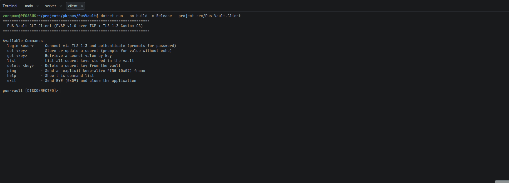
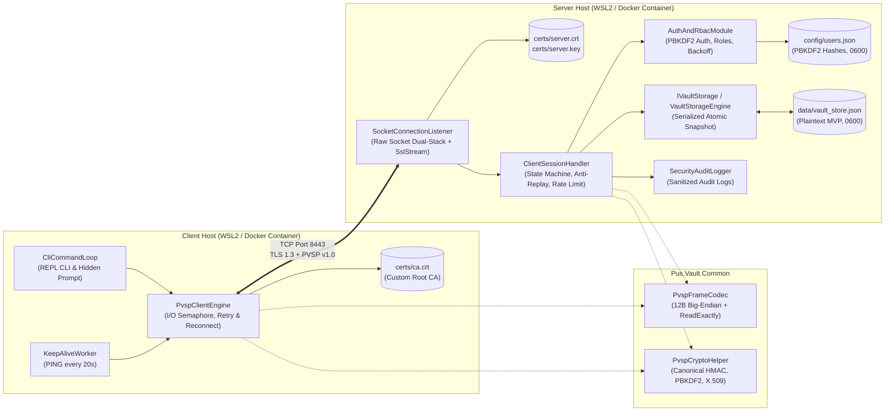
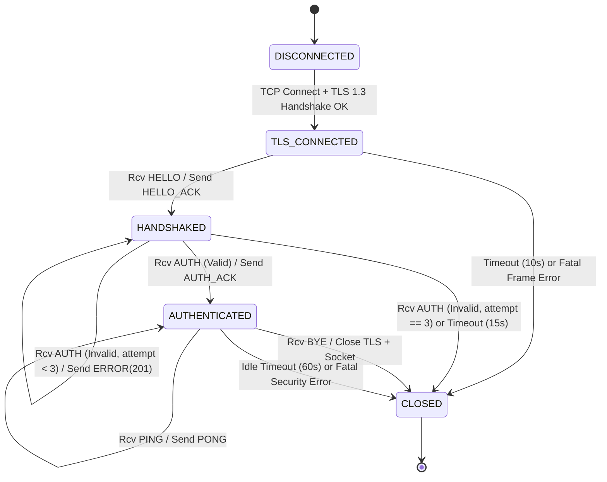
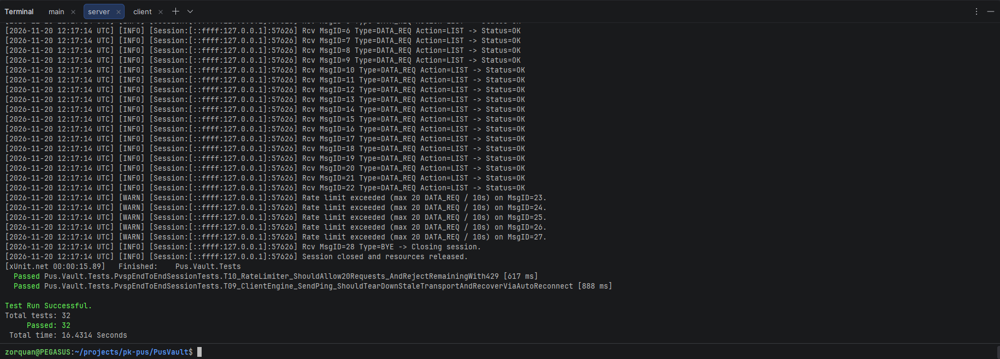
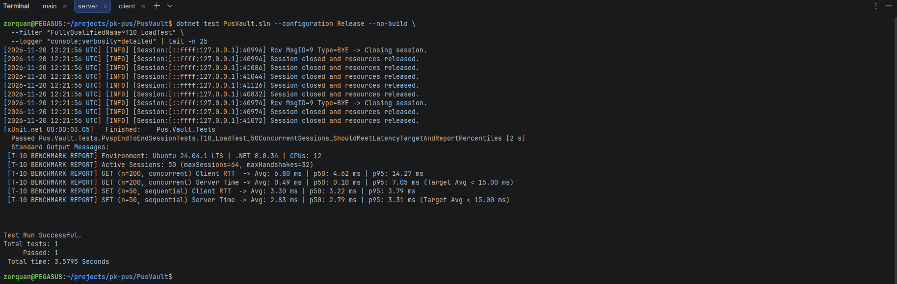
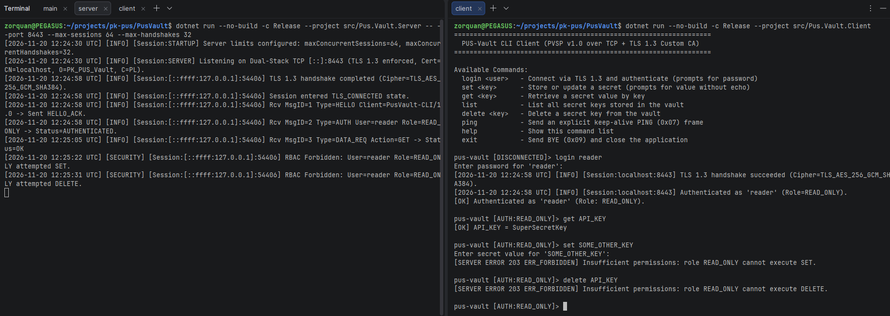
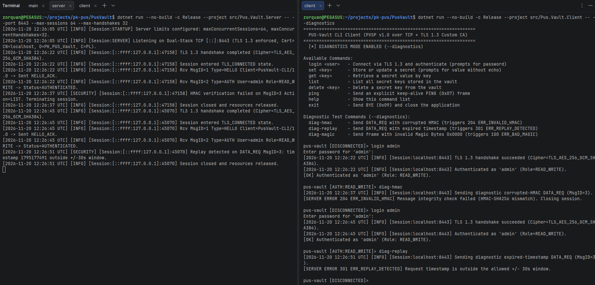
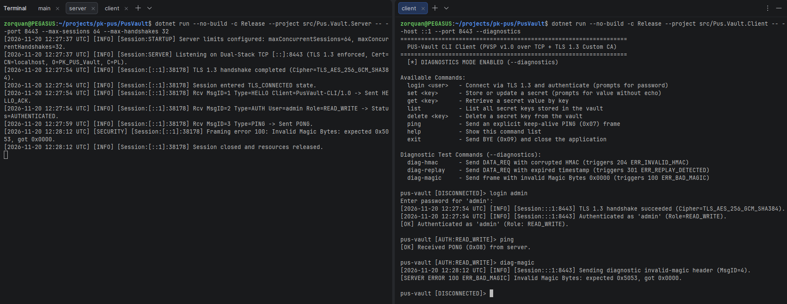

> 🌐 **Documentation in two languages / Dokumentacja w dwóch językach:**  
> 🇬🇧 **English (Current)** | 🇵🇱 **[Polski (README-pl.md)](./README-pl.md)**

# PUS-Vault - Secure Secrets & Configuration Manager (PVSP v1.0)

[](https://dotnet.microsoft.com/)
[](https://learn.microsoft.com/en-us/dotnet/csharp/)
[](../Assets/projekt-protoko%C5%82u.pdf)
[](./src/Pus.Vault.Common/PvspCryptoHelper.cs)
[](./tests/Pus.Vault.Tests/)
[](https://github.com/zephir-x/pk-pus/actions/workflows/pus-vault-ci.yml)
[](./Dockerfile)
[](https://ubuntu.com/)

A stateful, multi-threaded Client-Server secrets and configuration manager built in **.NET 8 (C#)** for the **Network Services Programming (PUS)** course. Communication runs exclusively over the proprietary **PVSP v1.0 (PUS-Vault Secret Protocol)** on top of raw `System.Net.Sockets.Socket` Dual-Stack TCP sockets (IPv6 + IPv4-mapped), mandatory **TLS 1.3** with a Custom Root CA, and canonical **HMAC-SHA256** message authentication.

---

## Table of Contents

1. [Project Overview](#1-project-overview)
2. [Architecture and Repository Structure](#2-architecture-and-repository-structure)
3. [PVSP v1.0 Protocol Summary](#3-pvsp-v10-protocol-summary)
4. [Prerequisites and Environment](#4-prerequisites-and-environment)
5. [Quick Start and Execution Guide](#5-quick-start-and-execution-guide)
6. [CLI Commands and Configuration](#6-cli-commands-and-configuration)
7. [Verification, Tests, and Performance Report](#7-verification-tests-and-performance-report)
8. [Live Demo Walkthrough](#8-live-demo-walkthrough)
9. [Known Limitations](#9-known-limitations)
10. [Authors and Related Documentation](#10-authors-and-related-documentation)

---

## 1. Project Overview

**PUS-Vault** centralizes sensitive configuration data (API keys, database passwords, tokens) in a single server-side key-value vault accessible through an interactive CLI client. Instead of relying on high-level transport wrappers (`TcpClient`, `TcpListener`, `HttpClient`), the entire transport and framing stack is implemented directly on `System.Net.Sockets.Socket` wrapped in `SslStream`.

### Key Capabilities
- **Low-Level Dual-Stack Networking:** Single IPv6 TCP listening socket (`DualMode = true`) on port `8443` accepting both native IPv6 (`::1`) and IPv4-mapped (`127.0.0.1` -> `::ffff:127.0.0.1`) clients concurrently, with configurable session/handshake limits (`--max-sessions` / `--max-handshakes`), bounded TLS handshake queue timeout (`10s`), and graceful `SIGINT`/`SIGTERM` shutdown.
- **Hybrid Binary + JSON Framing:** Fixed **12-byte Big-Endian binary header** (`Magic=0x5053`, `Version=0x01`, `Type`, `MessageId`, `PayloadLength`) paired with strict UTF-8 JSON payloads and an explicit `ReadExactly` loop eliminating TCP partial-read issues.
- **Defense-in-Depth Security:**
    - Mandatory **TLS 1.3** with **Custom Root CA** (`X509ChainTrustMode.CustomRootTrust`), strict hostname/SAN validation, and `serverAuth` EKU verification.
    - Application-layer **PBKDF2-HMAC-SHA256** password hashing (16-byte random salt, 600,000 iterations, startup Base64/length validation on `users.json`), strict exact constant-time `serverNonceEcho` challenge (`<= 32 B`), 256-bit CSPRNG `sessionToken`, and TTL-pruned, memory-bounded (`4096` entries) per-account/IP brute-force backoff.
    - Per-session **canonical HMAC-SHA256** signatures (length-prefixed binary input, constant-time `FixedTimeEquals`), strictly monotonic `Message ID`, isolated `DATA_REQ` duplicate caching (with freshness and rate-limit enforcement), overflow-safe $\pm 30\text{s}$ anti-replay timestamp validation, control-char/ANSI-escaped audit logging (`\u001b`), and sanitized/bounded `ERROR` responses (`<= 512 B` UTF-8 without reflecting untrusted field/action names).
    - Absolute phase deadlines (`10s` HELLO, `15s` AUTH, valid-frame-only `60s` idle reset), bounded `5s` server write timeout, server-enforced **RBAC** (`READ_WRITE` vs `READ_ONLY`), and **sliding-window rate limiting** (`20 DATA_REQ / 10s`).
- **Resilience and Persistence:** `IVaultStorage`-backed serialized atomic snapshot writes (`vault_store.json.tmp` -> `Flush(true)` -> `File.Move` with `0600` permissions and startup null/corruption validation), background `PING`/`PONG` keep-alive every 20s with broken-transport teardown and recovery, dedicated 10s client TLS handshake timeout, pre-send 64 KiB client payload check, strict `AUTH_ACK`/`DATA_RESP` response validation, structured UTC client logs, and reactive Auto-Reconnect (`1s`, `2s`, `4s`) safely retrying only `GET`, `LIST`, and `PING` (never silently retrying `SET`/`DELETE` once write begins).

> 📸 **Interactive CLI Session Preview**  
> 

---

## 2. Architecture and Repository Structure

### Component and Deployment Diagram



### Repository Layout & Source Links

```text
PusVault/
├── PusVault.sln                             # .NET 8 solution containing all 4 projects
├── Dockerfile                               # Multi-stage build (sdk:8.0 -> server & client runtime:8.0)
├── docker-compose.yml                       # Isolated bridge network, named volumes, :ro cert mounts
├── .dockerignore                            # Prevents certs, secrets, and local data from entering images
├── .env.example                             # Initial provisioning password template for Docker
├── README.md / README-pl.md                 # Bilingual documentation (EN / PL)
├── scripts/
│   └── generate_certs.sh                    # OpenSSL Custom Root CA & Server cert (SAN + serverAuth EKU)
├── src/
│   ├── Pus.Vault.Common/                    # Shared PVSP v1.0 protocol & cryptography library
│   │   ├── ErrorCodes.cs                    # Protocol constants, message types, states, error codes (100-500)
│   │   ├── PvspModels.cs                    # JSON DTOs & strict UTF-8 / duplicate-key validator (no field reflection)
│   │   ├── PvspFrameCodec.cs                # 12B Big-Endian framing & ReadExactlyLoopAsync
│   │   └── PvspCryptoHelper.cs              # Canonical HMAC-SHA256, PBKDF2, 256-bit CSPRNG, CustomRootTrust
│   ├── Pus.Vault.Server/                    # Multi-threaded TLS 1.3 Vault Server
│   │   ├── Program.cs                       # CLI/env flags (--port, --max-sessions, --max-handshakes), SIGINT/SIGTERM
│   │   ├── SocketConnectionListener.cs      # Raw Dual-Stack TCP Socket + TLS 1.3 SslStream + bounded handshake timeout
│   │   ├── ClientSessionHandler.cs          # State machine, absolute deadlines, anti-replay, isolated dup cache
│   │   ├── AuthAndRbacModule.cs             # PBKDF2, timing mitigation, strict nonce, TTL/4096-capped backoff, RBAC
│   │   ├── VaultStorageEngine.cs            # IVaultStorage + single-lock atomic snapshot & null/corruption checks
│   │   └── SecurityAuditLogger.cs           # Control-char/ANSI sanitized console & rotating file logger
│   └── Pus.Vault.Client/                    # Interactive CLI Client
│       ├── Program.cs                       # CLI argument parser (--host, --port, --ca, --diagnostics)
│       ├── CliCommandLoop.cs                # Interactive REPL & non-echoing hidden prompts
│       ├── PvspClientEngine.cs              # Serialized I/O, 10s TLS timeout, safe JSON parse, structured UTC logs, reconnect
│       └── KeepAliveWorker.cs               # Background PING timer (20s idle interval)
└── tests/
    └── Pus.Vault.Tests/                     # Automated xUnit test suite (32 tests: T-01..T-12 & protocol edge cases)
        ├── ProtocolAndCryptoUnitTests.cs    # HMAC vectors, CSPRNG, partial reads, framing, JSON, X.509 (6 tests)
        ├── ServerStorageAndAuthTests.cs     # IVaultStorage, concurrency, disk fail, RBAC, audit, session rules (12 tests)
        └── PvspEndToEndSessionTests.cs      # Live TLS CRUD, T-03/T-05/T-06/T-08, IPv6/KeepAlive, 50-client GET+SET load (14 tests)
```

| Module | Source Directory | Key Responsibilities |
| :--- | :--- | :--- |
| **`Pus.Vault.Common`** | [`src/Pus.Vault.Common/`](./src/Pus.Vault.Common/) | [`ErrorCodes.cs`](./src/Pus.Vault.Common/ErrorCodes.cs), [`PvspModels.cs`](./src/Pus.Vault.Common/PvspModels.cs), [`PvspFrameCodec.cs`](./src/Pus.Vault.Common/PvspFrameCodec.cs), [`PvspCryptoHelper.cs`](./src/Pus.Vault.Common/PvspCryptoHelper.cs) |
| **`Pus.Vault.Server`** | [`src/Pus.Vault.Server/`](./src/Pus.Vault.Server/) | [`Program.cs`](./src/Pus.Vault.Server/Program.cs), [`SocketConnectionListener.cs`](./src/Pus.Vault.Server/SocketConnectionListener.cs), [`ClientSessionHandler.cs`](./src/Pus.Vault.Server/ClientSessionHandler.cs), [`AuthAndRbacModule.cs`](./src/Pus.Vault.Server/AuthAndRbacModule.cs), [`VaultStorageEngine.cs`](./src/Pus.Vault.Server/VaultStorageEngine.cs), [`SecurityAuditLogger.cs`](./src/Pus.Vault.Server/SecurityAuditLogger.cs) |
| **`Pus.Vault.Client`** | [`src/Pus.Vault.Client/`](./src/Pus.Vault.Client/) | [`PvspClientEngine.cs`](./src/Pus.Vault.Client/PvspClientEngine.cs), [`KeepAliveWorker.cs`](./src/Pus.Vault.Client/KeepAliveWorker.cs), [`CliCommandLoop.cs`](./src/Pus.Vault.Client/CliCommandLoop.cs), [`Program.cs`](./src/Pus.Vault.Client/Program.cs) |
| **`Pus.Vault.Tests`** | [`tests/Pus.Vault.Tests/`](./tests/Pus.Vault.Tests/) | [`ProtocolAndCryptoUnitTests.cs`](./tests/Pus.Vault.Tests/ProtocolAndCryptoUnitTests.cs), [`ServerStorageAndAuthTests.cs`](./tests/Pus.Vault.Tests/ServerStorageAndAuthTests.cs), [`PvspEndToEndSessionTests.cs`](./tests/Pus.Vault.Tests/PvspEndToEndSessionTests.cs) |

*(Runtime directories `certs/`, `config/`, `data/`, `logs/`, and `.env` are excluded from version control via `.gitignore` and generated locally.)*

---

## 3. PVSP v1.0 Protocol Summary

Full formal specification is available in [`Assets/projekt-protokołu.pdf`](../Assets/projekt-protoko%C5%82u.pdf).

### Binary Frame Format (12-Byte Big-Endian Header + UTF-8 JSON Payload)

```text
 0                   1                   2                   3
 0 1 2 3 4 5 6 7 8 9 0 1 2 3 4 5 6 7 8 9 0 1 2 3 4 5 6 7 8 9 0 1
+-+-+-+-+-+-+-+-+-+-+-+-+-+-+-+-+-+-+-+-+-+-+-+-+-+-+-+-+-+-+-+-+
|      Magic Bytes (0x5053)     | Version (0x01)|  Message Type |  [Bytes 0..3]
+-+-+-+-+-+-+-+-+-+-+-+-+-+-+-+-+-+-+-+-+-+-+-+-+-+-+-+-+-+-+-+-+
|                   Message ID (uint32, Big-Endian)             |  [Bytes 4..7]
+-+-+-+-+-+-+-+-+-+-+-+-+-+-+-+-+-+-+-+-+-+-+-+-+-+-+-+-+-+-+-+-+
|                 Payload Length (uint32, Big-Endian)           |  [Bytes 8..11]
+-+-+-+-+-+-+-+-+-+-+-+-+-+-+-+-+-+-+-+-+-+-+-+-+-+-+-+-+-+-+-+-+
|                  JSON Payload (UTF-8, 0..65536 B)             |  [Bytes 12..N]
+-+-+-+-+-+-+-+-+-+-+-+-+-+-+-+-+-+-+-+-+-+-+-+-+-+-+-+-+-+-+-+-+
```

### Session State Machine



### Message Types & Key Timeouts

| Code | Type | Direction | Payload | Deadline / Policy |
| :---: | :--- | :---: | :--- | :--- |
| `0x01` / `0x02` | `HELLO` / `HELLO_ACK` | C -> S / S -> C | JSON (`clientName`, `serverNonce`) | TLS Handshake: `10s` (server queue + client), HELLO absolute deadline: `10s` |
| `0x03` / `0x04` | `AUTH` / `AUTH_ACK` | C -> S / S -> C | JSON (`username`, `password`, `serverNonceEcho` -> 256-bit `sessionToken`, `hmacSecret`, `role`) | AUTH absolute deadline: `15s` (max 3 attempts / conn) |
| `0x05` / `0x06` | `DATA_REQ` / `DATA_RESP` | C -> S / S -> C | JSON (`SET`, `GET`, `LIST`, `DELETE` + canonical `hmac`) | Client request timeout: `5s`, Rate limit: `20 / 10s` |
| `0x07` / `0x08` | `PING` / `PONG` | C -> S / S -> C | Empty (`0` bytes) | Client idle `PING`: `20s`, Server Idle Timeout: `60s` (reset on valid frames only) |
| `0x09` | `BYE` | C -> S | Empty (`0` bytes) | Graceful TLS + TCP close (no `BYE_ACK`) |
| `0xFF` | `ERROR` | S -> C | JSON (`errorCode`, `errorName <= 64 B`, `message <= 512 B`, `timestamp`) | Fatal codes (`100-103`, `105`, `204`, `301`) close session |

---

## 4. Prerequisites and Environment

Verified reference environment used during development and testing:

| Component | Verified Version | Purpose |
| :--- | :--- | :--- |
| **Operating System** | `Ubuntu 24.04.1 LTS` (WSL2 on Windows 11, 12 CPUs) | Native Linux sockets, POSIX `0600`/`0700` file modes |
| **.NET SDK** | `8.0.134` (Runtime `8.0.34`) | Building, running, and testing all C# projects |
| **OpenSSL** | `OpenSSL 3.0.13 (30 Jan 2024)` | Generating Custom Root CA and X.509 v3 SAN/EKU server certs |
| **Docker Engine** *(optional)* | `28.0.1` | Containerized execution |
| **Docker Compose** *(optional)* | `v2.33.1-desktop.1` | Orchestrating isolated server/client network and volumes |

---

## 5. Quick Start and Execution Guide

### Step 1: Generate Custom PKI Certificates (Required for Both Modes)

Run [`scripts/generate_certs.sh`](./scripts/generate_certs.sh) once from `PusVault/` to create `certs/ca.crt`, `certs/server.crt`, and `certs/server.key` (with `SAN: localhost, pus-vault-server, 127.0.0.1, ::1`, `EKU: serverAuth`, and `chmod 600` on private keys):

```bash
cd PusVault
chmod +x scripts/generate_certs.sh
./scripts/generate_certs.sh
```

---

### Option A: Native Execution (.NET 8 SDK on Linux / WSL2)

1. **Build the solution:**
   ```bash
   dotnet build PusVault.sln --configuration Release
   ```

2. **Start the Server (Terminal 1):**
   On first launch, if `config/users.json` does not exist yet, the server provisions `admin` (`READ_WRITE`) and `reader` (`READ_ONLY`) using PBKDF2-HMAC-SHA256 (600,000 iterations). You can either pass initial passwords via environment variables or let the server prompt for them securely without echo:
   ```bash
   # Option 1: Interactive hidden prompt on first start
   dotnet run --project src/Pus.Vault.Server

   # Option 2: Non-interactive provisioning with explicit limits
   PUS_ADMIN_PASS="AdminPass123!" PUS_READER_PASS="ReaderPass123!" \
     dotnet run --project src/Pus.Vault.Server -- --port 8443 --max-sessions 64 --max-handshakes 32
   ```

3. **Start the Interactive CLI Client (Terminal 2):**
   ```bash
   # Standard IPv4/localhost connection
   dotnet run --project src/Pus.Vault.Client

   # Native IPv6 Dual-Stack connection with diagnostics enabled
   dotnet run --project src/Pus.Vault.Client -- --host ::1 --port 8443 --diagnostics
   ```

---

### Option B: Containerized Execution (Docker Compose)

Docker Compose builds minimal `.NET 8 Runtime` containers from [`Dockerfile`](./Dockerfile) and connects them inside the dedicated bridge network `pus-vault-net`. The server mounts only `server.crt`/`server.key` (`:ro`), while the client mounts strictly `ca.crt` (`:ro`).

1. **Create your local `.env` file from the template:**
   ```bash
   cp .env.example .env
   # Edit .env if you want custom initial admin/reader passwords
   ```

2. **Build images and start the Server in detached mode:**
   ```bash
   docker compose up -d --build
   docker compose logs -f pus-vault-server
   ```

3. **Run the Interactive CLI Client inside `pus-vault-net`:**
   ```bash
   # Standard client session
   docker compose run --rm pus-vault-client

   # Client with diagnostic fault-injection commands enabled
   docker compose run --rm pus-vault-client --diagnostics
   ```

4. **Stop containers:**
   ```bash
   # Gracefully stop (SIGTERM) while preserving vault data and user accounts in named volumes
   docker compose down

   # Stop containers and wipe all persistent volumes (full reset)
   docker compose down -v
   ```

---

## 6. CLI Commands and Configuration

### Server & Client Startup Flags

| Application | Flag / Env Variable | Default | Description |
| :--- | :--- | :--- | :--- |
| **Server** | `--port <int>` | `8443` | Dual-Stack TCP listening port (`[::]:port`, valid range `0..65535`). |
| **Server** | `--max-sessions <int>` / `PUS_MAX_SESSIONS` | `64` | Maximum concurrent active client sessions (`>= 1`). |
| **Server** | `--max-handshakes <int>` / `PUS_MAX_HANDSHAKES` | `32` | Maximum concurrent in-progress TLS handshakes (`>= 1`). |
| **Client** | `--host <addr>` | `localhost` | Target server hostname or IP (`localhost`, `127.0.0.1`, `::1`, `pus-vault-server`). |
| **Client** | `--port <int>` | `8443` | Target server TCP port. |
| **Client** | `--ca <path>` | `certs/ca.crt` | Path to trusted Custom Root CA certificate (PEM). |
| **Client** | `--diagnostics` | *off* | Unlocks security/framing test commands (`diag-hmac`, `diag-replay`, `diag-magic`). |

### Interactive Client REPL Commands

| Command | Required Role | Protocol Frame | Behavior |
| :--- | :---: | :---: | :--- |
| `login <user>` | *None* | `HELLO` -> `AUTH` | Prompts for password without terminal echo; starts TLS 1.3 session. |
| `set <key>` | `READ_WRITE` | `DATA_REQ (SET)` | Prompts for secret value without echo; persists atomically to disk. |
| `get <key>` | Any | `DATA_REQ (GET)` | Retrieves secret value; auto-retried on transient network drop. |
| `list` | Any | `DATA_REQ (LIST)` | Lists all stored key names (max 1,000 / 64 KiB); auto-retried on drop. |
| `delete <key>` | `READ_WRITE` | `DATA_REQ (DELETE)` | Permanently deletes a key from RAM and `vault_store.json`. |
| `ping` | Any | `PING` -> `PONG` | Sends an explicit keep-alive probe (`PayloadLength = 0`); tears down & reconnects on drop/timeout. |
| `help` | Any | *Local* | Displays available CLI commands. |
| `exit` / `quit` | Any | `BYE` | Gracefully closes TLS/TCP session and clears in-memory credentials. |
| `diag-hmac` | `--diagnostics` | `DATA_REQ` (bad HMAC) | Sends forged HMAC -> triggers `204 ERR_INVALID_HMAC` + disconnect. |
| `diag-replay` | `--diagnostics` | `DATA_REQ` (-120s) | Sends expired timestamp -> triggers `301 ERR_REPLAY_DETECTED` + disconnect. |
| `diag-magic` | `--diagnostics` | Header `0x0000` | Sends bad Magic Bytes (with Big-Endian `MsgID`) -> triggers `100 ERR_BAD_MAGIC` + disconnect. |

---

## 7. Verification, Tests, and Performance Report

The automated xUnit suite in [`tests/Pus.Vault.Tests/`](./tests/Pus.Vault.Tests/) contains **32 tests** across 3 test classes (`6` + `12` + `14`), providing 100% coverage of the `T-01`..`T-12` test matrix defined in Stage 2 plus extended protocol, security, and resilience edge-case tests.

### Running the Full Test Suite

```bash
cd PusVault
dotnet test PusVault.sln --configuration Release --logger "console;verbosity=detailed"
```

### Test Matrix Coverage (`T-01`..`T-12` & Extended Protocol Checks)

| Test ID | Category | Verified Behavior | Automated Test Method(s) | Status |
| :---: | :--- | :--- | :--- | :---: |
| **T-01** | Functional | Full CRUD lifecycle (`HELLO` -> `AUTH` -> `SET` -> `GET` -> `LIST` -> `PING` -> `DELETE` -> `BYE`) + disk verification | `PvspEndToEndSessionTests.T01_T04_ClientEngine_ShouldExecuteFullCrudLifecycle_Ping_AndEnforceRbac` | PASS |
| **T-02** | Functional | Persistence across server restarts (`SET` -> restart -> `GET`) + null-value/corrupted JSON startup rejection | `ServerStorageAndAuthTests.T02_T12_VaultStorage_ShouldPersistAcrossRestarts_AndRejectCorruptedOrNullValueJson`, `PvspEndToEndSessionTests.T09_T02_...` | PASS |
| **T-03** | Security | Positive Custom CA accept + live TLS 1.3 & unit rejection of untrusted CA, wrong SAN, and missing `serverAuth` EKU (`AuthenticationException`) | `ProtocolAndCryptoUnitTests.T03_CustomCaValidator_...`, `PvspEndToEndSessionTests.T03_TlsHandshake_ShouldThrowAuthenticationException_OnUntrustedCa_WrongSan_AndMissingServerAuthEku` | PASS |
| **T-04** | Security | RBAC (`READ_ONLY` allows `GET`, blocks `SET`/`DELETE` with `203`), strict nonce case, brute-force lockout, and 3-attempt auth disconnect | `ServerStorageAndAuthTests.T04_AuthAndRbac_...`, `T04_SessionHandler_ShouldRejectWrongNonce_AndCloseConnectionAfter3FailedAuthAttempts`, `PvspEndToEndSessionTests.T01_T04_...` | PASS |
| **T-05** | Security | Live 1-byte HMAC tampering & forged diagnostic HMAC -> `204 ERR_INVALID_HMAC`, `[SECURITY]` log, immediate socket EOF | `PvspEndToEndSessionTests.T05_LiveServer_1ByteHmacMutation_ShouldReturn204_LogSecurity_AndCloseSocket`, `T05_T06_T08_Diagnostics_...` | PASS |
| **T-06** | Security | Replay defense: expired/extreme timestamps (`long.MinValue`/`MaxValue`), `MsgID=0`, old ID, sequence gap, and modified duplicate -> `301 ERR_REPLAY_DETECTED` + socket EOF | `ServerStorageAndAuthTests.T06_SessionHandler_ShouldRejectExtremeTimestamps_WithoutOverflow`, `PvspEndToEndSessionTests.T05_T06_T08_Diagnostics_...`, `T06_Server_ShouldRejectMsgIdZero_OldMessageId_Gap_AndModifiedDuplicate_With301AndClose` | PASS |
| **T-07** | Resilience | Fragmented TCP stream (`56 B` HELLO sent in 3-byte chunks every `50 ms`) reassembled by `ReadExactly` | `ProtocolAndCryptoUnitTests.T07_FrameCodec_...`, `PvspEndToEndSessionTests.T07_LiveServer_ShouldReassembleFragmentedHello_3BytesEvery50ms` | PASS |
| **T-08** | Resilience | Live TLS & unit framing rejection: Magic (`100` + `MsgID` echo), version (`101`), unknown type (`102`), payload > 64 KiB (`103` before payload) + EOF | `ProtocolAndCryptoUnitTests.T08_FrameCodec_...`, `PvspEndToEndSessionTests.T08_LiveServer_ShouldRejectAllFramingErrors_100_101_102_103_AndCloseConnection` | PASS |
| **T-09** | Resilience | Auto-Reconnect retries `GET` after restart, tears down stale transport & recovers on `PING`; dropped `SET` after send reports `IsUnknownMutationOutcome` (no silent retry) | `PvspEndToEndSessionTests.T09_T02_...`, `T09_ClientEngine_ShouldNotRetrySetMutation_WhenConnectionDropsAfterSend`, `T09_ClientEngine_SendPing_ShouldTearDownStaleTransportAndRecoverViaAutoReconnect` | PASS |
| **T-10** | Load & Limits | Rate limiter (20 OK, 5 rejected with `429`) + **50 active TLS 1.3 sessions** benchmark (200 concurrent `GET` + 50 sequential `SET`, limits `64`/`32`) | `PvspEndToEndSessionTests.T10_RateLimiter_...`, `T10_LoadTest_50ConcurrentSessions_ShouldMeetLatencyTargetAndReportPercentiles` | PASS |
| **T-11** | Validation | Invalid UTF-8/JSON (`104`), non-object root, wrong field types, unknown/duplicate/null fields, key/value > 32 KiB & non-empty `PING`/`BYE` (`106`), bad action (`107`), `LIST` > 1,000 keys or > 64 KiB (`108`), unsolicited `PONG` (`202`) | `ProtocolAndCryptoUnitTests.T11_StrictJsonValidator_...`, `ServerStorageAndAuthTests.T11_SessionHandler_...`, `PvspEndToEndSessionTests.T11_LiveServer_...` | PASS |
| **T-12** | Persistence & Logs | Concurrent `SET`/`DELETE`, disk failure RAM rollback, corrupted/null JSON halt, control-char/ANSI (`\u001b`) log sanitization & zero secret leaks | `ServerStorageAndAuthTests.T12_VaultStorage_...` (3 tests), `T12_AuditLogger_...`, `ServerListenerAndSession_...` | PASS |
| **Ext** | Session & E2E | 256-bit CSPRNG tokens/nonces/secrets, absolute `HELLO`/`AUTH` deadlines & `AUTHENTICATED` idle timeout (`105`), monotonic `MsgID` + isolated dup cache + bounded `ERROR` (`<= 512 B`), live TLS handshake timeout + IPv6 `::1` + `KeepAliveWorker` + structured UTC client logs | `ProtocolAndCryptoUnitTests.CryptoHelper_...`, `ServerStorageAndAuthTests.SessionHandler_ShouldEnforceAbsoluteHelloAndAuthDeadlines_...`, `SessionHandler_ShouldAdvanceSequenceIdOnNonClosingErrors_AndIsolateDuplicateCache`, `SessionHandler_ShouldEnforceAuthenticatedIdleTimeout_...`, `PvspEndToEndSessionTests.LiveServer_ShouldEnforceTlsHandshakeTimeout_KeepAliveWorker_Ipv6Loopback_AndStructuredClientLogs` | PASS |

### Measured Benchmark Report (`T-10` - 50 Concurrent Sessions)

- **Verified Full Suite (WSL2 `Ubuntu 24.04.1 LTS`, `.NET 8.0.34`, `12 CPUs`, Release):** `Total tests: 32 | Passed: 32 | Failed: 0 | Total time: 17.92 s` (`0 Warning(s), 0 Error(s)`).
- **Methodology:** 50 parallel clients connect and authenticate simultaneously against the live server running with **production concurrency limits (`maxSessions=64, maxHandshakes=32`)** over loopback (`TLS_AES_256_GCM_SHA384`). After a 1-request warm-up pass, while all 50 sessions stay active, the suite executes **200 concurrent `GET` (`50 × 4`)** operations followed by **50 sequential persisted `SET` (`50 × 1`)** operations across the active sessions. Both **Server-Side Processing Time** (asserted `< 15.00 ms` per Stage 2 spec) and **Client Full Round-Trip Time (RTT)** (HMAC, framing, TLS encrypt/decrypt, server execution, response parsing) are recorded.

| Operation & Scope | Samples | `Avg` | `p50` (Median) | `p95` | Target Requirement |
| :--- | :---: | :---: | :---: | :---: | :---: |
| **`GET` — Server Processing Time** *(concurrent)* | `200` (`50 × 4`) | **`0.13 ms`** | **`0.09 ms`** | **`0.12 ms`** | `< 15.00 ms` |
| **`GET` — Client Full RTT** *(concurrent)* | `200` (`50 × 4`) | **`7.30 ms`** | **`5.26 ms`** | **`11.76 ms`** | *Informational* |
| **`SET` — Server Processing Time** *(sequential, atomic disk flush)* | `50` (`50 × 1`) | **`3.61 ms`** | **`3.51 ms`** | **`3.98 ms`** | `< 15.00 ms` |
| **`SET` — Client Full RTT** *(sequential, atomic disk flush)* | `50` (`50 × 1`) | **`4.16 ms`** | **`4.07 ms`** | **`4.57 ms`** | *Informational* |

> 📸 **Automated xUnit Test Suite & T-10 Benchmark Output**  
> 
> 

---

## 8. Live Demo Walkthrough

The following 4 scenarios satisfy and exceed the Stage 3 live demonstration requirements (valid workflow, network/error recovery, security rejection, plus IPv6 Dual-Stack verification).

### Scenario 1: Valid CRUD Session & Restart Persistence
1. **Terminal 1 (Server):** `PUS_ADMIN_PASS="Admin123!" PUS_READER_PASS="Reader123!" dotnet run --project src/Pus.Vault.Server`
2. **Terminal 2 (Client):** `dotnet run --project src/Pus.Vault.Client`
3. Run: `login admin` *(enter `Admin123!` in hidden prompt)* -> `set STRIPE_API_KEY` *(enter value in hidden prompt)* -> `get STRIPE_API_KEY` -> `list` -> `ping` -> `exit`.
4. **Verify persistence:** Restart the server (`Ctrl+C` and run again), reconnect as `admin`, and execute `get STRIPE_API_KEY` - the secret is restored from `data/vault_store.json`.

### Scenario 2: Network Failure & Auto-Reconnect Recovery
1. Keep the client authenticated as `admin` (`pus-vault [AUTH:READ_WRITE]>`) with key `STRIPE_API_KEY` stored.
2. In **Terminal 1**, stop the server (`Ctrl+C`), wait 1 second, and immediately start it again.
3. In **Terminal 2**, issue `get STRIPE_API_KEY`.
4. **Observed result:** Client emits structured UTC log `[YYYY-MM-DD HH:mm:ss UTC] [WARN] [Session:localhost:8443] Connection lost during GET (...). Starting Auto-Reconnect...`, retries with exponential backoff (`1s`, `2s`, `4s`), establishes a fresh TLS 1.3 + `HELLO`/`AUTH` session, and seamlessly returns the secret value.

### Scenario 3: Security Rejection (RBAC, Forged HMAC, Replay, Bad Magic)
1. **RBAC (`203 ERR_FORBIDDEN`):** Log in as `reader` (`Reader123!`). Run `get STRIPE_API_KEY` (succeeds), then run `delete STRIPE_API_KEY` -> Server rejects with `[SERVER ERROR 203 ERR_FORBIDDEN]` and logs `[SECURITY] RBAC Forbidden`.
2. **Diagnostics Harness:** Start client with `dotnet run --project src/Pus.Vault.Client -- --diagnostics` and log in as `admin`:
    - Type `diag-hmac` -> Server returns `204 ERR_INVALID_HMAC`, logs `[SECURITY] HMAC verification failed`, and closes the socket.
    - Re-login and type `diag-replay` -> Server returns `301 ERR_REPLAY_DETECTED` and closes the socket.
    - Re-login and type `diag-magic` -> Server returns `100 ERR_BAD_MAGIC` and closes the socket.

> 📸 **Security Diagnostics & Server Audit Logs**  
> 
> 
> 

### Scenario 4: Native IPv6 Dual-Stack Verification
1. While the server listens on `[::]:8443` (`DualMode = true`), connect the client explicitly via IPv6 loopback:
   ```bash
   dotnet run --project src/Pus.Vault.Client -- --host ::1 --port 8443
   ```
2. Log in and verify in server logs that TLS 1.3 SAN validation accepts `IP:::1` alongside IPv4 clients (`[::ffff:127.0.0.1]`).

---

## 9. Known Limitations

In accordance with the MVP scope defined in Stage 1 and Stage 2, the current implementation has the following explicit limitations:

1. **Plaintext Storage at Rest (`data/vault_store.json`):** PVSP protects data in transit (TLS 1.3 + HMAC-SHA256) and enforces authentication/RBAC, but secret values stored in `data/vault_store.json` are written as plaintext JSON. Host/filesystem compromise is outside the MVP threat model. Minimal local mitigations are applied (`0700` on `data/`, `0600` on `vault_store.json`, excluded from Git and Docker images). Because storage is decoupled behind `IVaultStorage`, AEAD at-rest encryption (e.g., AES-GCM with an external master key) can be added as a post-MVP extension without altering the networking or protocol layers.
2. **No Pagination for `LIST`:** The `LIST` action returns all keys in a single frame capped at **1,000 keys** and **64 KiB** serialized UTF-8 payload (`108 ERR_RESPONSE_TOO_LARGE` above that threshold).
3. **Single In-Flight Request per Connection:** Each client connection allows at most one pending application request at a time; pipelining or out-of-order concurrent requests within a single TCP session are disallowed in MVP.
4. **No Silent Retry for Mutations (`SET`/`DELETE`):** The isolated in-session `DATA_REQ` deduplication cache replays the cached `DATA_RESP` (or business `ERROR`) for identical retries within a single live TCP session without re-executing the mutation. Once writing a `SET` or `DELETE` frame begins (`onWriteStarted`), if the connection drops, the client does not silently re-execute the mutation after reconnecting and instead reports an unknown outcome.
5. **In-Memory Credential Cache for Auto-Reconnect:** To support reactive Auto-Reconnect without re-prompting, the CLI client retains the logged-in username and password in process RAM until `exit` / disposal (never written to disk or logs).
6. **File-Based Account Store:** User accounts (`admin`, `reader`) are loaded at server startup from `config/users.json` (PBKDF2 hashes); runtime user management commands are outside MVP scope.

---

## 10. Authors and Related Documentation

### Project Team

| Author | GitHub Profile | Primary Contributions (per Stage 2 Plan) |
| :--- | :--- | :--- |
| **Kacper Gumulak** | [](https://github.com/zephir-x) | Server (`Pus.Vault.Server`), Binary Frame Codec (`Pus.Vault.Common`), OpenSSL PKI, Dockerization, Protocol Design |
| **Damian Judka** | [](https://github.com/geniuszmath75) | CLI Client (`Pus.Vault.Client`), Crypto Helper (`Pus.Vault.Common`), xUnit QA Suite (`T-01`..`T-12`), Application Design & Documentation |

### Related Course Documentation (`../Assets/`)
- 📄 **Stage 1 - PVSP v1.0 Protocol Specification:** [`projekt-protokołu.pdf`](../Assets/projekt-protoko%C5%82u.pdf) ([Markdown](../Assets/projekt-protoko%C5%82u.md))
- 📄 **Stage 2 - PUS-Vault Application Design:** [`projekt-aplikacji.pdf`](../Assets/projekt-aplikacji.pdf) ([Markdown](../Assets/projekt-aplikacji.md))
- 📄 **Course Grading Regulations:** [`zasady-zaliczenia.pdf`](../Assets/zasady-zaliczenia.pdf)